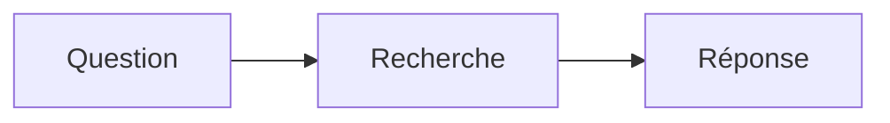
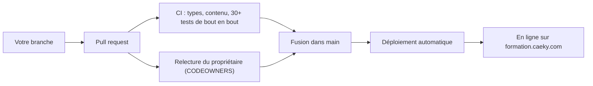

# Contribuer : proposer une formation

Tout le monde peut proposer une formation, un article, une vidéo, un lien ou une correction. Le principe : **une branche, un dossier Markdown, une pull request**. Rien d'autre à installer qu'un éditeur de texte (et Node.js si vous voulez prévisualiser).

`main` est protégée : on n'y écrit jamais directement. Chaque PR est relue par le propriétaire du dépôt et doit passer la CI (tests de bout en bout). Une fois fusionnée, elle est **en ligne sur formation.caeky.com en quelques minutes**, automatiquement.

---

## 1. En 5 étapes

```bash
# 1. Récupérer le dépôt (ou le « forker » sur GitHub si vous n'avez pas les droits d'écriture)
git clone git@github.com:YatchiYa/formation-plateform.git && cd formation-plateform
npm install                               # active aussi les garde-fous git

# 2. Créer une branche nommée d'après ce que vous ajoutez
git switch -c contenu/evaluer-un-assistant-rag

# 3. Écrire votre contenu dans content/ (voir §2), puis le prévisualiser
npm run dev                               # http://localhost:3000, la page se met à jour à chaque sauvegarde

# 4. Vérifier, puis valider
npm run typecheck && npm run e2e          # facultatif en local : la CI le fait de toute façon
git add content/ && git commit -m "Formation : évaluer un assistant RAG"

# 5. Pousser et ouvrir la pull request
git push -u origin contenu/evaluer-un-assistant-rag
```

Puis sur GitHub : **Compare & pull request**, remplissez la checklist du modèle, et c'est parti.

| Préfixe de branche | Pour |
|---|---|
| `contenu/…` | nouveau contenu |
| `correction/…` | coquille, lien cassé, mise à jour |
| `plateforme/…` | code du site |

---

## 2. Où et comment écrire

Le guide complet est dans [docs/02-ecrire-du-contenu.md](docs/02-ecrire-du-contenu.md). L'essentiel :

### Choisir l'emplacement
Rangez votre contenu dans la thématique qui convient (`content/01-ia-generative/`, `content/02-cloud/`, `content/04-agents-google-cloud/`…). Une nouvelle thématique, c'est un nouveau dossier avec un `index.md` qui contient `type: category`, `title`, `icon` et `description`.

### Une formation = un dossier

```text
content/01-ia-generative/10-evaluer-un-assistant-rag/
├── index.md                    ← présentation + métadonnées (obligatoire)
├── images/                     ← vos images (facultatif)
├── files/                      ← supports à télécharger : PDF, PPTX, notebooks… (facultatif)
├── 01-comprendre/
│   ├── index.md                ← title: "Comprendre" (titre du module)
│   ├── 01-pourquoi-evaluer.md  ← leçon
│   └── 02-jeu-de-donnees.md
└── 02-mettre-en-place/
    └── ...
```

Pas de modules ? Mettez directement `01-…md`, `02-…md` à côté de `index.md`.

### Le `index.md` d'une formation

```yaml
---
type: course
title: "Évaluer un assistant RAG"
description: "Une phrase concrète : ce que la personne saura faire à la fin."
level: intermediate          # beginner | intermediate | advanced
duration: "4h"
tags: [rag, evaluation, llm]
date: 2026-11-01
authors: [Votre Nom]
usecases: [recherche-documentaire]   # voir content/07-plateformes-et-cas-d-usage/01-cas-d-usage
platforms: [vertex-ai]               # voir content/07-plateformes-et-cas-d-usage/02-plateformes
references:
  - title: "RAGAS: Automated Evaluation of Retrieval Augmented Generation"
    url: https://arxiv.org/abs/2309.15217
---

Pour qui, objectifs, prérequis, programme…
```

### Les autres formats (un seul fichier suffit)

| Format | Frontmatter minimal |
|---|---|
| Article | `title`, `description` |
| Présentation | `type: slides` (une diapositive par bloc séparé par `---`) |
| Vidéo | `type: video`, `video: https://www.youtube.com/watch?v=…` |
| Lien / dépôt | `type: link`, `url: https://github.com/…` |
| Skill | un dossier avec `SKILL.md` (standard Agent Skills) |
| Cas d'usage / plateforme | `type: usecase` / `type: platform` (+ `url:`) |

---

## 3. Rendre une leçon interactive

Une bonne leçon se lit, mais surtout **se pratique**. Pour chaque leçon, visez :

**Un objectif clair en tête**
```markdown
> [!NOTE]
> Dans cette leçon, vous allez construire un jeu de 20 questions de référence.
```

**Au moins un schéma**
````markdown

````

**Des quiz** (correction immédiate, score enregistré dans le navigateur)
````markdown
```quiz
question: "Quelle métrique mesure si la réponse s'appuie sur les documents fournis ?"
options:
  - "La latence"
  - "La fidélité (faithfulness)"
  - "Le nombre de tokens"
answer: 1
explanation: "La fidélité vérifie que chaque affirmation est soutenue par le contexte récupéré."
```
````
`answer` commence à 0. Plusieurs bonnes réponses : `answer: [0, 2]`. Mettez les textes entre guillemets.

**Un exercice avec solution cachée** (gardez les lignes vides)
```markdown
<details>
<summary>Voir la solution</summary>

La solution, en Markdown : code, explications…

</details>
```

**Une checklist finale**, que le lecteur coche (c'est sauvegardé)
```markdown
- [ ] Je sais construire un jeu de données de référence
- [ ] Je sais écrire une grille pour un LLM-juge
```

Et aussi : blocs de code avec titre (```` ```python title="eval.py" ````), formules `$...$`, encadrés `> [!TIP]` / `> [!WARNING]`, vidéos ``, PDF et Word intégrés ``.

---

## 4. Les règles de qualité (vérifiées en relecture)

1. **Utile et exact** : chaque affirmation technique est juste et vérifiable ; pas de chiffres inventés présentés comme des faits.
2. **Références réelles** : chaque lien de `references` existe. Pas d'URL devinée.
3. **Aucune donnée sensible** : pas de secrets (clés, tokens, `.env`, `terraform.tfstate`), pas de noms de clients, d'e-mails ou d'identifiants de projets réels. La CI refuse les fuites évidentes, la relecture fait le reste.
4. **Pour quelqu'un qui débute** : chaque terme technique est expliqué la première fois, avec un exemple.
5. **Interactif** : au moins un schéma, deux quiz et un exercice par leçon d'une formation.
6. **Droits** : vous êtes l'auteur du contenu ou vous avez le droit de le publier ; les images reprises sont créditées.
7. **Langue** : le français est la langue par défaut. Une traduction = le même fichier avec `.en.md`, `.ar.md` ou `.es.md`.
8. **Une PR = un sujet** : une formation ou une correction par pull request, des commits lisibles.

Pas encore prêt ? Ajoutez `draft: true` : la page n'apparaît nulle part sur le site.

---

## 5. Ce qui se passe après votre PR



- La CI vérifie que **toutes** les pages s'affichent, que les diagrammes sont valides, qu'aucun lien n'est cassé et qu'aucun nom de client ou secret n'est présent.
- Les commentaires de relecture se règlent dans la même branche : poussez de nouveaux commits, la PR se met à jour.
- Après la fusion, le site est reconstruit et déployé automatiquement, avec retour automatique à la version précédente si le contrôle de santé échoue.

Merci pour votre contribution !
