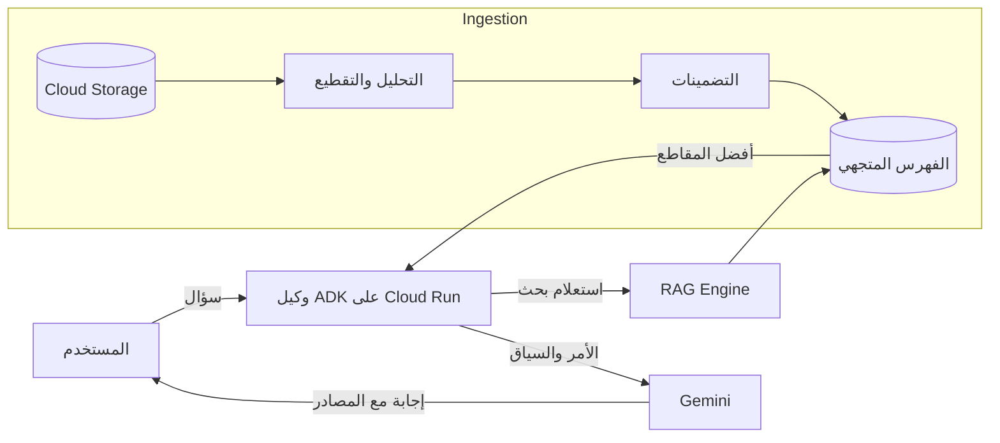
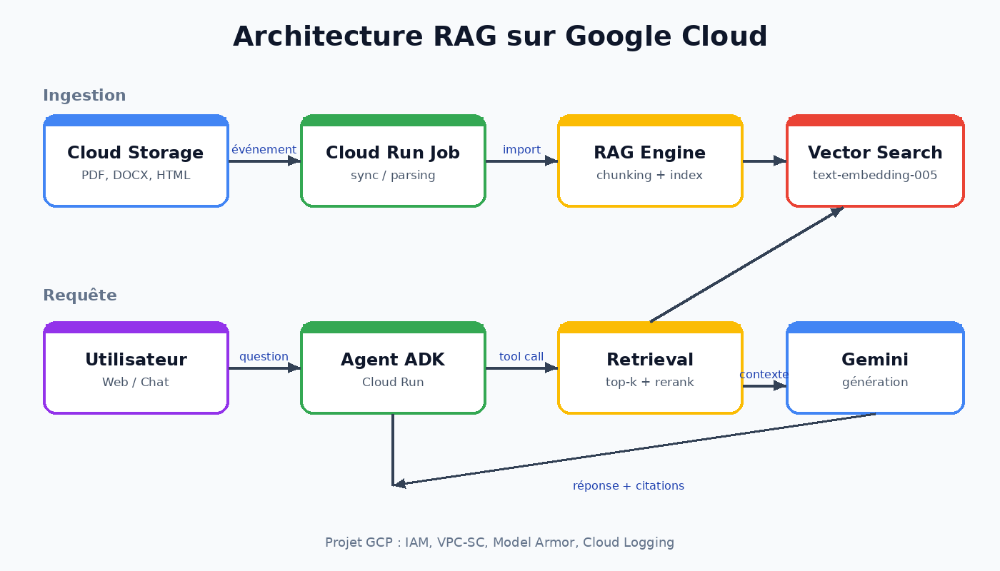

يعرف النموذج اللغوي الكبير مثل Gemini الكثير من الأشياء… لكنه لا يعرف شيئًا عن مستنداتك **الداخلية**. يحلّ *التوليد المعزّز بالاسترجاع* (RAG) هذه المشكلة عبر استرجاع المقاطع ذات الصلة من قاعدة المستندات لحظة طرح السؤال، ثم إدراجها في الأمر الموجّه إلى النموذج[^lewis].

## نظرة سريعة على البنية

المخطط نفسه في صورة توضيحية:

يتعايش مساران:

1. **الاستيعاب** (دون اتصال): تُقطَّع المستندات إلى أجزاء، ثم تُحوَّل إلى متجهات وتُفهرَس.
2. **الاستعلام** (مباشر): يُحوَّل السؤال إلى متجه، وتُسترجع الأجزاء الأقرب وتُقدَّم إلى النموذج.

> [!NOTE]
> يتولّى Vertex AI RAG Engine معظم عملية الاستيعاب: موصلات Cloud Storage وGoogle Drive، والتقطيع، والتضمينات، والتخزين المتجهي المُدار.

## RAG أم الضبط الدقيق أم السياق الطويل؟

| النهج | بيانات محدّثة | التكلفة | ذكر المصادر |
| --- | :---: | :---: | :---: |
| RAG | ✅ | متوسطة | ✅ |
| الضبط الدقيق | ❌ | مرتفعة | ❌ |
| السياق الطويل | ✅ | مرتفعة جدًا | ⚠️ |

> [!TIP]
> ابدأ دائمًا بنظام RAG بسيط بالإعدادات الافتراضية، ثم قِس النتائج، **وبعدها** حسّن حجم الأجزاء وإعادة الترتيب والمرشّحات.

## تقدّمك

- [x] فهم مبدأ RAG
- [x] التمييز بين مساري الاستيعاب والاستعلام
- [ ] حساب تشابه جيب التمام
- [ ] إنشاء أول مجموعة بيانات
- [ ] نشر الوكيل على Cloud Run

[^lewis]: Lewis وآخرون، *Retrieval-Augmented Generation for Knowledge-Intensive NLP Tasks*، مؤتمر NeurIPS 2020 — <https://arxiv.org/abs/2005.11401>.
