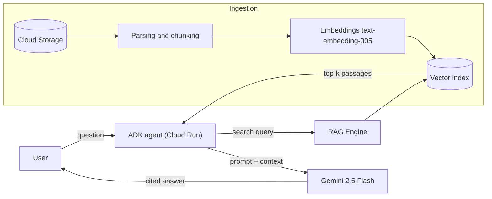

A large language model (LLM) such as Gemini knows a lot… but nothing about **your** internal documents. *Retrieval-Augmented Generation* (RAG) fixes this by retrieving relevant passages from a document base at question time and injecting them into the prompt[^lewis].

## Architecture at a glance

The same diagram, illustrated:

Two flows coexist:

1. **Ingestion** (offline): documents are split into *chunks*, turned into vectors and indexed.
2. **Query** (online): the question is embedded, the closest chunks are retrieved and handed to the model.

> [!NOTE]
> Vertex AI RAG Engine handles most of the ingestion: Cloud Storage and Google Drive connectors, chunking, embeddings and managed vector storage (`RagManagedDb`).

## RAG, fine-tuning or long context?

| Approach | Fresh data | Cost | Citations | When to use |
| --- | :---: | :---: | :---: | --- |
| RAG | ✅ | €€ | ✅ | Evolving document base |
| Fine-tuning | ❌ | €€€ | ❌ | Style, format, domain vocabulary |
| Long context | ✅ | €€€€ | ⚠️ | Few documents, one-off analysis |
| Prompt only | ❌ | € | ❌ | General knowledge |

> [!TIP]
> Always start with a simple RAG using default settings, measure, **then** optimise (chunk size, re-ranking, filters). Fine-tuning rarely comes first.

## Your progress

- [x] Understand the RAG principle
- [x] Identify the ingestion and query flows
- [ ] Compute a cosine similarity
- [ ] Create your first corpus
- [ ] Deploy the agent on Cloud Run

[^lewis]: Lewis et al., *Retrieval-Augmented Generation for Knowledge-Intensive NLP Tasks*, NeurIPS 2020 — <https://arxiv.org/abs/2005.11401>.
