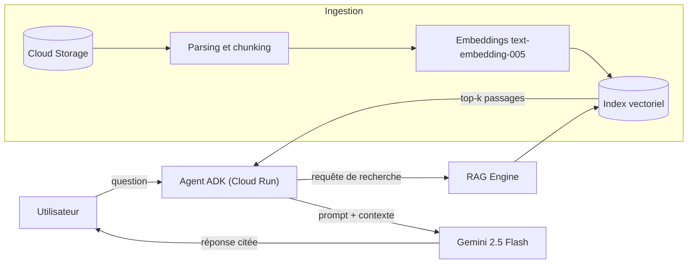

Un grand modèle de langage (LLM) comme Gemini connaît énormément de choses… mais rien de **vos** documents internes. Le *Retrieval-Augmented Generation* (RAG) résout ce problème en récupérant, au moment de la question, les passages pertinents d'une base documentaire pour les injecter dans le prompt[^lewis].

## L'architecture en un coup d'œil

Le même schéma, version illustrée :

Deux flux coexistent :

1. **L'ingestion** (hors ligne) : les documents sont découpés en *chunks*, transformés en vecteurs puis indexés.
2. **La requête** (en ligne) : la question est vectorisée, les chunks les plus proches sont récupérés et fournis au modèle.

> [!NOTE]
> Vertex AI RAG Engine prend en charge l'essentiel de l'ingestion : connecteurs Cloud Storage et Google Drive, découpage, embeddings et stockage vectoriel managé (`RagManagedDb`).

## RAG, fine-tuning ou long contexte ?

| Approche | Données à jour | Coût | Citations | Quand l'utiliser |
| --- | :---: | :---: | :---: | --- |
| RAG | ✅ | €€ | ✅ | Base documentaire qui évolue |
| Fine-tuning | ❌ | €€€ | ❌ | Style, format, vocabulaire métier |
| Long contexte | ✅ | €€€€ | ⚠️ | Peu de documents, analyse ponctuelle |
| Prompt seul | ❌ | € | ❌ | Connaissances générales |

> [!TIP]
> Commencez toujours par un RAG simple avec les paramètres par défaut, mesurez, **puis** optimisez (taille des chunks, re-ranking, filtres). Le fine-tuning vient rarement en premier.

## Les composants à maîtriser

- **Le chunking** : taille et recouvrement des passages.
- **Les embeddings** : la représentation vectorielle du sens (voir la leçon suivante).
- **Le retrieval** : top-k, seuil de distance, filtres par métadonnées.
- **La génération** : instructions au modèle pour citer et refuser de répondre hors contexte.

## Votre progression

- [x] Comprendre le principe du RAG
- [x] Identifier les deux flux ingestion / requête
- [ ] Calculer une similarité cosinus
- [ ] Créer son premier corpus
- [ ] Déployer l'agent sur Cloud Run

[^lewis]: Lewis et al., *Retrieval-Augmented Generation for Knowledge-Intensive NLP Tasks*, NeurIPS 2020 — <https://arxiv.org/abs/2005.11401>.
