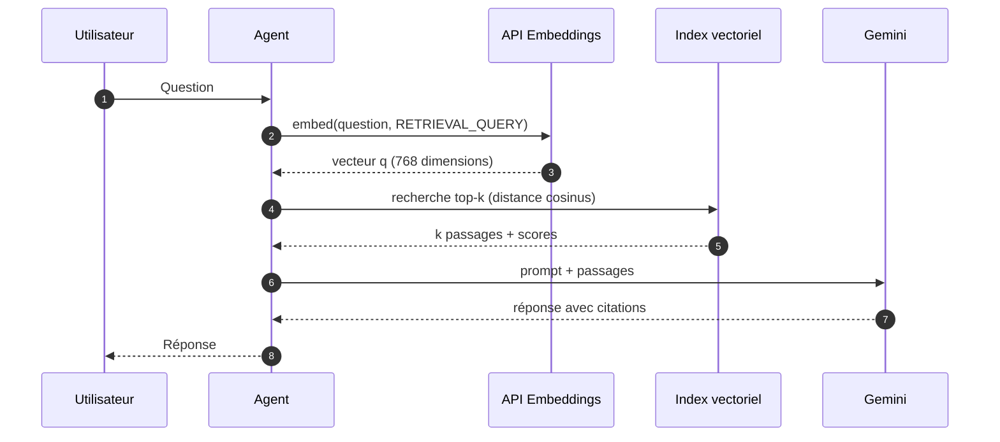
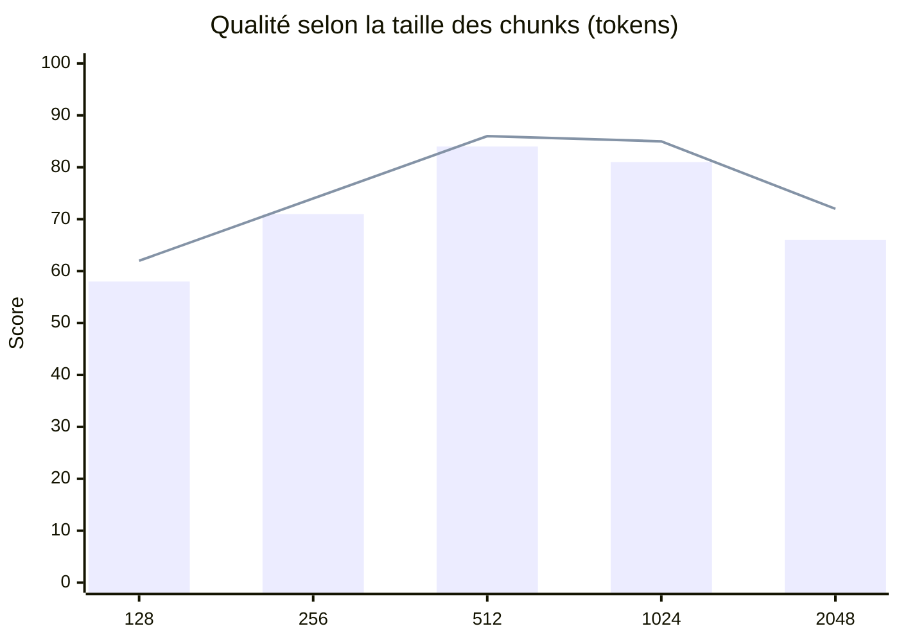
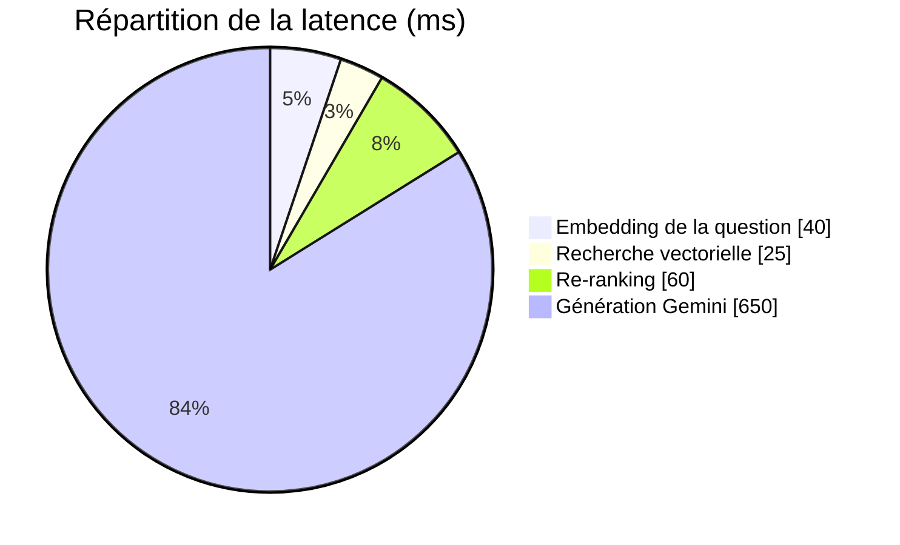

Un **embedding** est un vecteur $\mathbf{v} \in \mathbb{R}^d$ qui encode le sens d'un texte. Deux textes proches sémantiquement ont des vecteurs proches. Le modèle `text-embedding-005` de Vertex AI produit des vecteurs de dimension $d = 768$.

## La similarité cosinus

Pour comparer une question $\mathbf{q}$ et un passage $\mathbf{p}$, on mesure l'angle entre leurs vecteurs :

$$
\cos(\theta) = \frac{\mathbf{q} \cdot \mathbf{p}}{\lVert \mathbf{q} \rVert \, \lVert \mathbf{p} \rVert} = \frac{\sum_{i=1}^{d} q_i p_i}{\sqrt{\sum_{i=1}^{d} q_i^2} \, \sqrt{\sum_{i=1}^{d} p_i^2}}
$$

Le résultat est compris entre $-1$ et $1$. Si les vecteurs sont normalisés ($\lVert \mathbf{v} \rVert = 1$), la similarité cosinus se réduit au produit scalaire, ce qui accélère la recherche. La distance cosinus vaut alors $1 - \cos(\theta)$.

## Calculer des embeddings

```python title="embed.py"
import numpy as np
from vertexai.language_models import TextEmbeddingInput, TextEmbeddingModel

model = TextEmbeddingModel.from_pretrained("text-embedding-005")


def embed(texts: list[str], task: str) -> np.ndarray:
    inputs = [TextEmbeddingInput(t, task_type=task) for t in texts]
    return np.array([e.values for e in model.get_embeddings(inputs)])


docs = embed(
    ["Cloud Run exécute des conteneurs sans serveur.",
     "BigQuery est un entrepôt de données analytique."],
    task="RETRIEVAL_DOCUMENT",
)
query = embed(["Où déployer mon conteneur ?"], task="RETRIEVAL_QUERY")[0]

scores = docs @ query / (np.linalg.norm(docs, axis=1) * np.linalg.norm(query))
print(scores)  # le premier document obtient le meilleur score
```

> Le paramètre `task_type` compte : `RETRIEVAL_DOCUMENT` pour indexer, `RETRIEVAL_QUERY` pour interroger. Les deux espaces sont optimisés pour être comparés entre eux.

## Le parcours d'une requête



## Influence de la taille des chunks

Mesures indicatives sur un corpus de documentation technique (rappel@5 et fidélité de la réponse) :



Des chunks trop petits perdent le contexte ; trop grands, ils diluent le signal. La zone 512 à 1024 tokens est un bon point de départ.

## Où part le temps de réponse ?



La génération domine : optimiser le retrieval sert surtout la **qualité**, pas la latence.

## À retenir

- Un embedding est un vecteur dense ; la similarité cosinus mesure l'angle entre deux vecteurs.
- Utilisez le bon `task_type` à l'indexation et à la requête.
- Réglez la taille des chunks en mesurant, pas au hasard.
