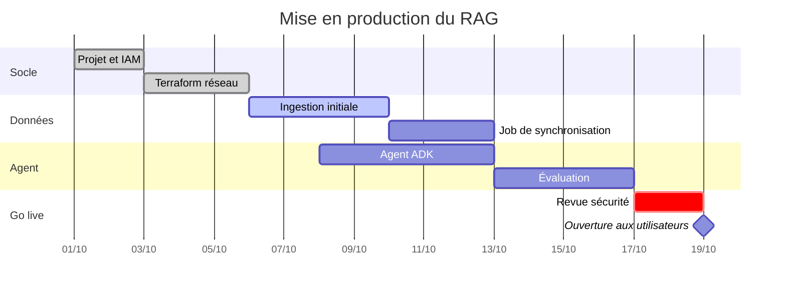

## Les supports du cours

Le support complet, à lire en ligne ou à télécharger :

Le guide d'installation pas à pas :

La présentation utilisée en session :

## Choisir son backend vectoriel

| Backend | Gestion | Volume conseillé | Filtrage métadonnées | Coût de départ |
| --- | --- | --- | --- | --- |
| RagManagedDb | Entièrement managé | < 1 M chunks | Basique | Faible |
| Vertex AI Vector Search | Managé, endpoint dédié | Milliards | Avancé (restricts) | Élevé (nœud permanent) |
| Vertex AI Feature Store | Managé, BigQuery | Millions | Via SQL | Moyen |
| AlloyDB + pgvector | Semi-managé | Dizaines de millions | SQL complet | Moyen |
| Cloud SQL + pgvector | Semi-managé | Millions | SQL complet | Faible |
| BigQuery Vector Search | Serverless | Milliards (batch) | SQL complet | Au volume scanné |
| Pinecone | SaaS tiers | Milliards | Avancé | Variable |
| Weaviate | SaaS ou auto-hébergé | Centaines de millions | Avancé | Variable |
| Firestore vector search | Serverless | Millions | Requêtes Firestore | Faible |

## Planning de mise en production

## Checklist de déploiement

- **Infrastructure**
  - Terraform appliqué depuis la CI uniquement
    - état distant dans un bucket versionné
    - verrouillage de l'état activé
  - Workload Identity Federation pour GitHub Actions
- **Agent**
  1. Image construite et poussée dans Artifact Registry
  2. Déploiement Cloud Run avec un compte de service dédié
     - `--no-allow-unauthenticated`
     - concurrence ajustée (80 par défaut)
  3. Trafic basculé progressivement (`--tag canary`)
- **Observabilité**
  - Cloud Logging et Cloud Trace
  - Tableau de bord des scores de retrieval

> « En production, la question n'est pas de savoir si le retrieval va se tromper, mais si vous le verrez. »
>
> — Retour d'expérience d'une équipe plateforme
