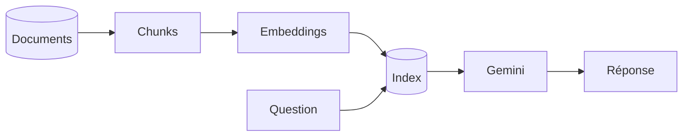

# Construire un RAG sur GCP

Récapitulatif du cours

*Vertex AI RAG Engine · Gemini · Cloud Run*

---

## Pourquoi le RAG ?

- Les LLM ignorent vos données privées
- Moins d'hallucinations grâce au contexte
- Des réponses **citées** et vérifiables
- Pas de réentraînement quand les documents changent

---

## L'architecture



---

## Le schéma complet


---

## Créer un corpus

```python
corpus = rag.create_corpus(display_name="docs-internes")
rag.import_files(corpus.name, ["gs://bucket/docs/"])
```

---

## Les réglages qui comptent

1. Taille des chunks : 512 à 1024 tokens
2. Recouvrement : 10 à 20 %
3. `top_k` entre 3 et 10
4. Seuil de distance vectorielle

---

## À retenir

- Mesurez avant d'optimiser
- Sécurisez : IAM, VPC-SC, Model Armor
- Automatisez : Terraform + CI/CD

**Merci !**
