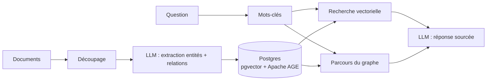
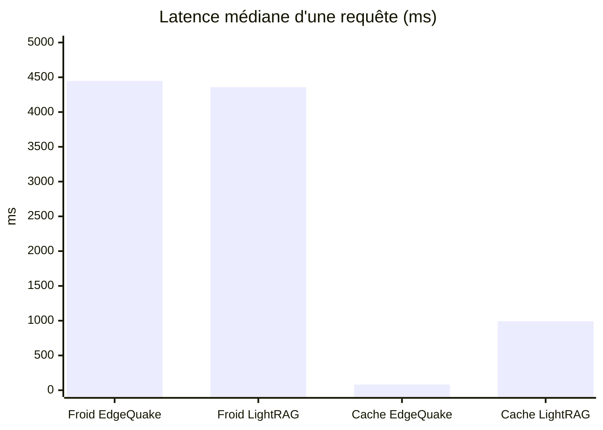

> [!NOTE]
> Fiche de lecture du [README d'EdgeQuake](https://github.com/raphaelmansuy/edgequake/blob/edgequake-main/README.md) (v0.34.0, licence Apache 2.0, © Raphaël Mansuy). Les chiffres viennent du projet, pas de mes propres mesures.

## Le problème qu'il résout

La recherche vectorielle trouve des passages **qui ressemblent** à la question. Elle peine dès que la réponse dépend de **relations** : « quels fournisseurs sont liés aux incidents du T3 ? », « qui travaille avec qui sur ce sujet ? ». Le Graph-RAG ajoute un graphe d'entités et de relations extrait des documents, puis combine graphe et vecteurs au moment de la question.

EdgeQuake implémente l'algorithme **LightRAG** en Rust, avec une promesse simple : *un binaire, un Postgres, n'importe quel LLM*, dans le cloud ou 100 % en local.

## Comment ça marche



- **Stockage unique** : PostgreSQL 16 à 18, `pgvector` pour les embeddings, **Apache AGE** pour le graphe. Pas de base vectorielle ni de base graphe à opérer en plus.
- **Interfaces** : interface web (port 3000), API REST avec Swagger (`/swagger-ui`, port 8080), `/health`, CLI (`edgequake migrate`, `edgequake doctor`), **serveur MCP** et SDK (Python, TypeScript, Rust, Go, Java, Kotlin, C#, PHP, Ruby, Swift).
- **Modèles** : OpenAI, Anthropic, Gemini, Mistral ; en local Ollama, LM Studio, llama.cpp, MLX… ; tout serveur compatible OpenAI ou Anthropic. Un modèle peut être choisi **par rôle** (extraction, requête, mots-clés, résumé, embeddings, vision).

## Les modes de requête

| Mode | Idéal pour |
|---|---|
| `naive` | Recherches proches du mot-clé |
| `local` | Une entité précise et ses voisines |
| `global` | Thèmes et questions de haut niveau |
| `hybrid` (défaut) | Réponses équilibrées et complètes |
| `mix` | Mélange pondéré vecteurs + graphe |
| `bypass` | LLM direct, sans recherche |

## Face à LightRAG (Python)

Mesures du projet sur GraphRAG-Bench (médical, n = 200, même corpus, mêmes modèles) :



| Mesure | EdgeQuake | LightRAG | Lecture |
|---|---|---|---|
| Exactitude des réponses | 0,792 | 0,786 | Égalité statistique |
| Requête à froid (p50) | 4 447 ms | 4 359 ms | Équivalent |
| Requête en cache (p50) | **82 ms** | 993 ms | EdgeQuake ~12× plus rapide |
| Rappel des preuves | 0,932 | **0,949** | LightRAG devant |

> [!TIP]
> Le message du projet est honnête : **même qualité de recherche que LightRAG, mais industrialisée**. L'intérêt n'est pas un meilleur score, c'est l'exploitation : un binaire, des migrations explicites, multi-tenant, SSO, audit.

## Ce qui le rend « production »

- **Migrations explicites** : l'API ne migre jamais la base ; `edgequake migrate` est rejoué depuis chaque version publiée.
- **Sécurité par défaut** : écoute sur loopback au démarrage rapide, secrets générés, clés de connexion chiffrées (AES-256-GCM, en écriture seule).
- **Multi-tenant** fermé par défaut (requête, suppression, reprise), authentification intégrée, **SSO Keycloak/OIDC**, journal d'audit.
- **PDF** : mode texte par défaut, mode **vision** pour les tableaux et scans, avec repli automatique.
- `/health` interroge réellement les fournisseurs ; `edgequake doctor` vérifie ce qui est joignable.

## L'essayer en 5 minutes

Il suffit de Docker, puis d'ouvrir http://localhost:3000 :

```bash
curl -fsSL https://raw.githubusercontent.com/raphaelmansuy/edgequake/edgequake-main/quickstart.sh | sh
```

> [!WARNING]
> Relisez un script avant de le passer à `sh`. Et avec Ollama, le premier lancement télécharge plusieurs Go de modèles.

Sans interface, par l'API :

```bash
curl -X POST http://localhost:8080/api/v1/documents/upload -F "file=@mon-document.pdf"

curl -X POST http://localhost:8080/api/v1/query \
  -H "Content-Type: application/json" \
  -d '{"query": "Quels sont les concepts principaux ?", "mode": "hybrid"}'
```

Version figée : `EDGEQUAKE_VERSION=0.34.0 sh quickstart.sh`. Mode CI : `quickstart.sh --yes --provider ollama`.

## Où ça se place par rapport à mes kits RAG

| Besoin | Option |
|---|---|
| Documents Drive / SharePoint, managé Google | [RAG sur vos documents Google Drive](../03-rag-documents-google-drive/README.md) |
| Questions sur des **relations** entre entités | EdgeQuake (graphe + vecteurs) |
| Tout en local, sans cloud | EdgeQuake + Ollama, ou le kit RAG local avec Claude |

Pistes d'essai : brancher EdgeQuake comme **serveur MCP** dans un agent ADK ou Gemini Enterprise (voir le parcours [Serveurs MCP](../../04-agents-google-cloud/02-serveurs-mcp/index.md)), et comparer `hybrid` vs RAG Engine sur le même corpus.
