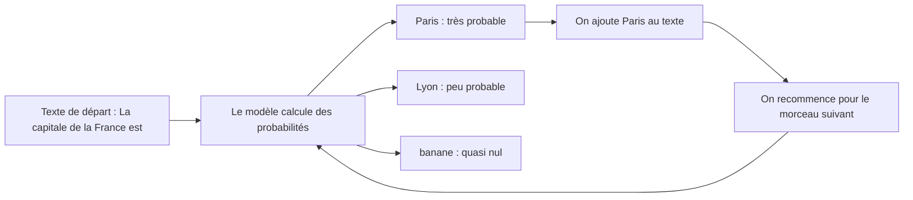

# Tokens et prédiction du mot suivant

> [!NOTE]
> **Dans cette leçon…** vous allez comprendre ce que signifie « LLM », ce qu'est un **token**, et pourquoi on dit qu'un assistant comme Claude ou Gemini « prédit le mot suivant ». À la fin, vous pourrez l'expliquer à un collègue en deux minutes.

## LLM : trois lettres, une idée simple

**LLM** veut dire *Large Language Model*, en français **grand modèle de langage**.

- **Modèle** : un programme qui a appris à partir d'exemples plutôt qu'à partir de règles écrites à la main.
- **De langage** : il travaille sur du texte (et, pour les plus récents, aussi sur des images, du son…).
- **Grand** : il a été entraîné sur une quantité gigantesque de textes, et il contient énormément de « réglages internes » (on parle de **paramètres**).

Claude (de l'entreprise Anthropic), Gemini (de Google), GPT (d'OpenAI, utilisé dans ChatGPT) ou Mistral sont des LLM. L'application que vous utilisez (la fenêtre de discussion) est l'**assistant** ; le LLM est le **moteur** qui tourne dessous.

> [!TIP]
> **Analogie :** le LLM est le moteur, l'assistant est la voiture. Deux voitures peuvent avoir le même moteur, et une même marque peut proposer plusieurs moteurs (un petit économique, un gros puissant).

## L'auto-complétion de votre téléphone, en beaucoup plus fort

Quand vous tapez « Je suis en » sur votre téléphone, il vous propose « retard », « route », « réunion ». Il a appris quelles suites de mots sont fréquentes.

Un LLM fait **exactement la même chose**, mais :

- il a lu infiniment plus de textes que votre clavier ;
- il tient compte de **tout ce qui précède**, pas seulement des deux derniers mots ;
- il recommence, encore et encore, jusqu'à produire une réponse complète.



Une réponse de dix lignes, c'est donc des centaines de petites prédictions enchaînées. Le modèle n'a pas « la réponse en tête » avant de commencer : il la construit morceau par morceau.

## Les tokens : les briques de Lego du texte

Le modèle ne lit pas des lettres, ni tout à fait des mots. Il découpe le texte en **tokens** (en français on dit parfois « jetons »). Un token est un **morceau de texte** : un mot court entier, un bout de mot long, un signe de ponctuation, un espace.

| Texte | Découpage possible en tokens (illustratif) |
| --- | --- |
| `chat` | `chat` |
| `anticonstitutionnellement` | `anti` · `constitution` · `nelle` · `ment` |
| `Bonjour !` | `Bon` · `jour` · ` !` |

> [!NOTE]
> Le découpage exact dépend de chaque modèle. Comme **ordre de grandeur**, un mot français courant fait souvent 1 à 2 tokens. Vous pouvez voir un découpage réel avec des outils publics comme le *tokenizer* d'OpenAI.

**Pourquoi c'est important pour vous ?** Parce que presque tout se compte en tokens :

- la **quantité de texte** qu'un modèle peut lire d'un coup (leçon 3) ;
- le **prix** facturé quand on utilise un modèle via une API (module 2) ;
- la **vitesse** de réponse : plus il y a de tokens à produire, plus c'est long.

```quiz
question: "Qu'est-ce qu'un token ?"
options:
  - "Un mot de passe qui protège l'accès au modèle"
  - "Un morceau de texte (mot, bout de mot, ponctuation) que le modèle manipule"
  - "Une phrase complète"
  - "Une lettre de l'alphabet"
answer: 1
explanation: "Un token est un morceau de texte. Il peut correspondre à un mot entier, à une partie de mot ou à un signe. Ce n'est ni une lettre, ni une phrase. Le mot 'token' a aussi un sens en sécurité informatique, d'où la confusion possible avec un mot de passe."
```

## Pourquoi « prédire le mot suivant » donne des réponses intelligentes

C'est la question que tout le monde se pose. Pour bien prédire la suite de « Le contrat est résilié si le locataire… », le modèle a dû, pendant son apprentissage, capter des régularités sur le droit, la grammaire, la logique d'un contrat. Pour prédire la suite d'une recette, il a capté des régularités sur la cuisine.

À force de deviner la suite de milliards de phrases, le modèle a donc emmagasiné une forme de **connaissance du monde et du langage**. Mais attention : ce n'est pas une base de données. Il ne « consulte » pas un fait ; il produit ce qui lui semble **le plus plausible**. Et plausible ne veut pas toujours dire vrai. Nous y reviendrons longuement dans le module 2.

> [!WARNING]
> Un LLM ne « sait » pas qu'il dit vrai. Il génère du texte **vraisemblable**. C'est la source des fameuses **hallucinations** : des réponses fausses mais rédigées avec aplomb.

```quiz
question: "Un LLM écrit une réponse de 300 mots. Comment l'a-t-il produite ?"
options:
  - "Il a cherché la réponse toute faite dans une base de données"
  - "Il a copié un texte trouvé sur Internet au moment de la question"
  - "Il a prédit un token après l'autre, chaque nouveau token tenant compte de tout ce qui précède"
answer: 2
explanation: "Le modèle génère la réponse pas à pas, token par token. Il ne puise pas dans une base de réponses toutes faites, et un LLM seul ne va pas sur Internet (certains assistants ajoutent une recherche web, mais c'est un outil en plus, vu au module 3)."
```

## Exercice : observer la prédiction en action

Ouvrez l'assistant auquel vous avez accès (Claude, Gemini…) et envoyez successivement ces trois messages, dans **trois conversations séparées** :

1. `Complète simplement cette phrase : "Il était une fois"`
2. `Complète simplement cette phrase : "Conformément à l'article 4 du présent contrat"`
3. `Complète simplement cette phrase : "Salut ! Tu viens ce soir"`

Notez pour chacun le **style** de la suite proposée. Que remarquez-vous ?

<details>
<summary>Voir la solution</summary>

Vous devriez observer que le modèle **adapte le registre** au début de phrase :

- « Il était une fois » → une suite de **conte** (« … une princesse qui vivait dans un château »).
- « Conformément à l'article 4… » → une suite **juridique** et formelle (« … les parties s'engagent à… »).
- « Salut ! Tu viens ce soir » → une suite **familière** (« … à l'apéro ? »).

C'est la prédiction du mot suivant en action : le début du texte rend certaines suites beaucoup plus probables que d'autres. **Leçon pratique :** la manière dont vous formulez votre demande oriente fortement le style et le contenu de la réponse. C'est tout l'art du *prompt* (module 3).

Si vous n'avez pas d'assistant sous la main, faites l'exercice de tête : vous verrez que vous, humain, « prédisez » aussi la suite de manière très différente selon le début.

</details>

## À retenir

- Un **LLM** est un programme entraîné sur d'énormes quantités de texte ; l'**assistant** est l'application qui l'utilise.
- Il découpe le texte en **tokens** et produit sa réponse **un token à la fois**, en choisissant à chaque fois une suite plausible.
- **Plausible** n'est pas **vrai** : il faut garder un esprit critique.

## Je sais faire

- [ ] Expliquer la différence entre un LLM et un assistant
- [ ] Définir un token avec mes propres mots
- [ ] Expliquer pourquoi « prédire le mot suivant » peut produire des réponses utiles
- [ ] Citer une raison pour laquelle une réponse d'IA peut être fausse
