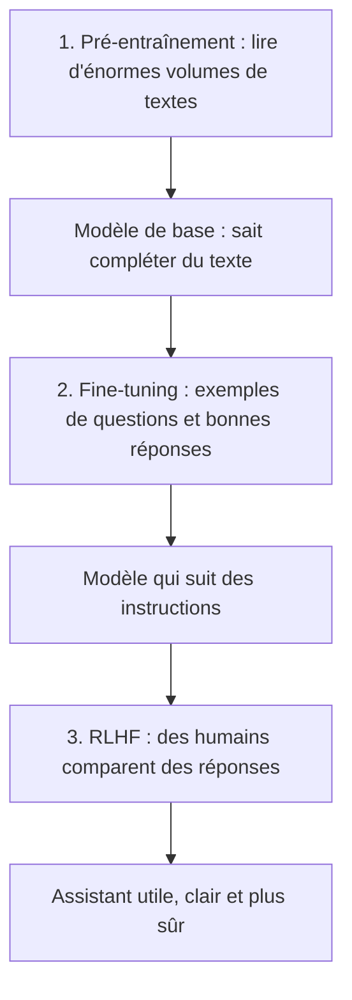

# Comment un modèle apprend

> [!NOTE]
> **Dans cette leçon…** vous allez découvrir les trois étapes de fabrication d'un assistant : le **pré-entraînement**, le **fine-tuning** (ajustement) et le **RLHF** (apprentissage à partir de retours humains). Vous comprendrez pourquoi votre entreprise n'a presque jamais besoin d'entraîner son propre modèle.

## Le parcours d'un nouveau collaborateur

Imaginez la formation d'un nouveau collaborateur très doué :

1. **L'école et les lectures** : pendant des années, il lit énormément et acquiert une culture générale. Il sait beaucoup de choses, mais il ne connaît pas encore les usages de votre entreprise.
2. **La formation métier** : on lui montre des exemples de bon travail (« voici comment on répond à un client »). Il apprend le format attendu.
3. **Le feedback du manager** : on lui dit « cette réponse-là est meilleure que celle-ci ». Il affine son jugement : plus clair, plus prudent, plus poli.

Un LLM suit à peu près le même parcours.



## Étape 1 : le pré-entraînement

**Pré-entraînement** (*pre-training*) : on montre au modèle une quantité colossale de textes (pages web publiques, livres, code, articles…) et on lui pose sans cesse le même exercice : **deviner le token suivant**. À chaque erreur, ses réglages internes (les **paramètres**) sont légèrement corrigés.

- C'est l'étape **la plus longue et la plus coûteuse** : elle mobilise des milliers de processeurs spécialisés pendant des semaines ou des mois. Seules quelques grandes entreprises et laboratoires la réalisent.
- Le résultat est un **modèle de base** : il connaît le langage et beaucoup de faits, mais il ne sait pas encore « converser ». Si vous lui écrivez « Quelle est la capitale de l'Italie ? », il pourrait répondre par… une autre question, comme dans un quiz qu'il aurait lu !

> [!IMPORTANT]
> Les connaissances du modèle s'arrêtent à la date à laquelle on a collecté ses textes d'entraînement. On parle de **date de coupure** (*knowledge cutoff*). Tout ce qui s'est passé après, le modèle l'ignore, sauf si on le lui fournit (module 3).

## Étape 2 : le fine-tuning

**Fine-tuning** (ajustement fin) : on reprend le modèle de base et on continue de l'entraîner, mais cette fois sur un jeu d'exemples **choisis** : des questions suivies de bonnes réponses, rédigées ou validées par des humains.

Le modèle apprend ainsi **le format** « on me pose une question, je réponds de façon utile ». C'est beaucoup moins coûteux que le pré-entraînement, car il y a beaucoup moins de données.

Les entreprises peuvent aussi faire du fine-tuning pour spécialiser un modèle sur un **style** ou une **tâche très répétitive** (classer des tickets, par exemple). Mais pour lui apprendre **vos documents internes**, ce n'est généralement pas la bonne méthode : on préfère lui donner les documents au moment de la question (le **RAG**, module 3).

## Étape 3 : le RLHF

**RLHF** veut dire *Reinforcement Learning from Human Feedback* : apprentissage par renforcement à partir de retours humains. Concrètement :

1. le modèle produit plusieurs réponses à une même question ;
2. des personnes les **classent** de la meilleure à la moins bonne ;
3. le modèle est ajusté pour produire plus souvent le genre de réponses préférées.

C'est ce qui rend l'assistant **plus utile, plus poli, plus prudent** : refuser une demande dangereuse, avouer une incertitude, structurer sa réponse. Il existe des variantes : par exemple, Anthropic a décrit une approche où le modèle est aussi guidé par une liste de principes écrits (une « constitution »).

| Étape | Analogie | Ce que le modèle y gagne | Qui la réalise ? |
| --- | --- | --- | --- |
| Pré-entraînement | L'école, des années de lecture | Langage, culture générale | Les éditeurs de modèles |
| Fine-tuning | La formation métier par l'exemple | Suivre des instructions, un format | Éditeurs, parfois entreprises |
| RLHF | Le feedback du manager | Jugement, ton, prudence | Les éditeurs de modèles |

```quiz
question: "Quelle étape donne au modèle l'essentiel de ses connaissances générales sur le monde ?"
options:
  - "Le pré-entraînement"
  - "Le fine-tuning"
  - "Le RLHF"
  - "La conversation avec l'utilisateur"
answer: 0
explanation: "C'est pendant le pré-entraînement, en lisant d'énormes volumes de textes, que le modèle acquiert langage et connaissances. Le fine-tuning et le RLHF ajustent surtout son comportement (format, ton, prudence). Vos conversations, elles, ne modifient pas le modèle en temps réel."
```

## Une idée reçue à corriger : « il apprend de ce que je lui dis »

Pendant une conversation, le modèle **ne se ré-entraîne pas**. Il « se souvient » de ce que vous avez dit **uniquement à l'intérieur de la conversation en cours** (c'est la fenêtre de contexte, leçon suivante). Fermez la conversation : il repart de zéro.

Certains assistants proposent une fonction « mémoire » ; il s'agit en réalité de notes enregistrées puis **réinjectées** dans les conversations suivantes, pas d'un ré-entraînement.

> [!WARNING]
> En revanche, selon l'offre utilisée et ses réglages, l'éditeur peut **conserver vos conversations** et parfois s'en servir pour entraîner de **futurs** modèles. C'est un point clé de confidentialité, traité dans le module 4. Les offres entreprise excluent en général cet usage, mais il faut le vérifier dans le contrat.

```quiz
question: "Un collègue affirme : « Si je corrige l'IA dans ma conversation, elle ne refera plus jamais l'erreur, pour personne. » Qu'en pensez-vous ?"
options:
  - "C'est vrai, le modèle se ré-entraîne immédiatement"
  - "C'est faux : la correction ne vaut que pour la conversation en cours ; le modèle lui-même n'est pas modifié"
  - "C'est vrai, mais seulement pour les utilisateurs de la même entreprise"
answer: 1
explanation: "Le modèle n'apprend pas en direct. Votre correction reste dans le contexte de la conversation et l'aide pour la suite de cet échange uniquement. Une nouvelle conversation, ou un autre utilisateur, repart du même modèle."
```

## Exercice : associer le besoin à la bonne étape

Pour chaque situation, indiquez si la solution relève du **pré-entraînement**, du **fine-tuning**, ou d'**aucun entraînement** (on donne simplement l'information au moment de la question).

1. Une start-up veut créer un tout nouveau modèle de langage à partir de rien.
2. Le service RH veut que l'assistant réponde à partir de la dernière version du règlement intérieur, mis à jour chaque trimestre.
3. Une équipe veut un modèle qui classe des milliers de tickets dans 12 catégories, toujours au même format.
4. Vous voulez que l'assistant rédige un e-mail en tenant compte d'un compte rendu de réunion que vous avez sous les yeux.

<details>
<summary>Voir la solution</summary>

1. **Pré-entraînement.** Créer un modèle à partir de rien, c'est la grande étape coûteuse ; peu d'acteurs la font.
2. **Aucun entraînement.** Le règlement change souvent : on le **fournit** au modèle au moment de la question (copier-coller, pièce jointe, ou RAG). Ré-entraîner à chaque mise à jour serait lent, coûteux, et le modèle pourrait mélanger ancienne et nouvelle version.
3. **Fine-tuning** (éventuellement). Tâche très répétitive, format fixe, gros volume : c'est le cas typique où un ajustement peut aider. Souvent, un bon prompt avec quelques exemples suffit déjà : on commence par là.
4. **Aucun entraînement.** Vous collez le compte rendu dans la conversation et vous demandez l'e-mail.

**Règle pratique :** dans la grande majorité des projets d'entreprise, on **n'entraîne rien**. On choisit un modèle existant et on lui donne les bonnes informations et les bonnes consignes.

</details>

## Je sais faire

- [ ] Décrire les trois étapes de fabrication d'un assistant avec une analogie
- [ ] Expliquer ce qu'est la date de coupure des connaissances
- [ ] Expliquer pourquoi le modèle n'apprend pas de mes conversations en direct
- [ ] Dire pourquoi on préfère fournir les documents plutôt que ré-entraîner le modèle
