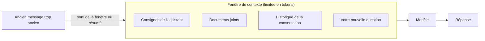

# Fenêtre de contexte et température

> [!NOTE]
> **Dans cette leçon…** vous allez comprendre deux réglages qui expliquent beaucoup de comportements « étranges » des assistants : la **fenêtre de contexte** (combien de texte le modèle peut garder en tête) et la **température** (à quel point il prend des risques en choisissant ses mots).

## La fenêtre de contexte : le plan de travail du modèle

La **fenêtre de contexte** est la quantité maximale de texte (comptée en **tokens**) que le modèle peut prendre en compte **en même temps** pour produire sa réponse.

> [!TIP]
> **Analogie :** c'est le **plan de travail** d'un cuisinier. Tout ce qui est posé dessus (vos messages, ses réponses, les documents joints, les consignes cachées de l'assistant) est utilisable. Ce qui ne tient pas dessus… n'existe pas pour lui.

Dans une conversation, à chaque nouveau message, l'assistant renvoie au modèle **tout l'historique** : c'est comme ça qu'il « se souvient » de ce qui a été dit.



### Ce que ça change pour vous

- **Les fenêtres actuelles sont grandes** : selon le modèle, elles vont, comme ordre de grandeur, de l'équivalent de quelques dizaines de pages à plusieurs centaines de pages, voire davantage. Vérifiez la documentation du modèle que vous utilisez.
- **Une conversation très longue** finit par déborder : l'assistant résume ou oublie les débuts. Si l'IA semble « oublier » une consigne donnée il y a longtemps, c'est souvent ça.
- **Même dans la fenêtre**, le modèle peut accorder moins d'attention à un détail noyé au milieu d'un très long document. Mieux vaut fournir le passage pertinent que 300 pages « au cas où ».
- **Plus de contexte = plus de coût et plus de temps** de réponse (module 2).

> [!TIP]
> Pour un nouveau sujet, **ouvrez une nouvelle conversation**. Vous évitez que d'anciennes consignes parasitent la réponse, et vous allez plus vite.

```quiz
question: "Après une très longue conversation, l'assistant ne respecte plus le format demandé au tout début. Quelle est l'explication la plus probable ?"
options:
  - "Le modèle s'est fatigué"
  - "La consigne initiale est sortie de la fenêtre de contexte, ou a été diluée dans l'historique"
  - "Le modèle a été mis à jour pendant la conversation"
answer: 1
explanation: "Un modèle ne se fatigue pas et n'est pas mis à jour en pleine conversation. En revanche, l'historique grossit : la consigne du début peut être résumée, tronquée ou simplement noyée. Solution : redonner la consigne, ou repartir d'une conversation neuve avec un message de départ complet."
```

## La température : le curseur prudence / créativité

Rappelez-vous la leçon 1 : à chaque étape, le modèle calcule une **probabilité** pour chaque token possible. Reste à **choisir** lequel écrire. C'est là qu'intervient la **température**.

- **Température basse** (proche de 0) : le modèle choisit presque toujours le token **le plus probable**. Réponses **stables, prévisibles**, parfois un peu plates.
- **Température haute** : il s'autorise plus souvent des tokens **moins probables**. Réponses **variées, créatives**, mais avec plus de risques d'écarts et d'erreurs.

> [!TIP]
> **Analogie :** un serveur à qui l'on demande « une suggestion ? ». À température basse, il cite toujours le plat du jour. À température haute, il propose parfois le plat original de la carte… et parfois un choix étrange.

| Tâche | Température conseillée | Pourquoi |
| --- | --- | --- |
| Extraire des dates d'un contrat | Basse | On veut la même réponse exacte à chaque fois |
| Résumer un compte rendu | Basse à moyenne | Fidélité avant tout |
| Trouver 10 idées de noms de produit | Haute | On cherche la diversité |
| Rédiger un post pour un réseau social | Moyenne | Un peu de style sans dérapage |

Dans les assistants grand public (Claude.ai, l'application Gemini…), la température n'est généralement **pas réglable** : elle est fixée par l'éditeur. Elle l'est en revanche quand on utilise le modèle via une **API** (une interface pour les développeurs) ou dans certains outils d'entreprise. Mais comprendre ce curseur explique un phénomène que vous avez sûrement remarqué : **poser deux fois la même question ne donne pas toujours la même réponse**.

### Pour les curieux : la température en 10 lignes

Vous n'avez pas besoin de lire ce code pour suivre la formation. Il montre simplement comment la température « écrase » ou « aplatit » les probabilités.

```python title="temperature.py"
import math

scores = {"Paris": 5.0, "Lyon": 2.0, "Marseille": 1.5}  # scores bruts du modèle (exemple)

def probabilites(scores, temperature):
    exp = {mot: math.exp(s / temperature) for mot, s in scores.items()}
    total = sum(exp.values())
    return {mot: round(v / total, 3) for mot, v in exp.items()}

print(probabilites(scores, 0.5))  # Paris écrase tout : choix quasi certain
print(probabilites(scores, 2.0))  # les probabilités se rapprochent : plus de variété
```

```quiz
question: "Vous voulez que l'IA extraie toujours de la même manière le montant total de factures. Quel réglage de température choisir, si vous avez la main ?"
options:
  - "Une température haute, pour qu'elle soit plus intelligente"
  - "Une température basse, pour des réponses stables et reproductibles"
  - "La température n'a aucun effet sur ce type de tâche"
answer: 1
explanation: "Pour une tâche factuelle et répétitive, on veut de la constance : température basse. Une température haute n'augmente pas l'intelligence, elle augmente la variété, ce qui est utile pour la créativité mais risqué pour l'extraction de données."
```

## Exercice : diagnostiquer trois situations

Pour chaque situation, dites si l'explication tient à la **fenêtre de contexte**, à la **température**, ou aux **deux**, et proposez une parade.

1. Marc demande deux fois « Propose un slogan pour notre séminaire » et obtient deux slogans différents.
2. Leïla colle un rapport de 400 pages et demande le chiffre d'une note de bas de page en page 212. La réponse est approximative.
3. Après 2 heures d'échanges sur un projet, l'assistant recommence à tutoyer alors qu'on lui avait demandé de vouvoyer.

<details>
<summary>Voir la solution</summary>

1. **Température.** Le modèle tire ses mots avec une part d'aléatoire : deux tirages, deux slogans. Ce n'est pas un bug, c'est même pratique pour des idées. **Parade :** demander directement « Propose 10 slogans » et choisir.
2. **Fenêtre de contexte.** Le rapport tient peut-être dans la fenêtre, mais un détail noyé dans un très long document est plus facile à rater. **Parade :** ne fournir que le chapitre concerné, ou demander de citer le passage exact avant de répondre.
3. **Fenêtre de contexte.** La consigne « vouvoyer » est loin dans l'historique, possiblement résumée ou diluée. **Parade :** rappeler la consigne, ou ouvrir une nouvelle conversation avec un message de départ qui récapitule le projet et les règles de ton.

</details>

## Je sais faire

- [ ] Expliquer la fenêtre de contexte avec l'analogie du plan de travail
- [ ] Expliquer pourquoi l'assistant « oublie » parfois une consigne ancienne
- [ ] Expliquer ce que fait la température et quand la baisser
- [ ] Expliquer pourquoi une même question peut donner deux réponses différentes
