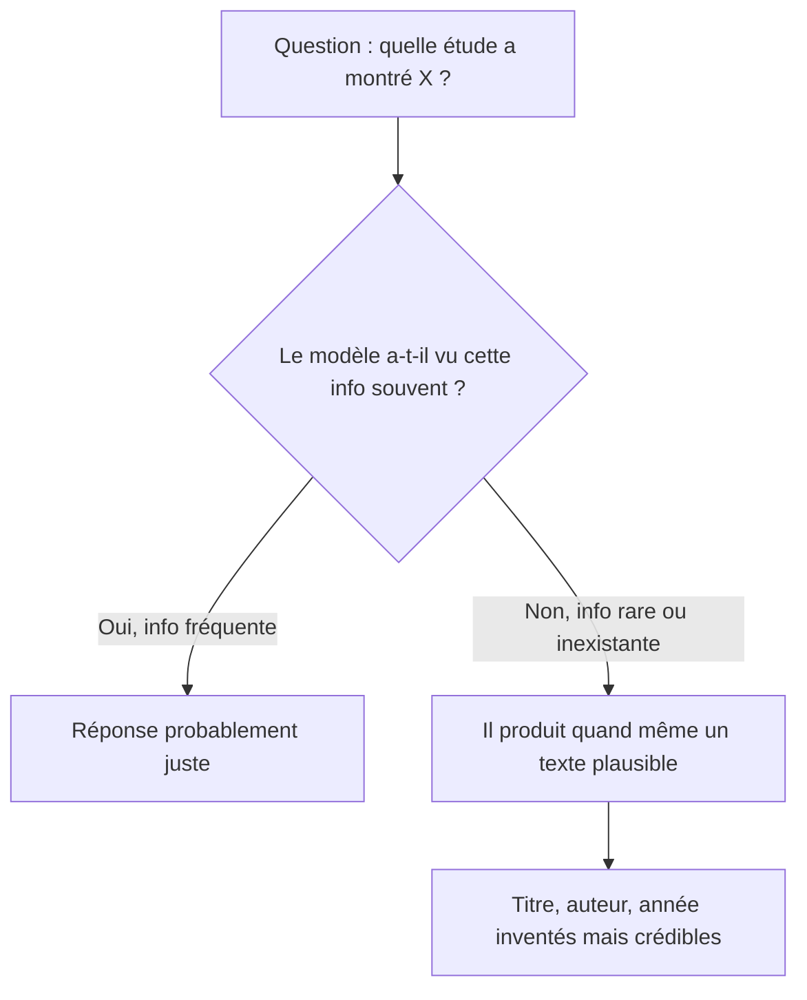

# Hallucinations et connaissances figées

> [!NOTE]
> **Dans cette leçon…** vous allez comprendre ce qu'est une **hallucination**, pourquoi elle se produit, ce que signifient des **connaissances figées**, et surtout adopter **4 réflexes** pour ne pas vous faire piéger.

## Qu'est-ce qu'une hallucination ?

On parle d'**hallucination** quand l'IA produit une information **fausse ou inventée**, présentée avec la même assurance qu'une information juste. Exemples typiques :

- une **référence** (article de loi, livre, étude, jurisprudence) qui n'existe pas ;
- une **citation** attribuée à quelqu'un qui ne l'a jamais dite ;
- un **chiffre** précis sorti de nulle part ;
- une **fonctionnalité** d'un logiciel qui n'existe pas.

> [!TIP]
> **Analogie :** un stagiaire brillant et très sûr de lui, qui préfère inventer une réponse crédible plutôt que d'avouer « je ne sais pas ». Il a raison la plupart du temps… ce qui rend ses erreurs d'autant plus difficiles à repérer.

## Pourquoi ça arrive

Souvenez-vous du module 1 : le modèle produit le texte **le plus plausible**, token après token. Il n'a pas de mécanisme interne qui vérifie chaque affirmation dans une source fiable.



Les hallucinations sont plus fréquentes quand :

| Situation | Exemple |
| --- | --- |
| Le sujet est **rare** ou très pointu | Un règlement interne, un produit de niche |
| On demande des **détails précis** | Numéros d'articles, dates exactes, URL |
| L'information est **récente** | Une loi votée le mois dernier |
| La question contient une **fausse prémisse** | « Pourquoi Victor Hugo a-t-il reçu le prix Nobel ? » (il ne l'a jamais reçu) |

Les modèles récents hallucinent moins qu'avant et avouent plus souvent leur incertitude, grâce notamment au RLHF. Mais **le risque zéro n'existe pas**.

```quiz
question: "Laquelle de ces demandes présente le plus fort risque d'hallucination ?"
options:
  - "Reformule ce paragraphe que je te colle dans un style plus simple"
  - "Donne-moi les références exactes (auteurs, année, revue) de trois études sur le télétravail dans le secteur bancaire"
  - "Corrige les fautes d'orthographe de ce texte"
answer: 1
explanation: "Demander des références précises, sans fournir de source, est le cas classique d'hallucination : le modèle peut produire des titres et des auteurs crédibles mais inventés. Reformuler ou corriger un texte que vous fournissez est beaucoup plus sûr : tout le contenu est déjà sous ses yeux."
```

## Les connaissances figées

Un modèle connaît le monde **jusqu'à sa date de coupure** (vue au module 1). Après, rien. Conséquences :

- il peut ignorer un **changement de loi**, une **nouvelle version** de logiciel, un **événement** récent ;
- il peut ne pas savoir **quel jour on est** si l'assistant ne le lui indique pas ;
- il peut présenter comme actuelle une information **périmée**.

Beaucoup d'assistants compensent avec une **recherche web** ou un accès à vos documents : le modèle reçoit alors des informations fraîches dans sa fenêtre de contexte. C'est un **outil ajouté**, pas une capacité du modèle lui-même (module 3).

> [!WARNING]
> Même avec une recherche web, l'IA peut mal lire ou mal résumer une page, ou s'appuyer sur une source peu fiable. Ouvrez les sources citées pour les points importants.

## Les 4 réflexes anti-hallucination

1. **Fournir la source** plutôt que demander de mémoire : collez le texte, joignez le document. « D'après ce document… » est bien plus fiable que « D'après tes connaissances… ».
2. **Autoriser le « je ne sais pas »** : écrivez explicitement « Si l'information n'est pas dans le document, dis-le plutôt que de deviner. »
3. **Demander les passages cités** : « Cite la phrase exacte du document sur laquelle tu t'appuies. » Vous vérifiez en quelques secondes.
4. **Vérifier ce qui engage** : chiffres, noms, dates, références juridiques, tout ce qui part chez un client ou dans une décision. Plus l'enjeu est fort, plus la vérification humaine est obligatoire.

```quiz
question: "Quelles pratiques réduisent réellement le risque d'hallucination ? (plusieurs réponses)"
options:
  - "Fournir le document source dans la conversation"
  - "Écrire la question en majuscules pour qu'elle soit prise au sérieux"
  - "Demander à l'IA de citer le passage exact qui justifie sa réponse"
  - "Autoriser explicitement l'IA à répondre qu'elle ne sait pas"
answer: [0, 2, 3]
explanation: "Fournir la source, exiger des citations et autoriser le 'je ne sais pas' sont les trois leviers les plus efficaces. Les majuscules n'ont aucun effet sur l'exactitude : le modèle ne 'travaille' pas plus sérieusement parce qu'on crie."
```

## Exercice : piéger (gentiment) l'IA

Dans votre assistant, testez ces deux demandes dans deux conversations séparées :

1. `Résume le livre "Les Algorithmes du Lundi" de Jeanne Moreau-Lefèvre, paru en 2011.` (Ce livre est inventé pour l'exercice.)
2. `Le livre "Les Algorithmes du Lundi" de Jeanne Moreau-Lefèvre existe-t-il ? Si tu n'en es pas sûr, dis-le clairement.`

Comparez les réponses. Puis réécrivez la première demande pour qu'elle soit « sûre ».

<details>
<summary>Voir la solution</summary>

**Ce que vous pouvez observer :**

- Selon le modèle, la demande 1 peut produire un **résumé inventé**, plausible et détaillé : c'est une hallucination provoquée par une **fausse prémisse** (la question suppose que le livre existe). Les modèles récents répondent souvent qu'ils ne connaissent pas ce livre, ce qui est le bon comportement.
- La demande 2 **autorise le doute** : le modèle indique beaucoup plus volontiers qu'il ne trouve pas trace de ce livre.

**Une version sûre de la demande :**

> Je cherche des informations sur un livre intitulé « Les Algorithmes du Lundi » de Jeanne Moreau-Lefèvre (2011). Indique d'abord si tu as des informations fiables sur ce livre. Si ce n'est pas le cas, dis-le et n'invente aucun contenu. Si tu en as, résume-le en précisant ton niveau de certitude.

Retenez le principe : **ne pas présupposer**, **autoriser le doute**, **demander le niveau de certitude**.

</details>

## Je sais faire

- [ ] Définir une hallucination et en donner deux exemples
- [ ] Expliquer pourquoi un LLM peut halluciner
- [ ] Expliquer ce que sont des connaissances figées et comment on les compense
- [ ] Appliquer les 4 réflexes anti-hallucination dans mes demandes
