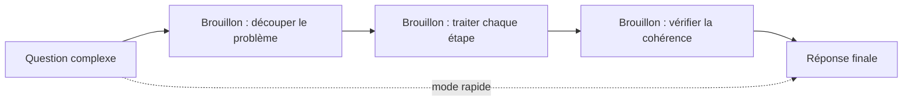
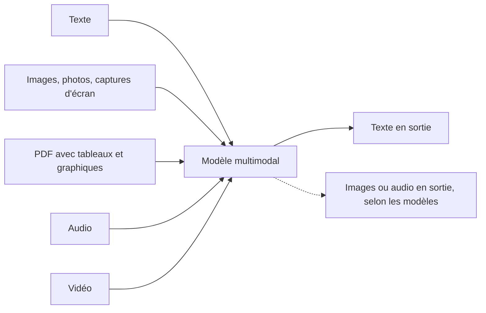

# Raisonnement et multimodalité

> [!NOTE]
> **Dans cette leçon…** vous allez dresser la carte des **points forts** et des **points faibles** des LLM, comprendre ce qu'on appelle les **modèles de raisonnement**, et découvrir la **multimodalité** : la capacité à traiter autre chose que du texte.

## Les points forts : tout ce qui est « langage »

Les LLM excellent dans les tâches où il faut **comprendre et transformer du texte** :

- **Résumer** un long document, un fil d'e-mails, un compte rendu.
- **Reformuler** : simplifier, changer de ton, adapter à un public.
- **Rédiger un premier jet** : e-mail, note, offre d'emploi, FAQ, post.
- **Traduire** entre de nombreuses langues.
- **Extraire et structurer** : transformer un texte libre en tableau (noms, dates, montants).
- **Classer** : trier des retours clients par thème, par sentiment.
- **Expliquer** un concept, un document technique, un message d'erreur.
- **Trouver des idées** : brainstorming, plans, angles d'approche.

## Les points faibles classiques

| Faiblesse | Pourquoi | Parade |
| --- | --- | --- |
| **Calcul exact** sur de gros nombres | Il prédit des tokens, il ne calcule pas comme une calculatrice | Faire calculer par un outil (tableur, outil de calcul intégré à l'assistant) |
| **Compter** (lettres, mots, lignes) | Il voit des tokens, pas des lettres | Ne pas lui faire confiance pour un décompte exact |
| **Faits précis et récents** | Hallucinations, date de coupure | Fournir les sources (leçon précédente) |
| **Cohérence sur très long texte** | Attention diluée, fenêtre limitée | Découper le travail en étapes |
| **Décisions à fort enjeu** | Il n'a ni responsabilité, ni accès au contexte complet | L'IA propose, l'humain décide |

> [!TIP]
> **Analogie :** un excellent rédacteur polyglotte, très cultivé… mais pas un comptable, pas un notaire, et pas quelqu'un qui lit le journal du jour.

```quiz
question: "Vous demandez à un assistant sans outil de calcul : « Combien font 48 731 × 9 274 ? ». Que faut-il en penser ?"
options:
  - "Le résultat est forcément juste, c'est un ordinateur"
  - "Le résultat peut être faux : un LLM prédit du texte, il ne calcule pas nativement comme une calculatrice"
  - "Le modèle refusera toujours de répondre"
answer: 1
explanation: "Un LLM n'est pas une calculatrice : il peut donner un résultat plausible mais faux sur des calculs complexes. Beaucoup d'assistants disposent aujourd'hui d'un outil de calcul ou d'exécution de code qui règle le problème, mais sans cet outil, vérifiez."
```

## Les modèles « de raisonnement »

Depuis quelques années, les éditeurs proposent des modèles ou des modes dits **de raisonnement** (on parle aussi de « réflexion étendue »). Le principe : avant de répondre, le modèle produit une sorte de **brouillon** où il décompose le problème étape par étape, vérifie, revient en arrière. Puis il donne sa réponse finale.



- **Avantages** : meilleurs résultats sur les problèmes à plusieurs étapes (logique, planification, analyse, code, mathématiques).
- **Inconvénients** : plus **lent** et plus **coûteux** (le brouillon consomme des tokens), et inutile pour une question simple.
- **Limite** : le raisonnement améliore la fiabilité, mais ne la garantit pas. Un raisonnement bien présenté peut contenir une erreur.

Vous pouvez obtenir un effet similaire, en plus léger, avec n'importe quel modèle en écrivant : « Réfléchis étape par étape avant de répondre. »

## La multimodalité : au-delà du texte

Un modèle **multimodal** peut recevoir (et parfois produire) plusieurs types de contenus, appelés **modalités** :



Cas concrets pour une équipe métier :

- prendre en photo un **tableau blanc** de réunion et obtenir un compte rendu structuré ;
- envoyer une **capture d'écran** d'un message d'erreur pour qu'on vous l'explique ;
- analyser un **PDF** avec des tableaux et des graphiques ;
- transcrire puis résumer un **enregistrement audio** (avec l'accord des participants) ;
- générer une **image** d'illustration pour une présentation (selon l'assistant).

Les capacités exactes varient d'un modèle et d'une offre à l'autre : vérifiez ce que propose le vôtre.

> [!WARNING]
> Une image contient souvent **plus d'informations qu'on ne le croit** : noms sur un badge, données d'un écran en arrière-plan, visages. Les mêmes règles de confidentialité s'appliquent qu'au texte (module 4).

```quiz
question: "Quelles tâches relèvent de la multimodalité ? (plusieurs réponses)"
options:
  - "Analyser la photo d'un ticket de caisse pour en extraire le montant"
  - "Reformuler un e-mail en style plus formel"
  - "Résumer un enregistrement audio de réunion"
  - "Expliquer un graphique contenu dans un PDF"
answer: [0, 2, 3]
explanation: "La multimodalité concerne les entrées ou sorties autres que le texte : image (ticket, graphique), audio (réunion). Reformuler un e-mail est une tâche purement textuelle."
```

## Exercice : bon ou mauvais usage ?

Classez chaque tâche en **adaptée** (l'IA peut la faire, avec relecture), **à outiller** (elle a besoin d'une source ou d'un outil) ou **inadaptée** (l'humain doit décider).

1. Rédiger le premier jet d'une offre d'emploi à partir d'une fiche de poste.
2. Calculer les primes annuelles de 80 salariés à partir d'un barème.
3. Décider seule quel candidat recruter.
4. Résumer les 40 retours d'une enquête interne par grands thèmes.
5. Donner le cours de bourse actuel d'une entreprise.

<details>
<summary>Voir la solution</summary>

1. **Adaptée.** Rédaction à partir d'une source fournie : point fort des LLM. Relecture humaine pour le ton et les mentions obligatoires.
2. **À outiller.** Le calcul exact doit être fait par un tableur ou un outil de calcul. L'IA peut aider à **écrire la formule** du tableur, pas à faire le calcul de tête.
3. **Inadaptée.** Décision à fort enjeu, qui touche des personnes : l'IA peut aider à structurer une grille d'évaluation, mais la décision reste humaine. Le recrutement est d'ailleurs classé parmi les usages « à haut risque » par le règlement européen sur l'IA.
4. **Adaptée.** Classer et synthétiser du texte fourni : point fort. Vérifiez sur un échantillon que les thèmes reflètent bien les réponses.
5. **À outiller.** Information en temps réel : impossible sans recherche web ou source de données, et à vérifier à la source.

</details>

## Je sais faire

- [ ] Citer 4 tâches où les LLM sont performants
- [ ] Citer 3 faiblesses et leur parade
- [ ] Expliquer ce qu'apporte un mode « raisonnement » et ce qu'il coûte
- [ ] Donner deux exemples d'usage multimodal dans mon métier
