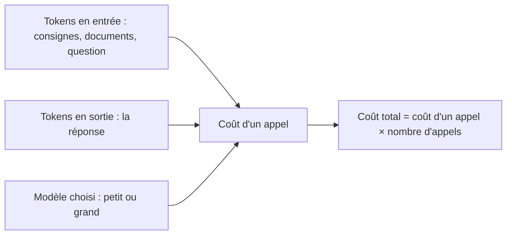

# Coûts et latence

> [!NOTE]
> **Dans cette leçon…** vous allez comprendre **comment se calcule le coût** d'un usage de l'IA, ce qu'est la **latence** (le temps de réponse), et comment faire un choix raisonnable entre un petit modèle rapide et un gros modèle puissant.

## Deux façons de payer l'IA

| Mode | Comment ça marche | Pour qui |
| --- | --- | --- |
| **Abonnement par utilisateur** | Un prix fixe par personne et par mois, usage « illimité » dans des limites raisonnables | Assistants pour les collaborateurs (offres Claude pour les équipes, Gemini Enterprise…) |
| **Paiement à l'usage (API)** | On paie au nombre de **tokens** lus et produits | Applications construites par une équipe technique |

Pour un manager qui équipe son équipe d'un assistant, c'est surtout l'**abonnement** qui compte. Mais dès qu'on parle d'**automatiser** une tâche (traiter 10 000 e-mails, générer des fiches produits en masse), on passe au paiement à l'usage, et il faut savoir raisonner en tokens.

## Le calcul du coût à l'usage

Le prix d'un appel à un modèle dépend de trois choses :



- Les **tokens d'entrée** : tout ce qu'on envoie (y compris les longs documents).
- Les **tokens de sortie** : tout ce que le modèle écrit. Ils sont généralement **plus chers** que les tokens d'entrée.
- Le **modèle** : chaque éditeur propose une gamme. Les plus puissants coûtent nettement plus cher par token que les plus petits.

Les prix changent souvent et sont publiés sur les pages tarifaires des éditeurs : consultez-les au moment de votre projet plutôt que de retenir un chiffre.

### Un exemple de raisonnement (chiffres fictifs)

Prenons des **prix imaginaires** pour l'exercice : 1 € par million de tokens en entrée, 5 € par million en sortie.

```python title="estimation_cout.py"
# Prix FICTIFS, uniquement pour apprendre à raisonner
prix_entree = 1 / 1_000_000   # euro par token d'entrée
prix_sortie = 5 / 1_000_000   # euro par token de sortie

tokens_entree_par_mail = 1_500   # le mail + les consignes
tokens_sortie_par_mail = 300     # la réponse proposée
nb_mails_par_mois = 10_000

cout = nb_mails_par_mois * (tokens_entree_par_mail * prix_entree
                            + tokens_sortie_par_mail * prix_sortie)
print(f"{cout:.2f} € par mois")   # 30.00 € par mois avec ces prix fictifs
```

Ce qui compte, c'est la **méthode** : tokens par appel × prix × volume. Et les leviers : un modèle plus petit, des consignes plus courtes, des réponses plus concises.

> [!TIP]
> Le coût caché le plus fréquent n'est pas la facture de l'IA, c'est le **temps de relecture humaine**. Un projet rentable est un projet où la relecture prend bien moins de temps que de tout faire à la main.

```quiz
question: "Une application envoie à chaque question un document de 100 pages, alors que seules 2 pages sont utiles. Quel est l'effet principal ?"
options:
  - "Aucun, seuls les tokens de sortie sont facturés"
  - "Un coût et un temps de réponse inutilement élevés, car tous les tokens d'entrée sont traités et facturés"
  - "Une meilleure réponse garantie, car plus de contexte est toujours mieux"
answer: 1
explanation: "Les tokens d'entrée sont facturés et traités eux aussi. Envoyer 100 pages au lieu de 2 coûte plus cher, ralentit la réponse et peut même noyer l'information utile. C'est exactement le problème que le RAG résout (module 3)."
```

## La latence : pourquoi il faut attendre

La **latence** est le temps entre votre question et la réponse. Elle dépend :

- de la **taille du modèle** : un grand modèle réfléchit plus lentement ;
- de la **longueur de l'entrée** : lire 300 pages prend plus de temps que lire 3 lignes ;
- de la **longueur de la sortie** : la réponse est produite token par token, d'où l'effet « texte qui s'écrit » à l'écran (on parle de *streaming*) ;
- du **mode raisonnement**, qui ajoute un temps de réflexion ;
- de la **charge** des serveurs de l'éditeur à ce moment-là.

| Besoin | Ce qui compte le plus | Choix typique |
| --- | --- | --- |
| Chatbot pour répondre en direct à un client | Rapidité | Petit modèle rapide |
| Analyse approfondie d'un dossier complexe | Qualité | Grand modèle, éventuellement en mode raisonnement |
| Traitement de milliers de documents la nuit | Coût | Petit modèle, traitement par lots |

> [!IMPORTANT]
> **La règle d'or :** commencer avec un bon modèle pour vérifier que la tâche est faisable, puis essayer un modèle plus petit et plus économique. Si la qualité reste suffisante, on garde le petit.

```quiz
question: "Pour un assistant qui doit répondre instantanément à des questions simples (horaires, procédures courantes), que privilégier ?"
options:
  - "Le plus gros modèle disponible, en mode raisonnement"
  - "Un modèle plus petit et rapide, testé sur des exemples réels"
  - "Peu importe, tous les modèles ont la même latence"
answer: 1
explanation: "Pour des questions simples et un besoin de réactivité, un petit modèle rapide suffit souvent et coûte moins cher. Le mode raisonnement ajouterait du temps d'attente sans bénéfice. Et les modèles n'ont pas tous la même vitesse."
```

## Exercice : estimer un projet

Votre équipe marketing veut générer automatiquement une description pour chacun des 2 000 produits du catalogue. Chaque appel envoie la fiche technique et les consignes (par exemple, environ 800 tokens) et reçoit une description (environ 250 tokens). On refait l'opération 4 fois par an.

1. Combien de tokens d'entrée et de sortie par an ?
2. Avec les prix fictifs de la leçon (1 € / million en entrée, 5 € / million en sortie), quel coût annuel ?
3. Quel coût oublie-t-on souvent ?

<details>
<summary>Voir la solution</summary>

1. **Volume annuel :** 2 000 produits × 4 fois = 8 000 appels.
   - Entrée : 8 000 × 800 = 6 400 000 tokens (6,4 millions).
   - Sortie : 8 000 × 250 = 2 000 000 tokens (2 millions).
2. **Coût (prix fictifs) :** 6,4 × 1 € + 2 × 5 € = 6,40 € + 10 € = **16,40 € par an**.
3. **Le coût oublié :** la **relecture humaine** de 8 000 descriptions. À, par exemple, une minute par description, cela fait environ 133 heures par an. C'est ce poste, bien plus que la facture de l'IA, qui décide de la rentabilité. Pistes : relire un échantillon, définir des critères de contrôle, ou faire vérifier automatiquement certains points (longueur, mentions obligatoires).

</details>

## Je sais faire

- [ ] Distinguer abonnement par utilisateur et paiement à l'usage
- [ ] Estimer un coût à partir des tokens, du prix et du volume
- [ ] Citer 3 facteurs qui influencent la latence
- [ ] Appliquer la règle « tester avec un bon modèle, puis descendre en gamme »
