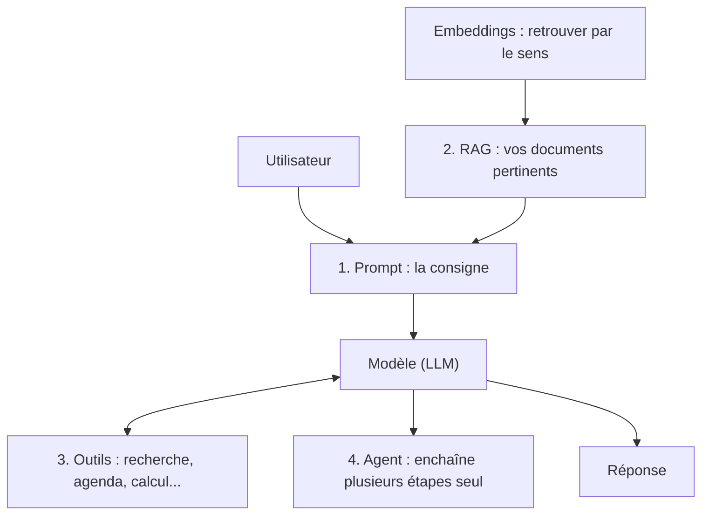

# Le prompt : bien briefer l'IA

> [!NOTE]
> **Dans cette leçon…** vous allez découvrir la première brique de toute application d'IA : le **prompt**. Vous apprendrez une structure simple en 5 éléments pour obtenir des réponses nettement meilleures, et la différence entre le prompt « système » et le prompt « utilisateur ».

## Vue d'ensemble du module

Une application d'IA, qu'il s'agisse d'un assistant interne ou d'un générateur de contenu, est souvent un assemblage de 4 briques. Ce module les présente une par une.



## Qu'est-ce qu'un prompt ?

Le **prompt** est tout simplement le **texte d'instruction** que reçoit le modèle. Quand vous écrivez dans Claude ou Gemini, vous écrivez un prompt.

> [!TIP]
> **Analogie :** briefer un prestataire freelance très compétent qui ne connaît **ni votre entreprise, ni votre projet, ni vos goûts**. Plus le brief est clair, meilleur est le livrable. « Fais-moi un logo » donne un résultat au hasard ; un brief de 10 lignes donne un résultat exploitable.

## La structure en 5 éléments

| Élément | Question à se poser | Exemple |
| --- | --- | --- |
| **Rôle** | Qui doit-il être ? | « Tu es un chargé de communication interne. » |
| **Contexte** | Que doit-il savoir ? | « Notre entreprise déménage le 3 mars ; 120 salariés concernés ; inquiétude sur le parking. » |
| **Tâche** | Que doit-il faire, précisément ? | « Rédige l'e-mail d'annonce. » |
| **Format** | Sous quelle forme ? | « 150 mots maximum, 3 paragraphes, un objet d'e-mail, ton rassurant. » |
| **Exemples / contraintes** | Que faut-il imiter ou éviter ? | « Ne promets rien sur le parking ; voici un ancien e-mail dont j'aime le ton : … » |

**Avant :**

```text title="prompt-faible.txt"
Écris un mail sur le déménagement.
```

**Après :**

```text title="prompt-structure.txt"
Tu es chargé de communication interne dans une entreprise de 120 personnes.

Contexte : nous déménageons le 3 mars dans de nouveaux locaux, à 2 km des actuels.
Les salariés s'inquiètent surtout du parking (le nouveau site en a moins).

Tâche : rédige l'e-mail d'annonce envoyé par la direction.

Format : un objet d'e-mail, puis 3 paragraphes courts, 150 mots maximum, ton chaleureux et rassurant.

Contraintes : ne fais aucune promesse chiffrée sur le parking ; annonce qu'une réunion
d'information aura lieu (date à compléter : [DATE]).
```

```quiz
question: "Quel élément manque le plus dans ce prompt : « Tu es juriste. Résume ce contrat. » ?"
options:
  - "Le rôle"
  - "Le format et l'objectif : pour qui, pour quoi faire, sous quelle forme"
  - "Rien, il est parfait"
answer: 1
explanation: "Le rôle est donné. Mais un résumé pour un directeur pressé, pour un commercial ou pour un juriste n'a ni la même longueur ni le même contenu. Préciser l'objectif (ex. repérer les clauses de résiliation) et le format (ex. tableau de 5 lignes) change tout."
```

## Prompt système et prompt utilisateur

Dans une application d'IA, il y a en général **deux niveaux** de prompt :

- Le **prompt système** : des consignes permanentes, écrites une fois pour toutes par ceux qui configurent l'assistant. Exemple : « Tu es l'assistant RH de l'entreprise. Tu réponds uniquement à partir des documents fournis. Tu vouvoies. Si tu ne sais pas, tu orientes vers rh@… ». L'utilisateur ne le voit généralement pas.
- Le **prompt utilisateur** : la question tapée par la personne, à chaque fois.

Dans les assistants du quotidien, vous pouvez souvent créer vos propres consignes permanentes : par exemple les **Projets** dans Claude, ou les **Gems** et agents personnalisés côté Gemini. C'est un excellent moyen de ne pas réécrire le même contexte à chaque fois.

> [!WARNING]
> Un prompt n'est pas un mur de sécurité. Un utilisateur malin, ou un document piégé contenant des instructions cachées, peut tenter de détourner l'assistant : on parle d'**injection de prompt**. C'est le premier risque listé par l'OWASP pour les applications d'IA. Ne comptez jamais **uniquement** sur le prompt pour protéger des données sensibles.

## Trois astuces qui marchent

1. **Itérer** : la première réponse est un brouillon. Répondez « plus court », « plus formel », « ajoute un exemple ». C'est une conversation.
2. **Demander des questions** : « Avant de rédiger, pose-moi les questions dont tu as besoin. » L'IA vous aide à compléter votre propre brief.
3. **Délimiter les données** : quand vous collez un texte, encadrez-le clairement (par exemple entre `<document>` et `</document>`, ou entre trois guillemets) pour que le modèle distingue votre consigne du contenu à traiter.

```quiz
question: "Vous configurez un assistant interne pour toute l'équipe. Où placer la consigne « Réponds toujours en français, en vouvoyant » ?"
options:
  - "Dans le prompt système (les consignes permanentes de l'assistant)"
  - "Dans chaque question de chaque utilisateur"
  - "Nulle part, le modèle le fera de lui-même"
answer: 0
explanation: "Une règle qui vaut pour toutes les conversations a sa place dans le prompt système : écrite une fois, appliquée partout. Demander à chaque utilisateur de la répéter serait fastidieux et peu fiable ; et sans consigne, le modèle peut adopter un autre ton."
```

## Exercice : réécrire un prompt

Réécrivez ce prompt avec la structure en 5 éléments :

> « Fais-moi une annonce pour recruter un stagiaire. »

Contexte à utiliser : stage de 6 mois au service achats, à partir de septembre, en Île-de-France, missions principales : suivi des commandes et analyse des fournisseurs ; l'entreprise met en avant le télétravail partiel.

<details>
<summary>Voir la solution</summary>

Une proposition (il n'y a pas une seule bonne réponse) :

```text title="prompt-annonce-stage.txt"
Rôle : tu es chargé de recrutement, spécialiste des annonces pour étudiants.

Contexte : nous recrutons un stagiaire pour 6 mois au service achats, à partir de septembre,
en Île-de-France. Missions principales : suivi des commandes et analyse des fournisseurs.
Point fort à mettre en avant : télétravail partiel possible.

Tâche : rédige l'annonce de stage.

Format : un titre accrocheur, puis 4 sections (L'équipe, Vos missions, Votre profil,
Pourquoi nous rejoindre), environ 200 mots, ton dynamique mais professionnel, vouvoiement.

Contraintes : langage inclusif ; n'invente ni gratification, ni avantage non listé ici ;
laisse [GRATIFICATION] et [CONTACT] à compléter.
```

Points clés : le **contexte** évite les inventions, le **format** évite un pavé, et la contrainte « n'invente pas » protège contre les hallucinations sur les avantages.

</details>

## Je sais faire

- [ ] Définir un prompt avec l'analogie du brief
- [ ] Rédiger un prompt avec rôle, contexte, tâche, format et contraintes
- [ ] Distinguer prompt système et prompt utilisateur
- [ ] Expliquer pourquoi un prompt ne suffit pas à sécuriser des données
