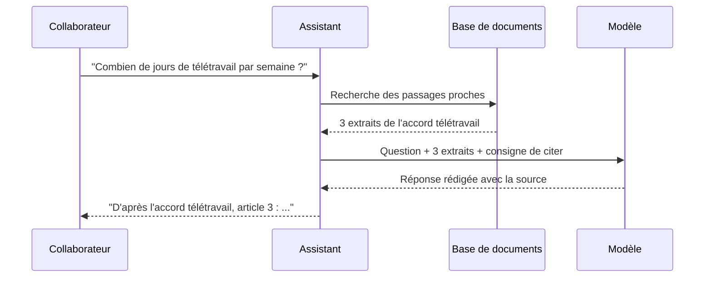
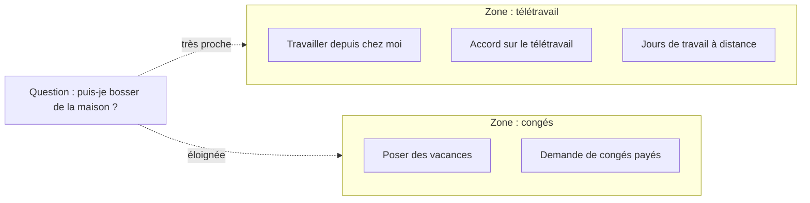

# Embeddings et RAG

> [!NOTE]
> **Dans cette leçon…** vous allez comprendre comment un assistant interne peut répondre à partir **de vos documents** (procédures, contrats, FAQ) grâce au **RAG**, et ce que sont les **embeddings** qui le rendent possible. Aucune formule, promis.

## Le problème à résoudre

Vous voulez un assistant qui réponde aux questions des collaborateurs à partir de **500 documents internes**. Trois options :

| Option | Problème |
| --- | --- |
| Compter sur les connaissances du modèle | Il ne connaît pas vos documents internes |
| Ré-entraîner le modèle sur vos documents | Coûteux, lent, à refaire à chaque mise à jour, et il peut mélanger les versions |
| Coller les 500 documents dans chaque question | Trop gros pour la fenêtre de contexte, ou trop cher et trop lent |

La solution la plus répandue : le **RAG**.

## Le RAG : l'examen à livre ouvert

**RAG** signifie *Retrieval-Augmented Generation* : **génération augmentée par la recherche**. Le principe tient en une phrase : **avant de répondre, on va chercher les quelques passages pertinents dans vos documents, et on les donne au modèle avec la question.**

> [!TIP]
> **Analogie :** un examen à **livre ouvert**. L'étudiant (le modèle) ne connaît pas le cours par cœur, mais un bibliothécaire très rapide lui tend les 3 bonnes pages juste avant chaque question. Il n'a plus qu'à lire et rédiger.



Les bénéfices :

- **Réponses à jour** : on met à jour le document, pas le modèle.
- **Sources citées** : l'utilisateur peut vérifier.
- **Moins d'hallucinations** : le modèle s'appuie sur un texte réel.
- **Droits respectés** (si c'est bien configuré) : on ne cherche que dans les documents auxquels l'utilisateur a accès.

```quiz
question: "Le règlement des notes de frais change. Avec un assistant basé sur le RAG, que faut-il faire ?"
options:
  - "Ré-entraîner le modèle sur le nouveau règlement"
  - "Remplacer l'ancien document par le nouveau dans la base de documents"
  - "Attendre la prochaine version du modèle de l'éditeur"
answer: 1
explanation: "C'est tout l'intérêt du RAG : la connaissance vit dans les documents, pas dans le modèle. On remplace le document (et on retire l'ancien, pour éviter les contradictions), et la recherche trouvera désormais la nouvelle version."
```

## Les embeddings : ranger les textes par le sens

Reste une question : comment le « bibliothécaire » trouve-t-il les bons passages ? Une recherche par mots-clés classique rate beaucoup de choses : si vous cherchez « travailler depuis chez moi » et que le document dit « télétravail », aucun mot ne correspond.

C'est là qu'interviennent les **embeddings** (en français, on parle de **plongements** ou de **représentations vectorielles**). Un embedding transforme un texte en une **liste de nombres** qui représente **son sens**. Deux textes au sens proche obtiennent des listes de nombres proches.

> [!TIP]
> **Analogie :** une **carte** où chaque phrase est une punaise. Les phrases qui parlent de la même chose sont épinglées **les unes à côté des autres**, même si elles n'emploient pas les mêmes mots. Chercher, c'est épingler la question sur la carte et regarder les punaises voisines.



En pratique :

1. **Préparation (une fois)** : on découpe chaque document en petits passages, on calcule l'embedding de chacun, on les range dans une base spécialisée (une « base vectorielle »).
2. **À chaque question** : on calcule l'embedding de la question, on récupère les passages les plus proches, on les donne au modèle.

### Pour les curieux : la proximité en quelques lignes

```python title="proximite.py"
import math

# Embeddings JOUETS en 3 dimensions (les vrais en ont des centaines ou des milliers)
textes = {
    "accord télétravail":        [0.9, 0.1, 0.0],
    "demande de congés payés":   [0.1, 0.9, 0.1],
    "travail à distance":        [0.8, 0.2, 0.1],
}
question = [0.85, 0.15, 0.05]  # "puis-je bosser de la maison ?"

def similarite(a, b):  # similarité cosinus : 1 = même direction, 0 = sans rapport
    produit = sum(x * y for x, y in zip(a, b))
    return produit / (math.hypot(*a) * math.hypot(*b))

for texte, vecteur in sorted(textes.items(), key=lambda t: -similarite(question, t[1])):
    print(f"{similarite(question, vecteur):.2f}  {texte}")
```

> [!WARNING]
> Le RAG ne fait pas de miracle. Si les documents sont **obsolètes, contradictoires ou mal rédigés**, les réponses le seront aussi. Un projet d'assistant interne commence presque toujours par un **ménage documentaire**.

```quiz
question: "Pourquoi les embeddings permettent-ils de trouver « accord télétravail » quand on cherche « travailler de chez moi » ?"
options:
  - "Parce qu'ils comparent les mots lettre par lettre"
  - "Parce qu'ils représentent le sens des textes : deux formulations proches en sens sont proches dans cette représentation"
  - "Parce que le modèle a mémorisé tous les documents de l'entreprise"
answer: 1
explanation: "Les embeddings capturent le sens, pas l'orthographe : c'est ce qui permet une recherche « sémantique ». Une comparaison lettre par lettre échouerait ici, et le modèle n'a pas mémorisé vos documents : c'est la recherche qui les lui fournit."
```

## Exercice : concevoir un mini-RAG sur papier

Le service achats veut un assistant qui répond aux questions des collaborateurs sur la **politique d'achat** (seuils de validation, fournisseurs référencés, procédure de commande). Répondez :

1. Quels documents mettre dans la base ?
2. Quelle consigne donner au modèle (prompt système) ?
3. Quels risques anticiper ?

<details>
<summary>Voir la solution</summary>

1. **Documents :** la politique d'achat en vigueur, la liste des fournisseurs référencés, la procédure de commande, une FAQ des questions fréquentes. **Pas** les anciennes versions (risque de contradiction), ni les contrats fournisseurs confidentiels si tous les collaborateurs n'y ont pas accès.
2. **Consigne possible :**
   > Tu es l'assistant achats. Réponds uniquement à partir des extraits fournis. Cite le document et la section utilisés. Si la réponse n'y figure pas, dis-le et oriente vers l'équipe achats. Ne donne jamais de montant qui ne figure pas dans les extraits.
3. **Risques :** documents périmés (désigner un responsable de mise à jour), droits d'accès (un collaborateur ne doit pas obtenir un extrait d'un document qu'il ne peut pas ouvrir), questions hors périmètre (prévoir l'orientation vers un humain), et injection de prompt via un document piégé.

</details>

## Je sais faire

- [ ] Expliquer le RAG avec l'analogie de l'examen à livre ouvert
- [ ] Dire pourquoi le RAG est souvent préférable au ré-entraînement
- [ ] Expliquer ce qu'est un embedding avec l'analogie de la carte
- [ ] Citer deux conditions pour qu'un assistant documentaire fonctionne bien
