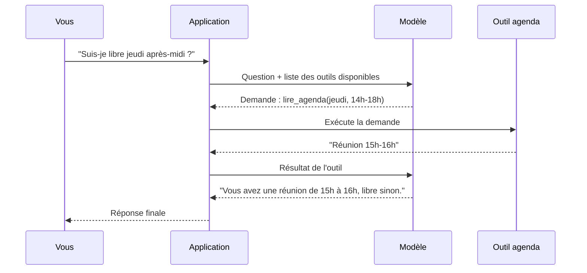
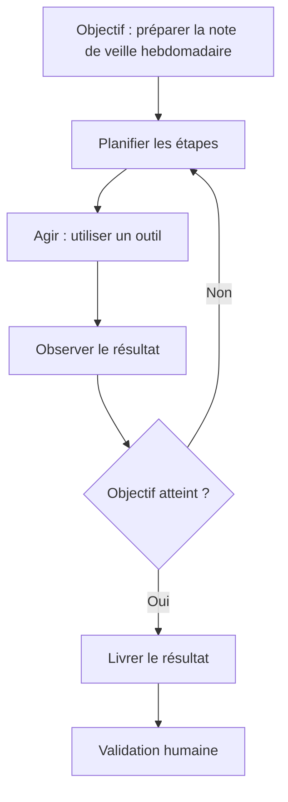

# Outils et agents

> [!NOTE]
> **Dans cette leçon…** vous allez comprendre comment un LLM, qui ne sait que produire du texte, peut **chercher sur le web, lire votre agenda ou envoyer un e-mail** grâce aux **outils**, et ce qu'on appelle un **agent**. Vous saurez aussi quels garde-fous exiger.

## Les outils : donner des mains au cerveau

Un LLM seul ne peut que **lire et écrire du texte**. Il ne peut pas, par lui-même, consulter Internet, ouvrir un fichier ou interroger une base de données.

Un **outil** (*tool*) est une fonction mise à disposition du modèle par l'application : « rechercher sur le web », « lire l'agenda », « calculer », « créer un ticket ». Le modèle ne l'exécute pas lui-même : il **demande** à l'application de l'utiliser, avec des paramètres précis, puis reçoit le résultat.

> [!TIP]
> **Analogie :** un **standardiste** très compétent. Il ne sait pas tout, mais il sait **qui appeler** : la comptabilité pour un solde, le planning pour une disponibilité. Il passe l'appel, écoute la réponse, puis vous la reformule.



Des outils que vous utilisez peut-être déjà sans le savoir :

| Outil | Ce qu'il apporte |
| --- | --- |
| Recherche web | Informations récentes (compense la date de coupure) |
| Exécution de code / calcul | Calculs exacts, graphiques, analyse de tableaux |
| Connecteurs (messagerie, drive, agenda, CRM) | Accès à vos données de travail, selon vos droits |
| Génération d'images | Illustrations |

Un standard ouvert, le **MCP** (*Model Context Protocol*, lancé par Anthropic et adopté depuis par de nombreux acteurs), sert justement à brancher des outils sur des assistants de manière uniforme, un peu comme une prise USB universelle.

```quiz
question: "Quand un assistant « consulte votre agenda », qui exécute réellement la lecture de l'agenda ?"
options:
  - "Le modèle lui-même, qui a appris votre agenda pendant son entraînement"
  - "L'application, qui exécute l'outil à la demande du modèle et lui renvoie le résultat"
  - "Personne, le modèle devine les créneaux probables"
answer: 1
explanation: "Le modèle formule une demande d'outil ; c'est l'application qui l'exécute (avec vos droits d'accès) et lui transmet le résultat. Le modèle n'a jamais appris votre agenda, et s'il devinait, ce serait une hallucination."
```

## Les agents : enchaîner les étapes seul

Un **agent** est un système où le modèle **décide lui-même des étapes** à suivre pour atteindre un objectif, en utilisant des outils plusieurs fois de suite, et en ajustant son plan selon les résultats.



| | Assistant simple | Agent |
| --- | --- | --- |
| Qui décide des étapes ? | Vous, message après message | Le modèle, à partir d'un objectif |
| Nombre d'actions | Une réponse à la fois | Plusieurs actions enchaînées |
| Exemple | « Résume ce document » | « Fais la veille de la semaine sur nos 5 concurrents et prépare une note » |
| Risque | Faible : vous voyez tout | Plus élevé : erreurs qui s'enchaînent, actions réelles |

Des plateformes comme **Gemini Enterprise** côté Google, ou les fonctions d'agents et de connecteurs de **Claude** côté Anthropic, permettent de créer ou d'utiliser des agents branchés sur les outils de l'entreprise.

> [!WARNING]
> Plus un agent peut **agir** (envoyer, payer, supprimer, publier), plus il faut de **garde-fous** :
> - **Moindre privilège** : il n'a accès qu'à ce dont il a besoin, en lecture seule si possible.
> - **Validation humaine** avant toute action irréversible ou externe (envoyer un e-mail à un client, modifier une commande).
> - **Traçabilité** : on garde l'historique de ce qu'il a fait.
> - **Méfiance envers les contenus lus** : une page web ou un e-mail peut contenir des instructions malveillantes (injection de prompt).

```quiz
question: "Un agent doit répondre aux demandes de remboursement des clients. Quel garde-fou est le plus important ?"
options:
  - "Lui donner accès à toutes les données de l'entreprise pour qu'il soit plus pertinent"
  - "Exiger une validation humaine avant tout remboursement effectif"
  - "Utiliser une température très haute pour qu'il soit plus créatif"
answer: 1
explanation: "Un remboursement est une action financière réelle et difficilement réversible : une validation humaine s'impose. Donner accès à toutes les données viole le principe du moindre privilège, et une température haute augmenterait le risque d'écarts."
```

## Exercice : choisir la bonne brique

Pour chaque besoin, indiquez la brique principale : **prompt seul**, **RAG**, **outil**, ou **agent**.

1. Reformuler un message délicat à un collègue.
2. Répondre aux questions des nouveaux arrivants à partir du livret d'accueil et des procédures internes.
3. Connaître la météo de demain à Lille.
4. Chaque lundi, récupérer les tickets de support de la semaine, les classer par thème, rédiger une synthèse et la déposer dans le drive de l'équipe.

<details>
<summary>Voir la solution</summary>

1. **Prompt seul.** Tout ce qu'il faut est dans votre message ; pas besoin de documents ni d'outils.
2. **RAG.** Les réponses doivent venir des documents internes, avec citation des sources. C'est le cas d'usage type de l'**assistant interne**.
3. **Outil** (recherche web ou service météo). Information en temps réel, que le modèle ne peut pas connaître.
4. **Agent.** Plusieurs étapes enchaînées (récupérer, classer, rédiger, déposer) avec plusieurs outils. Garde-fous : accès en lecture seule aux tickets, écriture limitée à un seul dossier, synthèse relue avant diffusion.

Remarquez la progression : on va du plus simple au plus complexe. **Règle :** choisissez toujours la brique la plus simple qui répond au besoin.

</details>

## Je sais faire

- [ ] Expliquer ce qu'est un outil avec l'analogie du standardiste
- [ ] Expliquer la différence entre un assistant et un agent
- [ ] Citer 3 garde-fous indispensables pour un agent
- [ ] Choisir la brique la plus simple adaptée à un besoin
