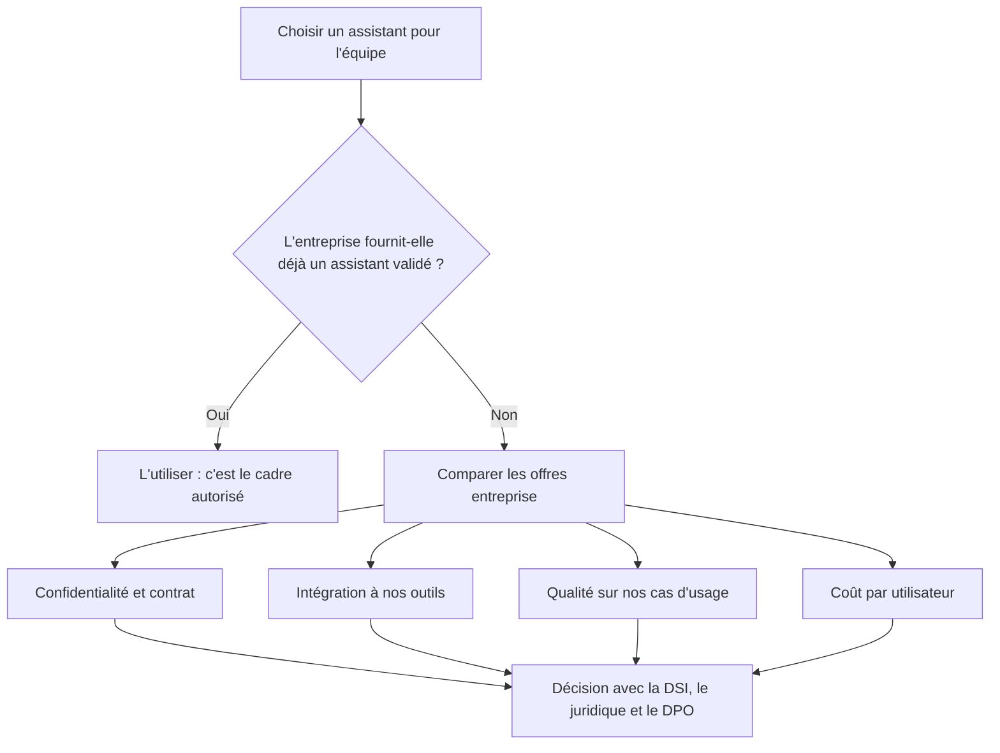

# Les familles de modèles et comment choisir

> [!NOTE]
> **Dans cette leçon…** vous allez découvrir les grandes **familles de modèles** du marché, comprendre la différence entre modèle **propriétaire** et modèle **ouvert**, et repartir avec une **grille de choix** qui ne dépend pas du classement du mois.

## Pourquoi on ne vous donnera pas de classement

Les modèles évoluent **tous les quelques mois**, et chaque nouvelle version dépasse souvent la précédente sur tel ou tel test. Un classement daté de janvier peut être faux en juin. Plutôt que de retenir « le meilleur », retenez **les critères** qui comptent pour votre usage, et testez sur **vos propres exemples**.

## Les grandes familles

| Famille | Éditeur | Type | Où on la trouve | Points souvent mis en avant |
| --- | --- | --- | --- | --- |
| **Claude** | Anthropic (États-Unis) | Propriétaire | Claude.ai, offres équipes et entreprise, API, grands clouds | Rédaction, analyse de longs documents, code, accent sur la sécurité |
| **Gemini** | Google | Propriétaire | Application Gemini, Google Workspace, Gemini Enterprise, Vertex AI | Multimodalité, intégration à l'écosystème Google, très longs contextes |
| **GPT** | OpenAI (États-Unis) | Propriétaire | ChatGPT, API, Microsoft (Copilot, Azure) | Large écosystème, intégration Microsoft |
| **Mistral** | Mistral AI (France) | Propriétaire et ouverts | Le Chat, API, certains modèles téléchargeables | Acteur européen, options d'hébergement maîtrisé |
| **Modèles ouverts** (Llama, Gemma, Mistral, Qwen…) | Divers | Poids ouverts | À installer sur ses propres serveurs ou chez un hébergeur | Contrôle total des données, mais exploitation technique à assurer |

Chaque famille propose une **gamme** : des modèles plus **petits et rapides** et des modèles plus **grands et puissants** (souvent avec un mode raisonnement). Les noms changent régulièrement ; c'est la logique de gamme qui reste.

> [!TIP]
> **Modèle propriétaire ou ouvert ?** Un modèle **propriétaire** est comme un **restaurant** : vous mangez sur place, la cuisine ne vous appartient pas, mais tout est géré pour vous. Un modèle **ouvert** (« open weights ») est comme une **recette** : vous cuisinez chez vous, vous maîtrisez tout… mais il vous faut la cuisine et le cuisinier.

```quiz
question: "Une collègue vous dit : « Gemini est le meilleur, j'ai vu un classement. » Quelle réaction est la plus juste ?"
options:
  - "Adopter Gemini immédiatement pour toutes les tâches"
  - "Retenir que les classements changent vite et tester les assistants disponibles sur nos propres cas d'usage"
  - "Refuser Gemini car un classement n'a aucune valeur"
answer: 1
explanation: "Un classement est une indication utile mais datée, et mesurée sur des tests qui ne ressemblent pas forcément à vos tâches. Le bon réflexe est de comparer sur vos propres exemples, en tenant compte aussi de la confidentialité et de l'intégration avec vos outils."
```

## L'assistant, plus important que le modèle

Pour un usage au quotidien, vous ne choisissez pas seulement un modèle, mais un **assistant** et une **offre**. Ce qui fait la différence :



| Critère | Questions à poser |
| --- | --- |
| **Confidentialité** | Mes données servent-elles à entraîner les modèles ? Où sont-elles stockées ? Combien de temps ? (leçon suivante) |
| **Intégration** | L'assistant se branche-t-il sur notre messagerie, notre drive, nos outils métiers ? |
| **Qualité** | Sur 10 tâches réelles de l'équipe, les résultats sont-ils bons ? |
| **Administration** | Gestion des comptes, des droits, journalisation, authentification d'entreprise ? |
| **Coût** | Prix par utilisateur, limites d'usage, options payantes ? |

Par exemple, une entreprise déjà équipée de Google Workspace regardera naturellement **Gemini Enterprise**, qui se connecte à ses données Google et à d'autres outils ; une autre pourra choisir les offres **Claude** pour équipes ou entreprise, avec ses Projets et connecteurs. Les deux approches sont valables : la bonne dépend de **votre** environnement.

```quiz
question: "Quels critères sont pertinents pour choisir l'assistant d'une équipe ? (plusieurs réponses)"
options:
  - "Les conditions de confidentialité du contrat"
  - "La qualité des résultats sur des tâches réelles de l'équipe"
  - "La popularité de l'assistant sur les réseaux sociaux"
  - "L'intégration avec les outils déjà utilisés"
answer: [0, 1, 3]
explanation: "Confidentialité, qualité mesurée sur vos tâches et intégration sont des critères solides. La popularité ne dit rien de l'adéquation à vos besoins ni du respect de vos contraintes."
```

## Exercice : organiser un mini-test comparatif

Vous devez recommander un assistant pour votre équipe. Préparez un **protocole de test** : combien de tâches, lesquelles, et comment noter les résultats ?

<details>
<summary>Voir la solution</summary>

Un protocole simple et efficace :

1. **Choisir 5 à 10 tâches réelles** et représentatives, par exemple : résumer un compte rendu, rédiger une réponse à un e-mail type, extraire les informations d'un document, reformuler un texte pour un public non expert, brainstormer des idées. Utilisez des **données fictives ou anonymisées** si vous testez un outil non validé par l'entreprise.
2. **Utiliser exactement le même prompt** dans chaque assistant.
3. **Noter avec une grille** commune, par exemple de 1 à 5 :

| Critère | Question |
| --- | --- |
| Exactitude | Y a-t-il des erreurs ou des inventions ? |
| Pertinence | Répond-il vraiment à la demande ? |
| Style | Le ton et le format conviennent-ils ? |
| Effort de correction | Combien de temps pour rendre le résultat utilisable ? |

4. **Faire noter par 2 ou 3 personnes**, sans qu'elles sachent quel assistant a produit quel résultat si possible (test « à l'aveugle »).
5. **Compléter** avec les critères non mesurables par test : confidentialité, intégration, coût, avis de la DSI.

</details>

## Je sais faire

- [ ] Citer les grandes familles de modèles et leurs éditeurs
- [ ] Expliquer la différence entre modèle propriétaire et modèle ouvert
- [ ] Expliquer pourquoi un classement ne suffit pas à choisir
- [ ] Organiser un test comparatif sur des tâches réelles
