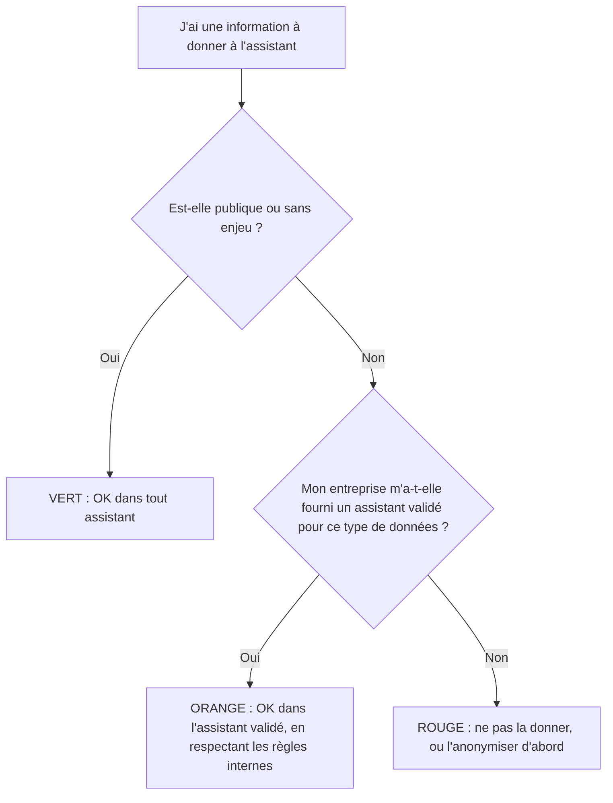

# Confidentialité des données et bonnes pratiques

> [!NOTE]
> **Dans cette leçon…** vous allez apprendre à **classer une information** avant de la confier à un assistant, connaître les questions à poser sur une offre, et adopter **8 bonnes pratiques** d'utilisation au quotidien.

## Que devient ce que je tape ?

Quand vous écrivez dans un assistant, votre texte (et vos fichiers) est **envoyé aux serveurs de l'éditeur** pour être traité. Selon l'offre et ses réglages :

- les conversations peuvent être **conservées** un certain temps ;
- elles peuvent, dans certaines offres grand public, servir à **entraîner de futurs modèles** (souvent désactivable dans les paramètres) ;
- des personnes de l'éditeur peuvent, dans certains cas prévus par les conditions, **examiner** des conversations (par exemple pour la sécurité).

Les **offres entreprise** (comme les offres Claude pour équipes et entreprises, ou Gemini Enterprise) prévoient généralement par contrat que **vos données ne servent pas à entraîner les modèles**, avec des garanties de sécurité et d'administration. **Vérifiez toujours les conditions de l'offre que vous utilisez réellement**, et demandez à votre DSI ou à votre DPO (délégué à la protection des données) en cas de doute.

> [!TIP]
> **Analogie :** utiliser un assistant grand public avec des données de l'entreprise, c'est comme **discuter d'un dossier confidentiel au téléphone dans un train bondé**. Ce n'est pas forcément entendu… mais vous n'en avez aucune garantie. L'offre entreprise, c'est la salle de réunion fermée.

## Le feu tricolore des données



| Couleur | Exemples | Règle |
| --- | --- | --- |
| **Vert** | Texte d'un site public, question de culture générale, modèle d'e-mail sans nom | Tout assistant |
| **Orange** | Compte rendu interne, procédure, document de travail | Uniquement l'assistant validé par l'entreprise |
| **Rouge** | Données personnelles sensibles (santé, salaires nominatifs, évaluations), secrets d'affaires, mots de passe, données clients identifiantes | Jamais dans un outil non validé ; dans l'outil validé seulement si la politique interne l'autorise explicitement |

> [!WARNING]
> **Données personnelles** (nom, e-mail, numéro de téléphone, informations RH…) : le RGPD s'applique. Les traiter avec un outil d'IA doit avoir une base légale, une finalité claire, et passer par les règles fixées par votre entreprise. La CNIL publie des recommandations dédiées à l'IA. Et ne collez **jamais** de mot de passe, clé d'accès ou code d'authentification.

**Anonymiser**, c'est remplacer les éléments identifiants par des repères : « Mme Dupont, 42 ans, en arrêt maladie » devient « [Salariée A] en absence ». Souvent, l'IA n'a pas besoin des vrais noms pour vous aider.

```quiz
question: "Vous voulez de l'aide pour rédiger un courrier délicat à un salarié en arrêt maladie, avec un assistant grand public non validé par l'entreprise. Que faire ?"
options:
  - "Coller tout le dossier du salarié pour que la réponse soit précise"
  - "Décrire la situation de façon anonyme et générique, sans nom ni information de santé, puis compléter vous-même le courrier"
  - "C'est sans risque si vous supprimez la conversation ensuite"
answer: 1
explanation: "Une information de santé liée à une personne est une donnée sensible : elle ne doit pas aller dans un outil non validé. Décrire la situation de façon anonyme suffit pour obtenir un bon modèle de courrier. Supprimer la conversation après coup ne garantit pas que les données n'ont pas été conservées."
```

## 8 bonnes pratiques au quotidien

1. **Utiliser l'outil validé** par l'entreprise pour toute donnée interne.
2. **Briefer comme un prestataire** : rôle, contexte, tâche, format, contraintes (module 3).
3. **Fournir la source** plutôt que demander de mémoire.
4. **Itérer** : la première réponse est un brouillon.
5. **Vérifier ce qui engage** : chiffres, noms, dates, références, tout ce qui part à l'extérieur.
6. **Rester l'auteur** : vous êtes responsable de ce que vous envoyez, même si l'IA l'a rédigé. Relisez avec vos yeux de professionnel.
7. **Être transparent** quand c'est attendu : selon le contexte et les règles internes, signaler qu'un contenu a été produit avec l'aide de l'IA. Le règlement européen sur l'IA prévoit d'ailleurs des obligations de transparence pour certains contenus générés.
8. **Capitaliser** : gardez vos meilleurs prompts dans un document partagé, ou en consignes permanentes (Projets Claude, Gems et agents Gemini).

| À faire | À éviter |
| --- | --- |
| « D'après ce document, … » | « D'après tes connaissances, quel est notre taux de remise ? » |
| Anonymiser les cas individuels | Coller un fichier client complet |
| Relire et corriger avant envoi | Copier-coller la réponse telle quelle |
| Nouvelle conversation pour un nouveau sujet | Une conversation unique de 3 semaines |

```quiz
question: "Un texte rédigé par l'IA et envoyé à un partenaire contient une erreur. Qui en est responsable ?"
options:
  - "L'éditeur de l'IA"
  - "La personne qui l'a envoyé, et l'entreprise au nom de laquelle elle agit"
  - "Personne, c'est une erreur de machine"
answer: 1
explanation: "L'IA est un outil : la responsabilité reste à la personne qui valide et envoie le contenu, dans le cadre de son entreprise. C'est pourquoi la relecture humaine de tout ce qui engage est indispensable."
```

## Exercice : classer 6 informations

Classez chaque information en **vert**, **orange** ou **rouge**, en supposant que votre entreprise vous fournit un assistant validé pour les documents internes.

1. Le communiqué de presse publié hier sur le site de l'entreprise.
2. Le compte rendu de la réunion d'équipe de lundi (sans données personnelles sensibles).
3. Le tableau des salaires nominatifs de l'équipe.
4. Votre mot de passe de messagerie, pour qu'il vous aide à le retenir.
5. Une question : « Comment structurer un plan de formation annuel ? »
6. La liste des clients avec leurs coordonnées, pour rédiger une campagne d'e-mails.

<details>
<summary>Voir la solution</summary>

1. **Vert.** Information déjà publique.
2. **Orange.** Document interne : uniquement dans l'assistant validé.
3. **Rouge.** Données personnelles RH, sensibles. Même dans l'outil validé, seulement si la politique interne l'autorise explicitement ; sinon, anonymiser (« [Poste A] : [montant] »).
4. **Rouge absolu.** Un mot de passe ne se donne à aucun outil, jamais.
5. **Vert.** Question générique, sans donnée de l'entreprise.
6. **Rouge.** Données personnelles de clients. Pour rédiger la campagne, l'IA n'a besoin que d'un **profil type** (« client PME du secteur industriel ») ; la fusion avec les vraies coordonnées se fait ensuite dans votre outil d'e-mailing.

</details>

## Je sais faire

- [ ] Expliquer ce que deviennent les données que je tape dans un assistant
- [ ] Classer une information selon le feu tricolore
- [ ] Anonymiser un cas avant de demander de l'aide
- [ ] Appliquer au moins 5 des 8 bonnes pratiques au quotidien
