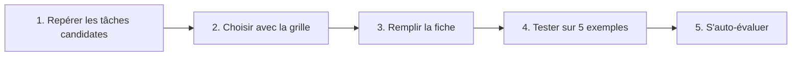

# Projet final : la fiche de votre premier cas d'usage

> [!NOTE]
> **Dans ce projet…** vous allez rédiger une **fiche d'une page** décrivant un premier cas d'usage de l'IA générative dans votre équipe : le problème, la solution envisagée, les données, les risques, la mesure du succès. C'est le document que vous pourrez présenter à votre manager, à la DSI ou au DPO.

## Les étapes



## Étape 1 : repérer les tâches candidates

Listez 5 tâches de votre équipe qui sont **répétitives**, **basées sur du texte**, et **chronophages**. Pistes fréquentes :

| Famille | Exemples |
| --- | --- |
| **Assistant interne** | Répondre aux questions récurrentes sur les procédures, retrouver une information dans la documentation, accueillir les nouveaux arrivants |
| **Génération de contenu** | Premiers jets d'e-mails, de comptes rendus, d'annonces, de fiches produits, de posts, de supports de formation |

## Étape 2 : choisir avec la grille

Notez chaque tâche de 1 (faible) à 3 (fort) :

| Critère | Question | Bon signe |
| --- | --- | --- |
| **Volume** | Combien de fois par semaine ? | Souvent |
| **Adéquation** | Est-ce du langage (résumer, rédiger, classer, retrouver) ? | Oui (module 2) |
| **Vérifiabilité** | Peut-on vérifier le résultat rapidement ? | Oui |
| **Risque** | Que se passe-t-il en cas d'erreur ? | Peu grave, rattrapable |
| **Données** | Les données nécessaires peuvent-elles aller dans l'outil validé ? | Oui (module 4) |

> [!TIP]
> Pour un **premier** cas d'usage, choisissez la tâche **la moins risquée** parmi celles qui ont un bon score, pas la plus spectaculaire. Un petit succès visible vaut mieux qu'un grand projet qui s'enlise.

```quiz
question: "Pour un premier cas d'usage, laquelle de ces tâches est la plus adaptée ?"
options:
  - "Décider automatiquement de l'attribution des primes annuelles"
  - "Proposer un premier jet de compte rendu à partir des notes de réunion, relu par l'organisateur"
  - "Répondre seul, sans relecture, aux réclamations juridiques des clients"
answer: 1
explanation: "Le compte rendu est fréquent, basé sur du texte fourni, facile à vérifier, et une erreur est rattrapée à la relecture. Les primes et les réclamations juridiques sont des sujets à fort enjeu qui exigent une décision humaine."
```

## Étape 3 : remplir la fiche

Copiez ce modèle dans votre outil de traitement de texte et remplissez chaque rubrique.

```markdown title="fiche-cas-usage.md"
# Fiche cas d'usage : [titre court]

**Équipe :** ...            **Porteur :** ...            **Date :** ...

## 1. Le problème
Quelle tâche ? Qui la fait ? Combien de fois ? Combien de temps (estimation) ?

## 2. La solution envisagée
Ce que fera l'IA, ce que fera l'humain.
Brique(s) : prompt seul / RAG / outil / agent (choisir la plus simple).
Assistant utilisé : [assistant validé par l'entreprise].

## 3. Les données
Quelles données entrent ? Couleur (vert / orange / rouge) ? Anonymisation nécessaire ?

## 4. Le prompt de départ
Rôle, contexte, tâche, format, contraintes.

## 5. Les risques et garde-fous
Hallucination, confidentialité, erreur envoyée à l'extérieur... et la parade pour chacun.

## 6. La mesure du succès
Indicateur(s) avant / après, durée du test, qui décide de continuer.

## 7. Les prochaines étapes
Test sur 5 exemples, avis DSI / DPO, pilote de 4 semaines...
```

> [!WARNING]
> Ne donnez **pas** de gains chiffrés comme des certitudes (« on gagnera 40 % de temps »). Écrivez une **hypothèse à vérifier** (« nous estimons, à vérifier pendant le pilote, un gain de l'ordre de… ») et prévoyez comment la mesurer.

## Étape 4 : tester sur 5 exemples

Avant de présenter la fiche, testez votre prompt sur **5 cas réels** (anonymisés si nécessaire) dans l'assistant validé. Notez pour chacun : résultat utilisable tel quel, avec retouches, ou inutilisable. Ajoutez ces résultats à la rubrique 6.

```quiz
question: "Quels éléments rendent la rubrique « Mesure du succès » crédible ? (plusieurs réponses)"
options:
  - "Un indicateur mesuré avant et après (temps passé, nombre de retouches...)"
  - "Une promesse de gain chiffrée sans test"
  - "Une durée de pilote définie et une personne qui décide de la suite"
  - "Les résultats d'un premier test sur quelques exemples réels"
answer: [0, 2, 3]
explanation: "Un indicateur avant/après, un cadre de pilote clair et des premiers résultats concrets rendent la fiche crédible. Une promesse chiffrée sans test est exactement ce qu'il faut éviter : c'est un chiffre inventé."
```

## Exemple de fiche complétée

<details>
<summary>Voir la solution</summary>

**Fiche cas d'usage : premier jet des comptes rendus de réunion**

**Équipe :** Service achats (8 personnes) · **Porteur :** responsable du service · **Date :** octobre

**1. Le problème.** Chaque semaine, l'équipe tient plusieurs réunions fournisseurs. Le compte rendu est rédigé à partir de notes manuscrites ou tapées, ce qui prend du temps et retarde souvent sa diffusion de plusieurs jours.

**2. La solution envisagée.** L'organisateur colle ses notes dans l'assistant validé par l'entreprise ; l'IA produit un compte rendu structuré (participants, décisions, actions, échéances). L'organisateur relit, corrige et diffuse. **Brique :** prompt seul, enregistré en consignes permanentes (Projet Claude ou Gem Gemini selon l'outil de l'entreprise).

**3. Les données.** Notes de réunion internes : **orange** (assistant validé uniquement). Les prix négociés confidentiels sont remplacés par « [prix] » avant de coller les notes.

**4. Le prompt de départ.**
> Tu es assistant du service achats. À partir des notes ci-dessous, rédige un compte rendu de réunion fournisseur. Format : Participants, Contexte (2 lignes), Décisions, Actions (tableau : action, responsable, échéance), Points ouverts. N'invente aucune information absente des notes ; si une échéance ou un responsable manque, écris « à préciser ». Notes : """..."""

**5. Les risques et garde-fous.**

| Risque | Garde-fou |
| --- | --- |
| Action ou échéance inventée | Consigne « à préciser » + relecture obligatoire par l'organisateur |
| Fuite de données confidentielles | Assistant validé uniquement, prix masqués |
| Envoi sans relecture | Règle d'équipe : aucun compte rendu diffusé sans relecture |

**6. La mesure du succès.** Indicateurs : délai entre réunion et diffusion, temps de rédaction déclaré, nombre de retouches. Premier test sur 5 réunions passées : 3 utilisables avec retouches légères, 1 avec retouches importantes (notes trop elliptiques), 1 inutilisable (notes illisibles). Pilote de 4 semaines ; décision par le responsable du service.

**7. Les prochaines étapes.** Validation de l'usage par la DSI ; pilote avec 3 volontaires ; bilan à 4 semaines ; si positif, partage du prompt à toute l'équipe.

</details>

## Grille d'auto-évaluation

Relisez votre fiche et cochez chaque critère rempli. **Objectif : au moins 10 sur 12** avant de la présenter.

- [ ] Le problème est décrit avec une tâche précise, des personnes et une fréquence
- [ ] La tâche relève d'un point fort des LLM (résumer, rédiger, classer, retrouver, reformuler)
- [ ] La brique choisie est la plus simple possible (prompt, RAG, outil ou agent)
- [ ] Le partage des rôles IA / humain est explicite
- [ ] Les données sont listées et classées (vert, orange, rouge)
- [ ] Les données personnelles ou confidentielles sont anonymisées ou exclues
- [ ] L'assistant utilisé est celui validé par l'entreprise
- [ ] Le prompt contient rôle, contexte, tâche, format et contraintes
- [ ] Le prompt autorise le « je ne sais pas » ou le « à préciser »
- [ ] Chaque risque identifié a un garde-fou, dont une relecture humaine de ce qui engage
- [ ] Aucun gain n'est présenté comme certain : ce sont des hypothèses avec une mesure prévue
- [ ] Le prompt a été testé sur au moins 5 exemples réels et les résultats sont notés

## Je sais faire

- [ ] Repérer des tâches candidates à l'IA dans mon équipe
- [ ] Choisir un premier cas d'usage peu risqué avec une grille
- [ ] Rédiger une fiche de cas d'usage complète
- [ ] Présenter des gains comme des hypothèses à mesurer
