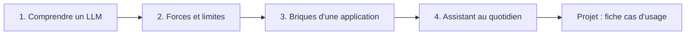

Vous entendez parler d'IA générative tous les jours, vos collègues utilisent déjà ChatGPT, Claude ou Gemini, et vous aimeriez **comprendre ce qui se passe vraiment** derrière l'écran, sans équations ni jargon. Cette formation est faite pour vous.

## Pour qui ?

- **Managers** qui doivent décider où (et où ne pas) utiliser l'IA dans leur équipe.
- **Métiers** (RH, juridique, marketing, finance, support, achats…) qui veulent gagner du temps sans prendre de risque.
- **Curieux** qui veulent enfin une explication claire.

Aucune compétence technique n'est requise. Chaque mot technique est expliqué la première fois qu'il apparaît, avec une analogie de la vie courante.

## Objectifs mesurables

À la fin de la formation, vous serez capable de :

1. **Expliquer en 2 minutes** à un collègue ce qu'est un LLM, un token et une fenêtre de contexte.
2. **Repérer** au moins 3 situations où une réponse d'IA doit être vérifiée (hallucination, information récente, calcul).
3. **Distinguer** prompt, RAG, outils et agents, et dire lequel répond à un besoin donné.
4. **Classer** une information de votre équipe en « je peux la donner à un assistant » ou « je ne dois pas ».
5. **Rédiger** la fiche d'un premier cas d'usage réaliste, prête à être présentée à votre hiérarchie.

## Prérequis

- Savoir utiliser un navigateur web.
- Idéalement, avoir accès à un assistant (Claude, Gemini, ou celui fourni par votre entreprise) pour faire les exercices. Ce n'est pas obligatoire : chaque exercice a une solution détaillée.

## Programme

| Module | Leçons | Durée indicative |
| --- | --- | --- |
| 1. Comprendre ce qu'est un LLM | Tokens et prédiction du mot suivant · Comment un modèle apprend · Fenêtre de contexte et température | 1h30 |
| 2. Ce que l'IA sait et ne sait pas faire | Hallucinations et connaissances figées · Raisonnement et multimodalité · Coûts et latence | 1h30 |
| 3. Les briques d'une application IA | Le prompt · Embeddings et RAG · Outils et agents | 1h30 |
| 4. Choisir et utiliser un assistant | Les familles de modèles · Confidentialité et bonnes pratiques | 45 min |
| 5. Projet final | Rédiger la fiche d'un premier cas d'usage | 45 min |

## Comment ça se passe

Chaque leçon contient :

- un objectif clair en début de page ;
- des schémas pour visualiser ;
- des **quiz** pour vérifier que vous avez compris (vous pouvez vous tromper, l'explication s'affiche) ;
- un **exercice pratique** avec sa solution cachée ;
- une checklist « Je sais faire » à cocher : votre progression est sauvegardée.

## Ce que vous saurez faire

À la fin, vous ne serez pas ingénieur en IA, et ce n'est pas le but. Vous saurez **poser les bonnes questions** : « cette tâche est-elle adaptée à l'IA ? », « quelles données ai-je le droit d'utiliser ? », « comment vérifier le résultat ? ». Et vous repartirez avec une **fiche de cas d'usage** concrète pour votre équipe, autour d'un assistant interne ou de la génération de contenu.
