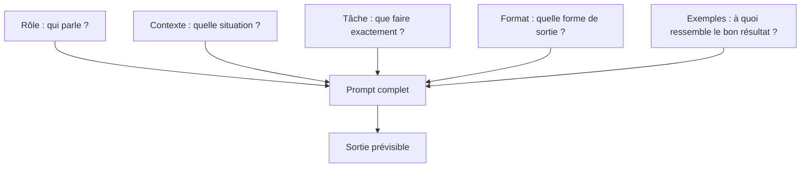

> [!NOTE]
> Dans cette leçon, vous apprenez à décomposer un prompt en cinq briques (rôle, contexte, tâche, format, exemples), à repérer celle qui manque, et à appeler un modèle depuis Python sans jamais écrire de clé dans le code.

## Le modèle ne lit pas dans vos pensées

Un LLM ne connaît ni votre entreprise, ni votre client, ni ce que vous entendez par « court ». Tout ce qui n'est pas écrit dans le prompt est **deviné**, et deviner, c'est varier d'un appel à l'autre. Le test le plus simple : *un collègue brillant, qui arrive aujourd'hui, comprendrait-il la demande sans vous poser de question ?*



| Composant | Question à laquelle il répond | Exemple |
|---|---|---|
| **Rôle** | Avec quelle expertise et quel ton ? | « Tu es conseiller du service client d'une boutique de vélos. » |
| **Contexte** | Que faut-il savoir pour bien répondre ? | Politique de retour, profil du client, historique de la conversation |
| **Tâche** | Quelle action précise, avec quels critères de réussite ? | « Rédige une réponse qui propose un échange ou un avoir. » |
| **Format** | Quelle forme, quelle longueur, quelle langue ? | « 3 phrases maximum, vouvoiement, pas de liste. » |
| **Exemples** | À quoi ressemble une bonne réponse ? | Une ou deux réponses modèles |

## Avant / après

| Avant (vague) | Après (structuré) |
|---|---|
| « Écris un mail pour le client mécontent. » | « Tu es responsable du service client d'une boutique en ligne de vélos. **Contexte** : le client a reçu un vélo avec la roue voilée ; notre politique permet un échange sous 30 jours. **Tâche** : rédige un mail d'excuse qui propose l'échange et un bon d'enlèvement gratuit. **Format** : 120 mots maximum, vouvoiement, signature « L'équipe Service client ». » |
| « Résume ce document. » | « Résume ce compte rendu de réunion pour un directeur qui n'y était pas. Garde uniquement les décisions et les actions (qui, quoi, quand). Format : liste à puces, 8 lignes maximum. » |
| « Fais un post LinkedIn sur notre nouveau produit. » | « Rôle : rédacteur B2B. Public : responsables logistique de PME. Tâche : annoncer le lancement de notre module de suivi de colis en mettant en avant le gain de temps. Format : 5 lignes, une question finale pour susciter des commentaires, aucun emoji. » |

> [!TIP]
> Les instructions **positives** marchent mieux que les interdictions. « Réponds en trois phrases » est plus fiable que « ne sois pas trop long ».

```quiz
question: "Un prompt produit des réponses de longueur très variable d'un appel à l'autre. Quel composant manque le plus probablement ?"
options:
  - "Le rôle"
  - "Le format"
  - "Le contexte"
answer: 1
explanation: "La longueur est une contrainte de format. Sans elle, le modèle choisit librement à chaque appel. Le rôle et le contexte influencent le ton et le fond, pas directement la longueur."
```

## Instructions claires : être précis sans être bavard

Trois règles couvrent l'essentiel :

1. **Dire le pourquoi.** « Réponds sans jargon, car le lecteur est un particulier » aide le modèle à généraliser à des cas que vous n'avez pas prévus.
2. **Numéroter les étapes** quand l'ordre compte.
3. **Définir les mots flous** : « court » = 3 phrases ; « urgent » = livraison prévue dans moins de 24 h.

| Formulation floue | Formulation précise |
|---|---|
| « Sois professionnel. » | « Vouvoiement, pas d'emoji, pas d'humour. » |
| « Donne les points importants. » | « Donne les 3 risques principaux, chacun en une phrase. » |
| « Si c'est grave, préviens. » | « Si le client mentionne une blessure ou un avocat, réponds uniquement : ESCALADE. » |

```quiz
question: "Quelles reformulations rendent la consigne « réponds rapidement au client » plus précise ? (plusieurs réponses)"
options:
  - "« Réponds en 2 phrases maximum. »"
  - "« Réponds de manière efficace. »"
  - "« Donne la réponse dans la première phrase, puis une seule phrase de contexte. »"
  - "« Sois concis et pertinent. »"
answer: [0, 2]
explanation: "Les options A et C sont vérifiables : on peut compter les phrases et contrôler l'ordre. « Efficace », « concis » et « pertinent » restent des mots flous que le modèle interprète à sa façon."
```

## Appeler un modèle depuis Python (sans clé en dur)

Le même prompt peut être envoyé à Claude ou à Gemini. La clé d'API vient **toujours** d'une variable d'environnement, et le nom du modèle aussi : vous changez de modèle sans toucher au code.

```python title="llm.py"
import os

def appeler(system: str, user: str, max_tokens: int = 800) -> str:
    """Appel générique : LLM_PROVIDER=claude ou gemini, LLM_MODEL=<nom du modèle>."""
    provider = os.environ.get("LLM_PROVIDER", "claude")
    model = os.environ["LLM_MODEL"]
    if provider == "claude":
        import anthropic  # lit ANTHROPIC_API_KEY dans l'environnement
        r = anthropic.Anthropic().messages.create(
            model=model, max_tokens=max_tokens, system=system,
            messages=[{"role": "user", "content": user}],
        )
        return r.content[0].text
    from google import genai  # lit GEMINI_API_KEY (ou GOOGLE_API_KEY)
    from google.genai import types
    r = genai.Client().models.generate_content(
        model=model, contents=user,
        config=types.GenerateContentConfig(system_instruction=system, max_output_tokens=max_tokens),
    )
    return r.text
```

```bash
export LLM_PROVIDER=claude
export LLM_MODEL="<nom du modèle, voir la documentation du fournisseur>"
export ANTHROPIC_API_KEY="..."   # à mettre dans un .env ignoré par git, jamais dans le code
```

> [!WARNING]
> Une clé collée dans un notebook ou un script finit tôt ou tard dans un dépôt git ou une capture d'écran. Variable d'environnement ou gestionnaire de secrets, sans exception.

## Exercice

Réécrivez ce prompt en faisant apparaître les cinq composants :

> « Réponds à ce client qui demande où est sa commande. »

Informations disponibles : boutique de cosmétiques en ligne, commande n° 4512 expédiée hier, livraison en 48 à 72 h, lien de suivi fourni par le transporteur.

<details>
<summary>Voir la solution</summary>

```text
[Rôle] Tu es conseillère du service client d'une boutique en ligne de cosmétiques. Ton ton est chaleureux et professionnel.

[Contexte] La commande n° 4512 du client a été expédiée hier. Le délai de livraison habituel est de 48 à 72 h. Lien de suivi : {lien_suivi}.

[Tâche] Réponds au message du client : rassure-le, donne la date de livraison estimée et le lien de suivi. Ne promets pas de date précise : le délai dépend du transporteur.

[Format] 3 phrases maximum, vouvoiement, en français, signature « L'équipe Service client ».

[Exemple de ton] « Bonne nouvelle : votre commande est en route ! »
```

Points clés : la tâche dit **ce qu'il ne faut pas promettre** (et pourquoi), le format est vérifiable, la variable `{lien_suivi}` prépare le passage au gabarit (module 3).

</details>

## Je sais faire

- [ ] Citer les cinq composants d'un prompt et le rôle de chacun.
- [ ] Repérer le composant manquant dans un prompt vague.
- [ ] Remplacer un mot flou par une contrainte vérifiable.
- [ ] Appeler Claude ou Gemini depuis Python avec la clé en variable d'environnement.
