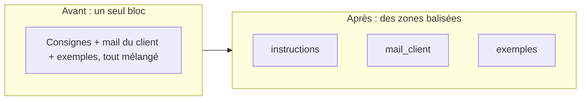

> [!NOTE]
> Dans cette leçon, vous apprenez à séparer clairement les **instructions** des **données** (mails, documents, messages de clients) avec des balises XML ou des délimiteurs, et à demander une sortie elle-même balisée, facile à extraire par du code.

## Le problème : instructions et données mélangées

Quand vous collez un mail de client au milieu de vos consignes, le modèle doit deviner où s'arrête votre texte et où commence celui du client. Si le mail contient « réponds en anglais » ou « ignore ce qui précède », la confusion devient un risque (on y reviendra avec l'injection de prompt au module 4).



## Les balises XML, simplement

Il n'existe pas de « balises officielles » : choisissez des noms parlants et restez cohérent. Claude est entraîné à bien exploiter cette structure ; Gemini et les autres modèles en profitent aussi.

| Avant | Après |
|---|---|
| `Voici le mail : Bonjour, je n'ai pas reçu mon colis... Réponds poliment et propose un remboursement.` | `<mail_client>Bonjour, je n'ai pas reçu mon colis...</mail_client>` puis : `Réponds au mail contenu dans <mail_client> : ton poli, proposition de remboursement.` |
| `Compare ces deux contrats : [contrat A] [contrat B]` | `<contrat_a>...</contrat_a>` `<contrat_b>...</contrat_b>` puis : `Liste les différences de durée et de résiliation entre <contrat_a> et <contrat_b>.` |
| `Résume ces 3 avis clients : ...` | `<avis id="1">...</avis>` `<avis id="2">...</avis>` `<avis id="3">...</avis>` puis : `Pour chaque avis, cite son id.` |

```text title="prompt-balise.txt"
<politique_retour>
Retours acceptés sous 30 jours, produit non utilisé, frais de retour offerts.
</politique_retour>

<message_client>
{message}
</message_client>

Réponds au message contenu dans <message_client> en appliquant uniquement
<politique_retour>. Écris ta réponse dans des balises <reponse>.
```

> [!TIP]
> Mettez les **longs documents en haut** du prompt et la question **à la fin**. Avec beaucoup de contexte, cela améliore en général la qualité de la réponse.

```quiz
question: "Pourquoi entourer le message d'un client par des balises `<message_client>` ?"
options:
  - "Parce que les modèles refusent le texte non balisé"
  - "Pour que le modèle distingue clairement les données à traiter des instructions à suivre"
  - "Pour réduire le nombre de tokens"
answer: 1
explanation: "Les balises délimitent ce qui est une donnée. Le modèle accepte très bien le texte libre, et les balises ajoutent quelques tokens au lieu d'en retirer."
```

## Autres délimiteurs

| Délimiteur | Quand l'utiliser | Limite |
|---|---|---|
| Balises XML `<doc>...</doc>` | Plusieurs blocs, sortie à extraire par code | Aucune, c'est le choix par défaut |
| Triple guillemets `"""..."""` | Un seul texte court | Ambigu si le texte contient lui-même des guillemets |
| Titres Markdown `## Contexte` | Prompts système longs, lisibles par des humains | Moins net pour extraire une sortie |
| Blocs de code ```` ``` ```` | Code source ou JSON en entrée | À réserver au code |

## Baliser aussi la sortie

Demander `<reponse>...</reponse>` ou `<analyse>` puis `<reponse>` permet à votre code de récupérer uniquement la partie utile :

```python title="extraire.py"
import re

def extraire(balise: str, texte: str) -> str | None:
    m = re.search(rf"<{balise}>(.*?)</{balise}>", texte, re.S)
    return m.group(1).strip() if m else None

sortie = "<analyse>Client calme, demande simple.</analyse><reponse>Bonjour, ...</reponse>"
assert extraire("reponse", sortie) == "Bonjour, ..."
assert extraire("absent", sortie) is None
```

> [!WARNING]
> Si la balise est absente, ne publiez pas la sortie brute au client : traitez-la comme une erreur (nouvel essai ou passage à un humain).

```quiz
question: "Vous avez 40 pages de conditions générales et une question précise. Quel ordre est recommandé ?"
options:
  - "La question d'abord, puis les 40 pages"
  - "Les 40 pages balisées d'abord, puis la question et les consignes à la fin"
  - "L'ordre n'a aucune importance"
answer: 1
explanation: "Avec un long contexte, placer le document en haut et la question à la fin donne en général de meilleurs résultats : la demande est la dernière chose lue avant de répondre."
```

## Exercice

Restructurez ce prompt avec des balises, de façon à pouvoir extraire automatiquement la catégorie et la réponse :

> « Voici un message d'un client : "Bonjour, ma facture de septembre est fausse, on m'a facturé deux fois." Dis-moi de quelle catégorie il s'agit parmi livraison, facturation, produit, et rédige une réponse. »

<details>
<summary>Voir la solution</summary>

```text
<categories>livraison, facturation, produit</categories>

<message_client>
Bonjour, ma facture de septembre est fausse, on m'a facturé deux fois.
</message_client>

1. Classe le message de <message_client> dans une seule des <categories>.
2. Rédige une réponse de 3 phrases maximum, vouvoiement.

Réponds exactement dans ce format :
<categorie>...</categorie>
<reponse>...</reponse>
```

Avec `extraire("categorie", sortie)` vous obtenez `facturation`, que votre code peut router vers la bonne équipe.

</details>

## Je sais faire

- [ ] Séparer instructions et données avec des balises XML.
- [ ] Placer un long document avant la question.
- [ ] Demander une sortie balisée et l'extraire en Python.
- [ ] Traiter l'absence de balise comme une erreur.
