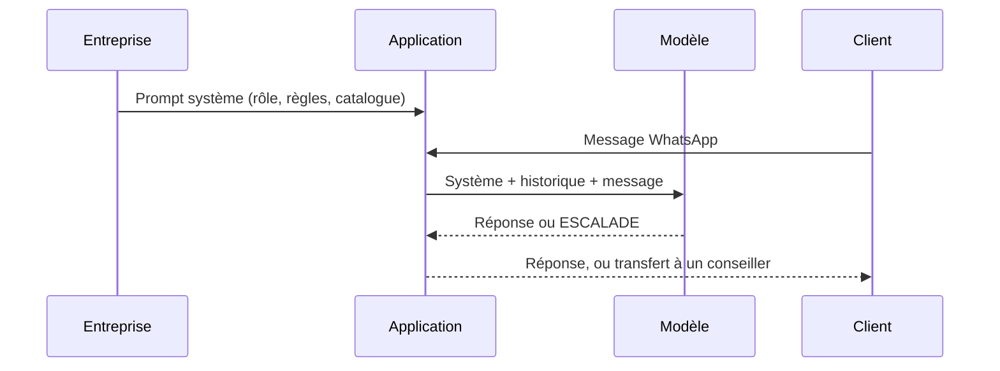

> [!NOTE]
> Dans cette leçon, vous apprenez à répartir les consignes entre **prompt système** (stable, fixé par l'entreprise) et **message utilisateur** (variable, à chaque échange), en prenant l'exemple d'un assistant de service client sur WhatsApp comme Watpilot.

## Deux étages, deux responsabilités



| | Prompt système | Message utilisateur |
|---|---|---|
| **Qui l'écrit ?** | L'équipe qui conçoit l'assistant | Le client final, ou votre code |
| **Fréquence de changement** | Rare, versionné | À chaque appel |
| **Contenu typique** | Rôle, ton, règles, limites, procédure d'escalade, format | La question, le document à traiter, les variables du moment |
| **Confiance** | Élevée | **Faible** : peut contenir n'importe quoi |

> [!IMPORTANT]
> Le prompt système n'est pas un coffre-fort. Considérez qu'un client motivé finira par en obtenir le contenu : n'y mettez **ni secret, ni clé, ni donnée personnelle**.

## Exemple : le prompt système d'un assistant WhatsApp

Watpilot est un assistant IA pour WhatsApp, basé sur Gemini, qui répond aux clients d'une entreprise, prend des commandes et passe la main à un humain quand il le faut. Voici le type de prompt système qu'on écrit pour ce genre d'assistant (entreprise fictive) :

```text title="systeme-boulangerie.txt"
Tu es l'assistant WhatsApp de la boulangerie « Au Bon Levain » (entreprise fictive).

## Ta mission
- Répondre aux questions sur les horaires, les produits et les prix du <catalogue>.
- Prendre les commandes à retirer en boutique.
- Passer la main à un conseiller humain quand la règle d'escalade s'applique.

## Ton style
- Tutoiement interdit : vouvoiement, phrases courtes, adaptées au mobile.
- 3 phrases maximum par message. Pas de liste de plus de 4 éléments.
- Réponds dans la langue du client (français, anglais ou arabe).

## Règles
- N'invente jamais un produit, un prix ou un horaire absent du <catalogue>.
  Si l'information manque, dis-le et propose un conseiller.
- Pour une commande, récupère : produits et quantités, jour et heure de retrait, prénom.
  Récapitule la commande et demande une confirmation explicite (« oui »).
- Ne demande jamais de numéro de carte bancaire.

## Escalade
Si le client se plaint d'un problème de santé (allergie, intoxication), est en colère
après deux messages, ou demande un humain : réponds exactement
« Je vous mets en relation avec un conseiller. » puis ajoute la ligne [ESCALADE].

<catalogue>
{catalogue}
</catalogue>
```

Le message utilisateur, lui, est simplement ce que le client a tapé, plus l'historique de la conversation.

```quiz
question: "Où placer la règle « n'invente jamais un prix absent du catalogue » ?"
options:
  - "Dans le prompt système"
  - "Dans chaque message du client"
  - "Nulle part, le modèle le sait déjà"
answer: 0
explanation: "C'est une règle stable, décidée par l'entreprise : elle va dans le prompt système. Le message utilisateur est écrit par le client et change à chaque échange ; et le modèle n'a aucun moyen de savoir quels prix sont les vôtres."
```

## Avant / après : un prompt système trop vague

| Avant | Après |
|---|---|
| « Tu es un assistant sympa qui aide les clients. » | Rôle précis, mission en 3 points, style mesurable (« 3 phrases max »), règles avec leur raison, procédure d'escalade avec texte exact |
| « Ne dis pas de bêtises. » | « Si l'information est absente du catalogue, dis-le et propose un conseiller. » |
| « Sois prudent avec les plaintes. » | « Allergie, intoxication, colère répétée ou demande d'un humain : réponds exactement "…" puis [ESCALADE]. » |

> [!TIP]
> Un **marqueur exact** comme `[ESCALADE]` est facile à détecter par le code de l'application (`if "[ESCALADE]" in reponse`). Une consigne du type « préviens si besoin » ne l'est pas.

```quiz
question: "Quelles informations ne doivent PAS figurer dans un prompt système ? (plusieurs réponses)"
options:
  - "Une clé d'API de paiement"
  - "Les horaires d'ouverture"
  - "Le numéro de téléphone personnel du gérant"
  - "La procédure d'escalade"
answer: [0, 2]
explanation: "Le prompt système peut fuiter : pas de secret ni de donnée personnelle. Horaires et procédure d'escalade sont précisément son rôle."
```

## En Python

Avec la fonction `appeler(system, user)` de la leçon 1 :

```python title="assistant.py"
from llm import appeler

SYSTEME = open("systeme-boulangerie.txt", encoding="utf-8").read()
CATALOGUE = "Baguette : 1,20 EUR. Croissant : 1,10 EUR. Ouvert du mardi au dimanche, 7h-19h."

reponse = appeler(SYSTEME.replace("{catalogue}", CATALOGUE), "Vous avez des macarons ?")
if "[ESCALADE]" in reponse:
    print("-> transfert à un conseiller")
else:
    print(reponse)
```

## Exercice

Une agence de location de voitures veut un assistant WhatsApp. Écrivez son prompt système (15 lignes maximum) : mission, style, deux règles, escalade. Ensuite, dites ce qui ira dans le message utilisateur.

<details>
<summary>Voir la solution</summary>

```text
Tu es l'assistant WhatsApp de l'agence « Roule Malin » (fictive).
Mission : renseigner sur les véhicules et tarifs de <tarifs>, pré-réserver un véhicule,
passer la main à un conseiller si nécessaire.
Style : vouvoiement, 3 phrases maximum, langue du client.
Règles :
- N'annonce que les tarifs présents dans <tarifs> ; sinon, propose un conseiller.
- Pour une pré-réservation, collecte : dates, catégorie de véhicule, prénom. Récapitule et
  demande « oui » pour confirmer. Précise que le permis sera vérifié en agence.
Escalade : accident, sinistre, litige sur une caution ou demande d'un humain →
« Je vous mets en relation avec un conseiller. » puis [ESCALADE].
<tarifs>{tarifs}</tarifs>
```

Message utilisateur : le texte du client, l'historique de la conversation et, si votre application le connaît, le contexte du moment (« le client a une réservation en cours du 12 au 15 »).

</details>

## Je sais faire

- [ ] Dire ce qui relève du prompt système et du message utilisateur.
- [ ] Écrire un prompt système de service client avec mission, style, règles et escalade.
- [ ] Prévoir un marqueur exact détectable par le code.
- [ ] Ne mettre aucun secret dans un prompt système.
