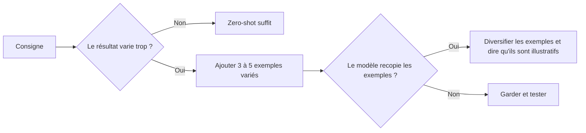

> [!NOTE]
> Dans cette leçon, vous apprenez à utiliser des exemples (*few-shot*) pour montrer au modèle ce que vous attendez, à les choisir pour couvrir les cas limites, et à éviter qu'il ne les recopie mot pour mot.

## Montrer plutôt que décrire

Décrire un ton (« chaleureux mais pro ») est difficile ; en montrer deux exemples est immédiat. C'est l'idée popularisée par l'article GPT-3 (*Language Models are Few-Shot Learners*, 2020) : quelques démonstrations dans le prompt suffisent souvent à fixer une tâche.

| Terme | Ce que contient le prompt | Usage typique |
|---|---|---|
| **Zero-shot** | La consigne seule | Tâches simples et courantes |
| **One-shot** | Consigne + 1 exemple | Fixer un format |
| **Few-shot** | Consigne + 3 à 5 exemples variés | Fixer un ton, une classification, des cas limites |



## Avant / après : classifier des messages

| Avant (zero-shot) | Après (few-shot) |
|---|---|
| « Classe ce message en : livraison, facturation, produit, autre. » Résultat : parfois « Livraison », parfois « problème de livraison », parfois une phrase entière. | Même consigne + 4 exemples balisés montrant **exactement** la sortie attendue (un mot en minuscules), dont un cas ambigu et un cas « autre ». |

```text title="classif-few-shot.txt"
Classe le message dans une seule catégorie : livraison, facturation, produit, autre.
Réponds par la catégorie seule, en minuscules.

<exemples>
<exemple>
<message>Mon colis est marqué livré mais je n'ai rien reçu.</message>
<categorie>livraison</categorie>
</exemple>
<exemple>
<message>On m'a prélevé deux fois pour la même commande.</message>
<categorie>facturation</categorie>
</exemple>
<exemple>
<message>La crème a changé d'odeur après une semaine, et je veux être remboursée.</message>
<categorie>produit</categorie>
</exemple>
<exemple>
<message>Vous recrutez des vendeurs pour l'été ?</message>
<categorie>autre</categorie>
</exemple>
</exemples>

<message>{message}</message>
```

> [!TIP]
> Le troisième exemple est volontairement **ambigu** (produit + remboursement) : il montre la règle de priorité (la cause, pas la demande). Les cas limites sont les exemples les plus utiles.

```quiz
question: "Vos 4 exemples de réponses client commencent tous par « Bonjour et merci pour votre message ». Que risque-t-il de se passer ?"
options:
  - "Rien, le modèle comprend que c'est une coïncidence"
  - "Le modèle reproduira cette formule dans presque toutes ses réponses"
  - "Le modèle refusera de répondre"
answer: 1
explanation: "Les modèles imitent fortement les régularités des exemples. Si tous partagent la même formule, elle devient de fait une consigne. Diversifiez les exemples sur ce qui doit varier."
```

## Bien choisir ses exemples

| Bonne pratique | Pourquoi |
|---|---|
| 3 à 5 exemples, pas 30 | Au-delà, le gain diminue et le coût augmente (module 3) |
| Varier longueur, ton du client, sujet | Éviter que le modèle copie une forme unique |
| Inclure au moins un cas limite | C'est là que le zero-shot échoue |
| Les baliser (`<exemple>`) | Les séparer des instructions et des vraies données |
| Préciser « exemples illustratifs, ne pas recopier » | Limiter la reprise mot pour mot |
| Équilibrer les catégories | Un exemple « facturation » sur quatre = moins de biais qu'un sur dix |

> [!WARNING]
> N'utilisez jamais de vrais messages de clients comme exemples sans les anonymiser : un prompt est copié, partagé, loggé. Remplacez noms, adresses, numéros de commande.

```quiz
question: "Quels exemples ajouter en priorité à un prompt de classification qui se trompe parfois ? (plusieurs réponses)"
options:
  - "Les messages sur lesquels il s'est trompé, corrigés et anonymisés"
  - "Dix exemples de plus du cas le plus fréquent"
  - "Un message qui relève de deux catégories, avec la règle de priorité"
  - "Un exemple en majuscules sans rapport avec la tâche"
answer: [0, 2]
explanation: "Les erreurs réelles et les cas ambigus apprennent quelque chose au modèle. Multiplier le cas fréquent déséquilibre les catégories ; un exemple hors sujet ne sert à rien."
```

## En Python : construire le bloc d'exemples

```python title="few_shot.py"
EXEMPLES = [
    ("Mon colis est marqué livré mais je n'ai rien reçu.", "livraison"),
    ("On m'a prélevé deux fois pour la même commande.", "facturation"),
]

def bloc_exemples(exemples: list[tuple[str, str]]) -> str:
    lignes = ["<exemples>"]
    for msg, cat in exemples:
        lignes.append(f"<exemple><message>{msg}</message><categorie>{cat}</categorie></exemple>")
    lignes.append("</exemples>")
    return "\n".join(lignes)

print(bloc_exemples(EXEMPLES))
```

Garder les exemples dans une liste Python (ou un fichier YAML) permet de les enrichir quand un test échoue, sans réécrire le prompt.

## Exercice

Vous générez des **titres de fiches produit** pour un site de jardinage. Les titres actuels sont trop longs et pleins d'adjectifs. Écrivez un prompt few-shot avec 3 exemples qui fixent le style : `Produit + bénéfice principal`, 60 caractères maximum.

<details>
<summary>Voir la solution</summary>

```text
Rédige un titre de fiche produit au format « Produit : bénéfice principal », 60 caractères
maximum, sans adjectif superlatif. Les exemples ci-dessous sont illustratifs : ne les recopie pas.

<exemples>
<exemple><description>Tuyau d'arrosage extensible 15 m avec pistolet 7 jets</description>
<titre>Tuyau extensible 15 m : se range dans un tiroir</titre></exemple>
<exemple><description>Sécateur à crémaillère pour branches jusqu'à 25 mm, poignées ergonomiques</description>
<titre>Sécateur à crémaillère : coupe sans forcer jusqu'à 25 mm</titre></exemple>
<exemple><description>Engrais bio pour tomates, sac de 2 kg, action 3 mois</description>
<titre>Engrais bio tomates : nourrit 3 mois en une fois</titre></exemple>
</exemples>

<description>{description}</description>
```

Les exemples varient le type de produit et la nature du bénéfice (rangement, effort, durée), ce qui évite la répétition d'une même tournure. Vérifiez la longueur par code (`len(titre) <= 60`), pas seulement par consigne.

</details>

## Je sais faire

- [ ] Expliquer la différence entre zero-shot, one-shot et few-shot.
- [ ] Choisir 3 à 5 exemples variés dont au moins un cas limite.
- [ ] Baliser les exemples et préciser qu'ils sont illustratifs.
- [ ] Anonymiser des exemples tirés de vrais échanges.
