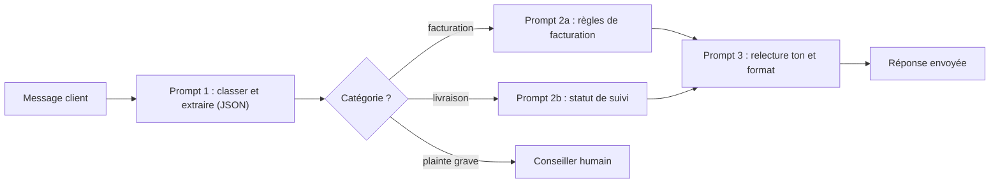

> [!NOTE]
> Dans cette leçon, vous apprenez à faire raisonner le modèle avant qu'il réponde (chaîne de raisonnement), à séparer ce raisonnement de la réponse envoyée au client, et à découper une tâche complexe en plusieurs prompts simples enchaînés.

## Pourquoi « laisser réfléchir » aide

Un modèle produit sa réponse token par token. S'il doit donner le verdict dès le premier mot, il n'a « pas eu le temps » de poser les étapes. Lui demander de raisonner d'abord améliore souvent les tâches à plusieurs étapes : calcul, application de règles, comparaison. C'est le principe de la *chaîne de raisonnement* (*chain-of-thought*, Wei et al., 2022).

| Niveau | Formulation | Quand |
|---|---|---|
| Simple | « Réfléchis étape par étape avant de répondre. » | Rapide à tester |
| Guidé | « D'abord, vérifie la date d'achat. Ensuite, la condition du produit. Enfin, décide. » | Vous connaissez la procédure |
| Structuré | « Raisonne dans `<analyse>`, puis réponds dans `<reponse>`. » | Le raisonnement ne doit pas être montré au client |

> [!TIP]
> Les modèles récents proposent souvent un mode de **réflexion intégrée** (par exemple *extended thinking* chez Claude, *thinking* chez Gemini). Quand il est disponible, il remplace avantageusement le « réfléchis étape par étape » manuel. Les balises `<analyse>` restent utiles pour **lire et tester** le raisonnement.

## Avant / après : décision de remboursement

| Avant | Après |
|---|---|
| « Le client a droit au remboursement ? Réponds oui ou non. » Le modèle répond parfois « oui » à un achat de 45 jours. | « Dans `<analyse>`, vérifie dans l'ordre : 1) nombre de jours depuis l'achat (limite 30), 2) produit ouvert ou non, 3) exception éventuelle de la politique. Puis donne `<decision>oui</decision>` ou `<decision>non</decision>` et une `<reponse>` au client. » |

```text title="remboursement.txt"
<politique>Remboursement sous 30 jours après achat, produit non ouvert.
Exception : produit défectueux, remboursement sous 1 an.</politique>
<demande>{demande}</demande>
<date_du_jour>{date}</date_du_jour>

1. Dans <analyse>, calcule le nombre de jours depuis l'achat, indique si le
   produit est ouvert et s'il est déclaré défectueux.
2. Donne <decision>oui</decision> ou <decision>non</decision>.
3. Rédige une <reponse> de 3 phrases au client, sans recopier ton analyse.
```

Votre code n'envoie au client que `<reponse>`, mais garde `<analyse>` dans les logs : c'est précieux pour comprendre une erreur.

```quiz
question: "Pourquoi demander le raisonnement dans `<analyse>` et la réponse dans `<reponse>` ?"
options:
  - "Pour que le client voie tout le raisonnement interne"
  - "Pour améliorer la décision tout en n'envoyant au client que la réponse finale"
  - "Parce que le modèle ne peut pas raisonner sans balises"
answer: 1
explanation: "Le raisonnement améliore la décision ; les balises permettent au code de ne publier que la réponse et de garder l'analyse pour le débogage. Le modèle peut raisonner sans balises, mais on ne pourrait plus séparer proprement."
```

## Décomposer : un prompt, une tâche

Un « méga-prompt » qui doit lire un mail, détecter la langue, classer, chercher dans la politique, rédiger et traduire échoue de façon difficile à diagnostiquer. Le **chaînage** découpe le travail : chaque étape est simple, testable, et peut utiliser un modèle plus petit.



| Méga-prompt | Chaîne de prompts |
|---|---|
| Une erreur quelque part, impossible de savoir où | Chaque étape a sa sortie, vérifiable |
| Toutes les règles chargées à chaque appel | Seules les règles utiles à la catégorie |
| Un seul modèle, souvent le plus gros | Petit modèle pour classer, plus gros pour rédiger |
| Tests difficiles | Un jeu de tests par étape |

> [!WARNING]
> Ne décomposez pas tout. Trois appels au lieu d'un, c'est plus de latence et de coût. Décomposez quand une étape échoue souvent ou quand le résultat intermédiaire sert à router (humain ou non, équipe A ou B).

```quiz
question: "Dans quels cas la décomposition en plusieurs prompts est-elle justifiée ? (plusieurs réponses)"
options:
  - "Le résultat de la première étape décide de la suite (routage)"
  - "La tâche consiste à corriger l'orthographe d'une phrase"
  - "Vous n'arrivez pas à savoir quelle partie d'un long prompt cause les erreurs"
  - "Vous voulez systématiquement tripler le nombre d'appels"
answer: [0, 2]
explanation: "Le routage et le diagnostic sont les deux bonnes raisons de découper. Une tâche simple n'en a pas besoin, et multiplier les appels sans raison augmente coût et latence."
```

## En Python : une chaîne de deux étapes

```python title="chaine.py"
from llm import appeler
from extraire import extraire  # leçon « Séparateurs et balises XML »

def traiter(message: str) -> str:
    cat = extraire("categorie", appeler(
        "Classe le message : livraison, facturation, autre. Réponds <categorie>...</categorie>.",
        f"<message>{message}</message>"))
    if cat not in {"livraison", "facturation"}:
        return "[ESCALADE]"  # catégorie inconnue ou absente : un humain prend la main
    regles = open(f"regles_{cat}.txt", encoding="utf-8").read()
    return appeler(f"Tu es conseiller service client.\n<regles>{regles}</regles>",
                   f"<message>{message}</message>\nRéponds en 3 phrases.")
```

## Exercice

Ce prompt unique échoue souvent : « Lis l'avis client, dis s'il est positif ou négatif, trouve le produit concerné, rédige une réponse publique et, si l'avis est négatif, prépare un résumé pour l'équipe qualité. » Proposez une chaîne de prompts et dites ce que chaque étape renvoie.

<details>
<summary>Voir la solution</summary>

| Étape | Entrée | Sortie | Vérification possible |
|---|---|---|---|
| 1. Analyse | Avis brut | `{"sentiment": "negatif", "produit": "...", "probleme": "..."}` | JSON valide, sentiment dans la liste |
| 2. Réponse publique | Avis + résultat de l'étape 1 | Texte de 3 phrases | Longueur, pas de promesse de remboursement |
| 3. Résumé qualité (seulement si négatif) | Résultat de l'étape 1 | 2 lignes pour l'équipe | Contient le produit et le problème |

L'étape 1 est la plus critique : c'est elle qui décide si l'étape 3 a lieu. On peut la confier à un modèle rapide et la tester sur une vingtaine d'avis annotés.

</details>

## Je sais faire

- [ ] Demander un raisonnement guidé par étapes.
- [ ] Séparer `<analyse>` et `<reponse>` et ne publier que la réponse.
- [ ] Dire quand une tâche mérite d'être décomposée, et quand non.
- [ ] Écrire une chaîne de deux prompts avec un routage.
