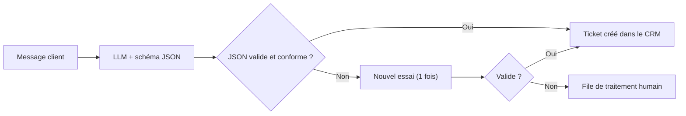

> [!NOTE]
> Dans cette leçon, vous apprenez à obtenir des sorties **structurées** (JSON conforme à un schéma) et à les valider en Python, à amorcer la réponse (*prefill*), et à mettre en place une boucle d'**auto-critique** simple.

## Pourquoi du JSON ?

Dès qu'une réponse est lue par du **code** (un CRM, un outil de tickets, un tableur), le texte libre ne suffit plus. Il faut une structure stable, et une vérification.



## Avant / après

| Avant | Après |
|---|---|
| « Extrais les infos de la commande. » Sortie : « Le client veut 2 baguettes pour demain matin, il s'appelle Karim. » | « Extrais la commande au format JSON suivant, sans texte autour : `{"prenom": string, "articles": [{"produit": string, "quantite": entier}], "retrait": "AAAA-MM-JJ HH:MM" ou null}`. Si une information manque, mets null. » |
| Champs inventés quand l'info manque | `null` explicite, que le code sait traiter (« demander l'heure de retrait ») |

## Trois façons d'obtenir du JSON, de la plus fiable à la moins fiable

| Méthode | Principe | Plateformes |
|---|---|---|
| **Sortie structurée native** | Vous passez un schéma, l'API contraint la sortie | Gemini : `response_mime_type` + `response_schema` ; Claude : définition d'outil avec `input_schema`, ou sorties structurées selon le modèle (voir la documentation) |
| **Prompt + schéma + validation** | Le schéma est dans le prompt, votre code valide | Tous les modèles |
| **Prompt seul** | « Réponds en JSON » | À éviter en production |

```python title="json_gemini.py"
import os
from google import genai
from google.genai import types
from pydantic import BaseModel

class Article(BaseModel):
    produit: str
    quantite: int

class Commande(BaseModel):
    prenom: str | None
    articles: list[Article]
    retrait: str | None

r = genai.Client().models.generate_content(  # clé lue dans l'environnement
    model=os.environ["LLM_MODEL"],
    contents="Bonjour, c'est Karim, je voudrais 2 baguettes et 3 croissants pour demain 8h.",
    config=types.GenerateContentConfig(
        response_mime_type="application/json", response_schema=Commande),
)
commande = Commande.model_validate_json(r.text)  # lève une erreur si non conforme
```

Sans sortie native, validez vous-même avec `json.loads` et quelques vérifications de champs : c'est l'objet de l'exercice en fin de leçon.

> [!WARNING]
> Un JSON **syntaxiquement** valide peut être **faux** : quantité inventée, date mal interprétée. La validation de forme ne remplace pas les tests sur le fond (module 3).

```quiz
question: "Le client n'a pas donné d'heure de retrait. Que doit contenir le champ « retrait » ?"
options:
  - "Une heure plausible, par exemple 08:00"
  - "null, pour que l'application demande l'heure au client"
  - "Le texte « inconnu »"
answer: 1
explanation: "null est explicite et facile à traiter par le code. Une heure inventée crée une fausse commande ; un texte libre casse le format attendu."
```

## Prefill : amorcer la réponse

Avec l'API Claude, vous pouvez écrire le **début** de la réponse de l'assistant : le modèle continue à partir de là. Commencer par `{` pousse fortement vers un JSON sans préambule ; commencer par `<analyse>` impose de raisonner d'abord.

```python title="prefill_claude.py"
import os, anthropic

r = anthropic.Anthropic().messages.create(
    model=os.environ["LLM_MODEL"], max_tokens=500,
    system="Extrais la commande en JSON : prenom, articles, retrait.",
    messages=[
        {"role": "user", "content": "C'est Karim, 2 baguettes pour demain 8h."},
        {"role": "assistant", "content": "{"},  # prefill
    ],
)
json_texte = "{" + r.content[0].text  # le prefill n'est pas répété dans la sortie
```

> [!CAUTION]
> Le prefill n'est pas disponible partout : il n'existe pas tel quel chez tous les fournisseurs, et certains modèles récents de Claude ne l'acceptent plus. Vérifiez la documentation de votre modèle ; à défaut, préférez la sortie structurée native.

## Auto-critique : faire relire le modèle

Une seconde passe, avec une **grille explicite**, attrape une partie des erreurs : promesse interdite (« remboursé sous 24 h »), ton inadapté, information inventée. Elle coûte un appel de plus : réservez-la aux sorties envoyées à des clients.

```text title="relecture.txt"
Relis la <reponse> ci-dessous selon ces critères :
1. Aucune information absente de <politique>.
2. Aucune promesse de délai ou de geste commercial non prévu.
3. Vouvoiement, 3 phrases maximum.
4. Répond bien à la question du <message_client>.
Si tout est respecté, renvoie exactement OK. Sinon, renvoie la réponse corrigée dans <reponse>.
```

```quiz
question: "Quelles affirmations sur l'auto-critique sont vraies ? (plusieurs réponses)"
options:
  - "Elle fonctionne mieux avec une grille de critères explicites"
  - "Elle garantit une réponse sans erreur"
  - "Elle ajoute un appel, donc du coût et de la latence"
answer: [0, 2]
explanation: "Une grille rend la relecture précise ; chaque passe ajoute coût et latence. Elle réduit les erreurs mais ne garantit rien : le relecteur est le même type de modèle, avec les mêmes angles morts."
```

## Exercice

Écrivez le prompt (consigne + schéma) qui transforme un mail de réclamation en ticket JSON avec : `categorie` (livraison, facturation, produit, autre), `urgence` (basse, normale, haute), `resume` (1 phrase), `numero_commande` (texte ou null). Puis écrivez la fonction de validation.

<details>
<summary>Voir la solution</summary>

```text
Transforme le mail contenu dans <mail> en ticket. Réponds uniquement par un JSON :
{"categorie": "livraison|facturation|produit|autre",
 "urgence": "basse|normale|haute",
 "resume": "une phrase",
 "numero_commande": "texte ou null"}
Urgence haute : client sans produit depuis plus de 7 jours, double prélèvement, ou risque de sécurité.
N'invente jamais de numéro de commande : null s'il n'apparaît pas.
<mail>{mail}</mail>
```

```python title="valider_ticket.py"
import json

CHOIX = {"categorie": {"livraison", "facturation", "produit", "autre"},
         "urgence": {"basse", "normale", "haute"}}

def valider_ticket(texte: str) -> dict | None:
    try:
        d = json.loads(texte)
    except json.JSONDecodeError:
        return None
    if any(d.get(k) not in v for k, v in CHOIX.items()):
        return None
    if not isinstance(d.get("resume"), str) or not d["resume"]:
        return None
    if d.get("numero_commande") is not None and not isinstance(d["numero_commande"], str):
        return None
    return d

assert valider_ticket('{"categorie":"produit","urgence":"haute","resume":"Casque cassé.","numero_commande":null}')
assert valider_ticket('{"categorie":"colis","urgence":"haute","resume":"x","numero_commande":null}') is None
```

</details>

## Je sais faire

- [ ] Écrire un schéma JSON dans un prompt, avec `null` pour les informations manquantes.
- [ ] Utiliser la sortie structurée native de Gemini ou un outil chez Claude.
- [ ] Valider un JSON en Python et prévoir un plan B (nouvel essai, humain).
- [ ] Amorcer une réponse par prefill quand le modèle le permet.
- [ ] Écrire une grille d'auto-critique.
