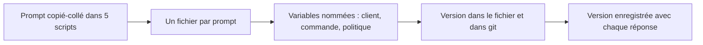

> [!NOTE]
> Dans cette leçon, vous apprenez à transformer un prompt en **gabarit réutilisable** avec des variables, à le ranger dans un fichier versionné par git, et à savoir à tout moment quelle version a produit quelle réponse.

## Du prompt collé au gabarit



| Avant | Après |
|---|---|
| Le même prompt copié dans le bot WhatsApp, le script de mails et un notebook, avec trois variantes divergentes | Un fichier `prompts/reponse_retard.txt`, chargé par les trois outils |
| `"Réponds à " + nom + " au sujet de " + commande` construit à la main | Gabarit avec `$prenom`, `$numero_commande`, remplis par `string.Template` |
| « Qui a modifié le prompt mardi ? » Personne ne sait | `git log prompts/reponse_retard.txt` |
| Une réponse étrange en production, impossible de savoir avec quel prompt | Chaque réponse loggée avec `prompt_id` et `version` |

## Des variables, avec la bibliothèque standard

`string.Template` suffit : ses `$variables` ne se confondent pas avec les accolades d'un JSON présent dans le prompt (contrairement à `str.format`).

```text title="prompts/reponse_retard.txt"
# id: reponse_retard
# version: 1.2.0
# description: Réponse à un client dont la commande est en retard.
Tu es conseiller du service client de $entreprise.
<commande>Numéro $numero_commande, date de livraison prévue : $date_prevue.</commande>
<message_client>$message</message_client>
Réponds en 3 phrases maximum, vouvoiement, en $langue.
Format : {"reponse": "...", "escalade": true|false}
```

```python title="gabarits.py"
from pathlib import Path
from string import Template

def charger(nom: str) -> tuple[dict, Template]:
    lignes = Path(f"prompts/{nom}.txt").read_text(encoding="utf-8").splitlines()
    meta = {l[2:].split(":")[0]: l.split(":", 1)[1].strip() for l in lignes if l.startswith("# ")}
    corps = "\n".join(l for l in lignes if not l.startswith("# "))
    return meta, Template(corps)

meta, gabarit = charger("reponse_retard")
prompt = gabarit.substitute(entreprise="Vélos du Sud", numero_commande="A-1029",
                            date_prevue="12 octobre", message="Toujours rien reçu !", langue="français")
print(meta["version"])  # 1.2.0
```

> [!TIP]
> `substitute()` lève une erreur si une variable manque. C'est voulu : mieux vaut un plantage en test qu'un prompt envoyé avec `$numero_commande` en clair.

```quiz
question: "Pourquoi préférer string.Template à str.format pour un prompt qui contient un exemple JSON ?"
options:
  - "string.Template est plus rapide"
  - "Les accolades du JSON seraient interprétées comme des variables par str.format"
  - "str.format n'accepte pas les accents"
answer: 1
explanation: "str.format traite chaque { } comme un emplacement : un JSON d'exemple provoque une erreur ou doit être échappé avec {{ }}. Les $variables de string.Template n'ont pas ce problème."
```

## Versionner ses prompts

Un prompt est du code qui s'exprime en français : il se versionne de la même façon.

| Changement | Exemple | Version |
|---|---|---|
| Correction mineure (faute, reformulation sans effet attendu) | Faute de frappe | 1.2.0 → 1.2.1 |
| Nouveau comportement compatible | Ajout de la langue arabe | 1.2.1 → 1.3.0 |
| Changement qui casse le format de sortie | Nouveau champ JSON obligatoire | 1.3.0 → 2.0.0 |

Règles simples :

1. **Un fichier par prompt**, dans un dossier `prompts/` du dépôt.
2. **Une modification = un commit** avec un message qui dit pourquoi (« ajoute l'escalade allergie suite au ticket 88 »).
3. **Loggez `id` et `version` avec chaque appel**, ainsi que le nom du modèle : la même version de prompt peut se comporter différemment sur un autre modèle.
4. **Pas de modification directe en production** : on passe par les tests (leçon suivante).

> [!WARNING]
> Changer de **modèle** est un changement aussi important que changer de prompt. Relancez toute la suite de tests avant de basculer.

```quiz
question: "Que faut-il enregistrer avec chaque réponse produite en production ? (plusieurs réponses)"
options:
  - "L'identifiant et la version du prompt"
  - "Le nom du modèle utilisé"
  - "La clé d'API"
  - "La date de l'appel"
answer: [0, 1, 3]
explanation: "Identifiant, version, modèle et date permettent de rejouer et d'expliquer une réponse. La clé d'API ne doit jamais apparaître dans des logs."
```

## Exercice

Transformez ce prompt écrit en dur dans un script en gabarit versionné, avec ses métadonnées et ses variables :

```python
prompt = "Écris une relance pour Mme Martin qui n'a pas payé la facture F-778 de 340 euros échue le 1er octobre. Ton courtois."
```

<details>
<summary>Voir la solution</summary>

```text title="prompts/relance_facture.txt"
# id: relance_facture
# version: 1.0.0
# description: Première relance courtoise d'une facture impayée.
Tu es chargé de recouvrement chez $entreprise. Ton courtois, jamais menaçant.
<facture>Client : $civilite $nom. Facture $numero de $montant, échue le $echeance.</facture>
Rédige un mail de relance de 80 mots maximum : rappelle la facture, propose de contacter
le service comptable en cas d'erreur, termine par « Bien cordialement ».
```

```python
meta, g = charger("relance_facture")
prompt = g.substitute(entreprise="Atelier Bois", civilite="Mme", nom="Martin",
                      numero="F-778", montant="340 EUR", echeance="1er octobre")
```

Les données personnelles (nom, montant) restent hors du fichier versionné : elles ne sont injectées qu'au moment de l'appel.

</details>

## Je sais faire

- [ ] Ranger un prompt dans un fichier avec `id`, `version` et `description`.
- [ ] Remplir un gabarit avec `string.Template` et détecter une variable manquante.
- [ ] Choisir le bon numéro de version selon le type de changement.
- [ ] Logger prompt, version et modèle avec chaque réponse.
