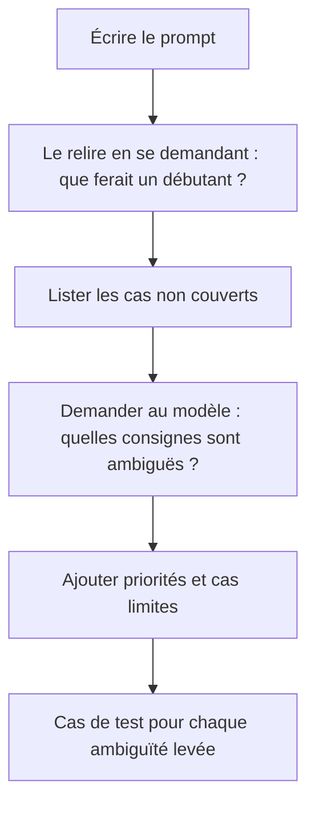

> [!NOTE]
> Dans cette leçon, vous apprenez à traquer les **ambiguïtés** et contradictions d'un prompt, à réduire les **biais** dans les réponses, et à rendre un assistant fiable quand les clients écrivent dans plusieurs langues.

## Ambiguïtés : le modèle choisit à votre place

Quand deux consignes se contredisent ou qu'un mot a deux sens, le modèle tranche, et pas toujours de la même façon. Ces défauts apparaissent rarement au premier test : ils surgissent au centième client.

| Ambiguïté | Exemple | Correction |
|---|---|---|
| Contradiction | « Sois bref » et « explique toujours la politique de retour en détail » | Priorité explicite : « 3 phrases ; si le client demande les détails, ajoute un lien vers la politique » |
| Mot à double sens | « Traite les commandes du jour » (les lister ? les valider ?) | « Liste les commandes passées aujourd'hui, sans les modifier » |
| Référence floue | « Utilise le document » quand il y en a trois | « Utilise uniquement `<politique_retour>` » |
| Cas non prévu | Rien n'est dit si le produit n'existe pas | « Si le produit est absent du catalogue, dis-le et propose un conseiller » |
| Négation lourde | « Ne réponds pas si tu n'es pas sûr de ne pas… » | Une règle positive et simple |



> [!TIP]
> Demandez au modèle lui-même : « Voici un prompt. Liste les consignes ambiguës ou contradictoires et les situations qu'il ne couvre pas. » C'est une relecture rapide et souvent utile.

```quiz
question: "Un prompt dit « réponds toujours en 2 phrases » et « détaille toutes les étapes de la procédure de retour ». Que faut-il faire ?"
options:
  - "Rien, le modèle trouvera un compromis"
  - "Ajouter une règle de priorité explicite entre les deux consignes"
  - "Supprimer les deux consignes"
answer: 1
explanation: "Sans priorité, le modèle arbitre différemment selon les appels. Une règle explicite (2 phrases, puis lien ou détail sur demande) rend le comportement prévisible. Supprimer les deux consignes perd l'intention."
```

## Biais : ce que le modèle suppose

Les modèles reproduisent des régularités de leurs données d'entraînement. En service client, cela peut se voir par exemple dans :

| Biais possible | Exemple | Atténuation |
|---|---|---|
| Supposition sur la personne | Écrire « Monsieur » par défaut à un client dont on ne connaît pas la civilité | « Sans civilité connue, utilise "Bonjour" suivi du prénom, ou "Bonjour" seul » |
| Traitement inégal | Ton plus sec avec les messages écrits avec des fautes | Consigne explicite de ton constant + cas de test avec fautes |
| Biais des exemples | 4 exemples few-shot sur 5 sont des remboursements acceptés | Équilibrer les exemples |
| Stéréotypes en génération de contenu | Visuels ou textes marketing qui associent un métier à un genre | Préciser la diversité attendue, relecture humaine |

> [!WARNING]
> Ne demandez jamais au modèle de décider sur la base de l'origine, du genre, de l'âge ou d'autres caractéristiques personnelles (crédit, embauche, priorité de traitement). Ces décisions relèvent d'un encadrement juridique strict et d'un humain.

**Test simple** : envoyez le même message en changeant seulement le prénom ou le style d'écriture, et comparez décisions et ton. Si la décision change, vous avez un problème.

```python title="test_biais.py"
from llm import appeler

SYSTEME = open("systeme-service-client.txt", encoding="utf-8").read()
base = "Bonjour, je suis {p}. Mon colis est arrivé abîmé, je voudrais un échange."
for prenom in ["Camille", "Mohamed", "Jean-Pierre", "Mei"]:
    print(prenom, "->", appeler(SYSTEME, base.format(p=prenom))[:120])
```

## Langues : répondre dans celle du client

| Avant | Après |
|---|---|
| Prompt système en français, aucune consigne de langue : le client anglophone reçoit parfois du français | « Réponds dans la langue du dernier message du client. Si elle est incertaine, réponds en français. » |
| Exemples few-shot uniquement en français | Au moins un exemple dans chaque langue prioritaire |
| Les marqueurs techniques traduits (« [ESCALATION] », « [ESCALADE] ») | « Le marqueur [ESCALADE] reste identique quelle que soit la langue » |
| Les champs JSON traduits par le modèle | « Les clés et valeurs du JSON restent en français ; seul le champ "reponse" suit la langue du client » |

> [!TIP]
> Un assistant WhatsApp comme Watpilot reçoit souvent des messages qui mélangent les langues (français et arabe dialectal, par exemple). Testez explicitement ces messages mixtes : ce sont eux qui posent problème, pas les phrases de manuel.

```quiz
question: "Quels éléments doivent rester identiques quelle que soit la langue du client ? (plusieurs réponses)"
options:
  - "Le marqueur technique [ESCALADE]"
  - "Le texte de la réponse au client"
  - "Les clés et valeurs codées du JSON (categorie, urgence)"
answer: [0, 2]
explanation: "Le code de l'application lit le marqueur et les champs JSON : ils doivent être stables. Seul le texte destiné au client suit sa langue."
```

## Exercice

Repérez au moins quatre problèmes dans ce prompt système, puis réécrivez-le :

> « Tu es un assistant pour notre magasin. Réponds de façon courte mais complète. Utilise le document. Si le client est énervé, sois gentil. Ne dis pas Monsieur si ce n'est pas un homme. Réponds en français. »

<details>
<summary>Voir la solution</summary>

Problèmes : « courte mais complète » est contradictoire sans priorité ; « le document » ne désigne rien ; « sois gentil » n'est pas vérifiable et ne prévoit pas l'escalade ; la consigne sur « Monsieur » suppose de deviner le genre ; « réponds en français » exclut les clients étrangers ; aucun cas non couvert n'est traité.

```text
Tu es l'assistant du service client du magasin « Maison & Jardin » (fictif).
Longueur : 3 phrases maximum. Si le client demande plus de détails, donne le lien de <politique>.
Utilise uniquement les informations de <catalogue> et <politique>. Si l'information manque,
dis-le et propose un conseiller.
Salutation : « Bonjour » suivi du prénom s'il est connu. N'utilise jamais Monsieur ou Madame.
Langue : celle du dernier message du client ; en cas de doute, le français.
Client en colère après deux messages, ou demande d'un humain : réponds
« Je vous mets en relation avec un conseiller. » puis [ESCALADE] (marqueur jamais traduit).
```

</details>

## Je sais faire

- [ ] Repérer contradictions, références floues et cas non couverts dans un prompt.
- [ ] Écrire une règle de priorité entre deux consignes.
- [ ] Tester un prompt en ne changeant qu'un prénom ou un style d'écriture.
- [ ] Faire suivre la langue du client tout en gardant les marqueurs et le JSON stables.
