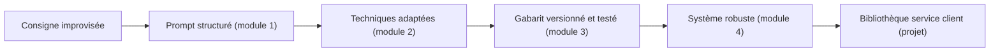

Un prompt qui « marche une fois » dans une fenêtre de chat n'est pas un prompt fiable. Dès qu'il est appelé mille fois par jour, par un assistant de service client ou un script d'automatisation, il doit se comporter comme du code : **lisible, versionné, testé**. Cette formation vous fait passer de la consigne improvisée au système de prompts maintenable.

## Pour qui ?

- Chefs de projet, product owners et responsables service client qui rédigent ou valident des prompts.
- Développeurs qui intègrent un LLM (Claude, Gemini) dans une application.
- Toute personne qui a déjà utilisé un assistant IA et veut des résultats **reproductibles**.

## Objectifs mesurables

À la fin de la formation, vous serez capable de :

1. Réécrire un prompt vague en prompt structuré (rôle, contexte, tâche, format, exemples) en moins de 10 minutes.
2. Choisir la bonne technique (few-shot, raisonnement, décomposition, sortie JSON) pour un cas donné et justifier ce choix.
3. Transformer un prompt en **gabarit versionné** avec variables, et lui associer au moins 5 cas de test automatiques.
4. Identifier et atténuer 4 familles de risques : ambiguïté, injection de prompt, biais, mauvais usage d'un LLM.
5. Livrer une bibliothèque de 5 prompts de service client testée par un script Python.

## Prérequis

- Avoir déjà utilisé un assistant conversationnel (Claude, Gemini, ChatGPT…).
- Bases de Python (lire une fonction, lancer un script) pour les exercices de code. Les leçons restent lisibles sans coder.
- Facultatif : une clé d'API Claude ou Gemini, à placer dans une **variable d'environnement**, jamais dans le code.

## Programme

| Module | Leçons | Durée indicative |
|---|---|---|
| 1. Anatomie d'un bon prompt | Les cinq composants ; séparateurs et balises XML ; prompt système vs utilisateur | 1h30 |
| 2. Les techniques qui changent les résultats | Few-shot ; raisonnement et décomposition ; sorties structurées, prefill et auto-critique | 1h30 |
| 3. Prompts pour l'entreprise | Gabarits, variables et versionnage ; tests de régression, coût et longueur | 1h |
| 4. Pièges et robustesse | Ambiguïtés, biais et langues ; injection de prompt et quand ne pas utiliser un LLM | 1h |
| 5. Projet final | Construire et tester une bibliothèque de 5 prompts de service client | 1h |

## Ce que vous saurez faire

- Lire un prompt et dire en 30 secondes ce qui lui manque.
- Écrire un prompt système de service client du type de celui d'un assistant WhatsApp comme **Watpilot** (répondre, prendre une commande, passer la main à un humain).
- Obtenir un JSON valide à chaque appel, et le vérifier.
- Faire tourner une suite de tests de prompts avant chaque modification.
- Savoir dire « ici, un LLM n'est pas le bon outil ».

> [!TIP]
> Chaque leçon contient des quiz, un exercice avec solution cachée et une checklist « Je sais faire » que vous pouvez cocher : votre progression est sauvegardée.
