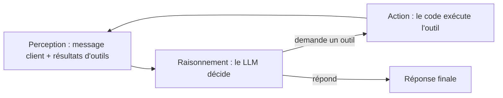
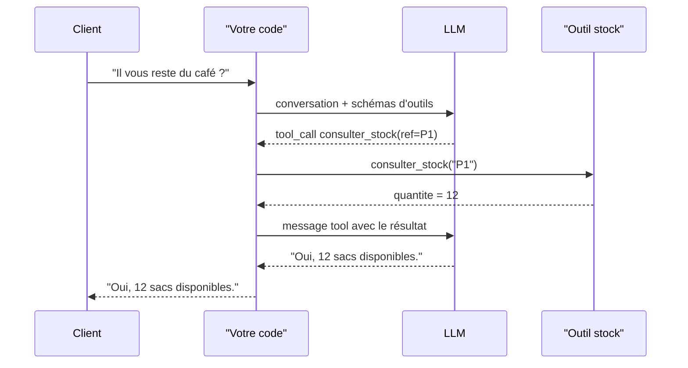

# La boucle d'un agent et l'appel d'outils

> [!NOTE]
> Dans cette leçon, vous allez comprendre ce qu'un agent fait réellement à chaque tour (percevoir, raisonner, agir), et comment un LLM qui ne sait produire que du texte arrive à « appeler une fonction ».

## Un LLM seul ne fait rien

Un modèle de langage reçoit du texte et renvoie du texte. Il ne lit pas votre base de données, n'envoie pas d'e-mail, ne connaît pas votre stock du jour. Pour qu'il **agisse**, il faut trois choses autour de lui :

1. une **liste d'outils** qu'il a le droit d'utiliser (des fonctions Python, des API) ;
2. un **programme** qui exécute les outils qu'il demande et lui renvoie le résultat ;
3. une **boucle** qui recommence tant que le modèle n'a pas fini.

C'est tout. Un agent, c'est cette boucle.



| Étape | Qui la fait ? | Exemple (assistant de commandes) |
| --- | --- | --- |
| Perception | votre code assemble le contexte | « Je veux 3 sacs de café » + historique |
| Raisonnement | le LLM | « Il faut d'abord trouver la référence du café » |
| Action | votre code | `chercher_produit("café")` → `[{"ref": "P1", ...}]` |
| Perception (tour 2) | votre code | le résultat est ajouté à la conversation |
| Raisonnement (tour 2) | le LLM | « Vérifions le stock de P1 » |

> [!IMPORTANT]
> Le LLM **ne fait jamais** l'action lui-même. Il **demande** une action ; c'est votre code qui décide de l'exécuter. C'est là que se placent tous vos garde-fous.

## Le function calling, concrètement

On donne au modèle, avec la conversation, une description de chaque outil au format **JSON Schema** :

```json title="outil.json"
{
  "name": "consulter_stock",
  "description": "Donne la quantité en stock d'une référence produit (ex. P1).",
  "parameters": {
    "type": "object",
    "properties": { "ref": { "type": "string" } },
    "required": ["ref"]
  }
}
```

Le modèle a été entraîné à répondre, quand c'est utile, non pas par une phrase mais par un **appel structuré** :

```json title="reponse_du_modele.json"
{
  "tool_calls": [
    { "id": "call_1", "function": { "name": "consulter_stock", "arguments": "{\"ref\": \"P1\"}" } }
  ]
}
```

Votre code lit ce JSON, appelle `consulter_stock(ref="P1")`, puis renvoie le résultat au modèle dans un message de rôle `tool`. Le modèle reprend alors son raisonnement avec cette nouvelle information.



> [!TIP]
> La **description** de l'outil est un prompt. « Donne le stock » est moins bon que « Donne la quantité en stock d'une référence produit (ex. P1). Utiliser après chercher_produit. » Le modèle choisit ses outils en lisant ces phrases.

```quiz
question: "Dans un agent, qui exécute réellement la fonction consulter_stock ?"
options:
  - "Le LLM, sur les serveurs du fournisseur"
  - "Votre programme, après avoir lu la demande d'appel renvoyée par le LLM"
  - "Le client final, depuis son navigateur"
answer: 1
explanation: "Le LLM ne fait que produire un appel structuré (nom + arguments). C'est votre code qui l'exécute, ce qui permet de valider, refuser ou journaliser chaque action. Le fournisseur n'a pas accès à votre stock, et le client n'exécute rien."
```

## Pourquoi « boucle » et pas « un seul appel » ?

Une seule question peut demander plusieurs actions qui dépendent les unes des autres : on ne peut pas consulter le stock tant qu'on ne connaît pas la référence. Le modèle enchaîne donc les tours. C'est l'idée popularisée par l'article **ReAct** (raisonner puis agir, observer, recommencer).

Conséquences pratiques, que l'on traitera au module 2 :

- la boucle peut **ne jamais s'arrêter** (le modèle redemande sans fin le même outil) → limite d'itérations ;
- un outil peut **échouer** → l'erreur doit revenir au modèle, pas faire planter le programme ;
- chaque tour **coûte** des tokens → l'historique grossit à chaque tour.

```quiz
question: "Quelles affirmations sont vraies sur l'appel d'outils ? (plusieurs réponses)"
options:
  - "Le schéma JSON des paramètres aide le modèle à produire des arguments valides"
  - "Le modèle garantit que les arguments sont toujours corrects"
  - "Le modèle peut demander plusieurs outils dans une même réponse"
  - "Une fois l'outil exécuté, il faut renvoyer son résultat au modèle pour qu'il continue"
answer: [0, 2, 3]
explanation: "Le schéma guide le modèle mais ne garantit rien : il faut toujours valider les arguments côté code. Les fournisseurs actuels permettent plusieurs tool_calls par réponse, et le résultat doit être réinjecté dans la conversation pour que le modèle en tienne compte."
```

## Exercice : tracer la boucle à la main

Un client écrit : « Je voudrais 2 boîtes de thé vert, c'est possible ? ». Les outils disponibles sont `chercher_produit(texte)` et `consulter_stock(ref)`. Le thé vert a la référence P2 et un stock de 0.

Écrivez la suite des messages (rôle + contenu résumé) échangés entre votre code et le LLM jusqu'à la réponse finale.

<details>
<summary>Voir la solution</summary>

| # | Rôle | Contenu |
| --- | --- | --- |
| 1 | system | « Tu es l'assistant de commandes… n'invente jamais un stock. » |
| 2 | user | « Je voudrais 2 boîtes de thé vert, c'est possible ? » |
| 3 | assistant | tool_call `chercher_produit(texte="thé vert")` |
| 4 | tool | `[{"ref": "P2", "nom": "Thé vert 200 g", "prix": 9.5}]` |
| 5 | assistant | tool_call `consulter_stock(ref="P2")` |
| 6 | tool | `{"ref": "P2", "quantite": 0}` |
| 7 | assistant | « Désolé, le thé vert est en rupture. Voulez-vous être prévenu du réapprovisionnement ? » |

Trois appels au LLM (messages 3, 5, 7), deux exécutions d'outils. Remarquez que le message 7 n'a **aucun** tool_call : c'est ce qui indique à la boucle qu'elle peut s'arrêter.

</details>

## Je sais faire

- [ ] Décrire les trois étapes perception → raisonnement → action avec un exemple
- [ ] Expliquer pourquoi le LLM ne fait que *demander* une action
- [ ] Lire un schéma d'outil JSON et un `tool_call` renvoyé par le modèle
- [ ] Citer trois risques propres à une boucle (boucle infinie, erreur d'outil, coût)
