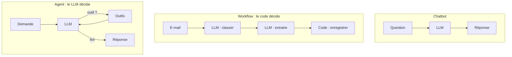

# Chatbot, workflow ou agent : choisir (et savoir dire non)

> [!NOTE]
> Dans cette leçon, vous allez distinguer trois architectures qui utilisent toutes un LLM, et apprendre à reconnaître les cas où un agent est une **mauvaise idée**.

## Trois architectures, une question : qui décide de la suite ?

| | Chatbot | Workflow | Agent |
| --- | --- | --- | --- |
| Qui décide des étapes ? | personne : une question, une réponse | **vous**, dans le code | **le LLM**, à chaque tour |
| Appels d'outils | aucun (ou RAG fixe) | oui, dans un ordre écrit d'avance | oui, choisis dynamiquement |
| Nombre d'appels LLM | 1 | fixe et connu | variable |
| Prévisibilité | forte | forte | plus faible |
| Coût par requête | faible, stable | moyen, stable | variable, parfois élevé |
| Exemple | FAQ sur les horaires | « classer l'e-mail → extraire la commande → l'enregistrer » | « aide ce client à commander, quoi qu'il demande » |



> [!TIP]
> La distinction vient de l'article « Building effective agents » d'Anthropic (voir les références) : un **workflow** suit des chemins écrits dans le code, un **agent** dirige lui-même son processus et l'usage de ses outils. Commencez toujours par la solution la plus simple qui marche.

## L'échelle de complexité

Montez d'un cran seulement quand le cran du dessous échoue **sur des cas réels**, mesurés :

1. **Un appel LLM bien prompté** (avec éventuellement des documents dans le contexte).
2. **Un workflow** : enchaînement fixe, routage par catégorie, étapes en parallèle.
3. **Un agent à quelques outils**.
4. **Plusieurs agents** qui collaborent (module 4).

Chaque cran ajoute de la latence, du coût et des façons de se tromper.

```quiz
question: "Un service reçoit des bons de commande PDF toujours au même format. Il faut extraire les lignes et les insérer dans l'ERP. Que choisir ?"
options:
  - "Un agent autonome avec un outil lire_pdf et un outil inserer_erp"
  - "Un workflow : extraction structurée par le LLM, puis validation et insertion par du code"
  - "Un système multi-agents avec un agent par champ du formulaire"
answer: 1
explanation: "Les étapes sont connues d'avance et toujours les mêmes : c'est la définition d'un workflow. Un agent ajouterait de l'imprévisibilité (il pourrait sauter la validation) sans aucun bénéfice. Le multi-agents serait de la sur-ingénierie."
```

## Quand un agent est une mauvaise idée

| Signal | Pourquoi c'est un problème | Alternative |
| --- | --- | --- |
| Le processus est entièrement connu | l'agent « réinvente » à chaque fois un chemin que vous connaissez déjà | workflow |
| Une erreur coûte très cher ou est irréversible (virement, suppression) | le LLM peut choisir la mauvaise action | workflow + validation humaine obligatoire |
| Latence exigée très faible | plusieurs allers-retours LLM par requête | un seul appel, ou du code classique |
| Pas de jeu de tests | impossible de savoir si une modification améliore ou casse l'agent | construire d'abord 20 à 50 cas de test réels |
| Règle métier déterministe (« -10 % au-delà de 100 € ») | un LLM peut se tromper dans un calcul | une fonction Python, appelée comme outil |

> [!WARNING]
> « Agent » est souvent un mot marketing. Si vous pouvez dessiner le diagramme complet des étapes sur un tableau blanc, vous avez un workflow. C'est une **bonne** nouvelle : il sera moins cher et plus fiable.

## Quand un agent vaut le coup

- Les demandes sont **ouvertes** et variées : un client peut demander un produit, modifier une commande, prendre rendez-vous, poser une question hors sujet.
- Le nombre d'étapes **n'est pas connu d'avance** (chercher, comparer, vérifier, recommencer).
- On peut **tolérer** une erreur occasionnelle parce qu'il existe une sortie vers un humain.

C'est typiquement le cas d'un assistant de prise de commande conversationnel. Watpilot, par exemple, est un agent de ce type sur WhatsApp, construit sur Gemini : il prend des commandes et des rendez-vous, et **escalade vers un humain** quand la demande sort de son périmètre. Les actions sensibles (création de commande) restent encadrées par des outils précis plutôt que laissées au libre arbitre du modèle.

```quiz
question: "Parmi ces besoins, lesquels justifient plutôt un agent qu'un workflow ? (plusieurs réponses)"
options:
  - "Un assistant interne qui répond aux questions RH, réserve des salles et ouvre des tickets selon la demande"
  - "Traduire chaque nuit les fiches produits nouvellement créées"
  - "Un support client qui doit diagnostiquer un problème en posant des questions et en consultant plusieurs systèmes"
  - "Calculer la TVA d'une facture"
answer: [0, 2]
explanation: "L'assistant interne et le support de diagnostic ont des demandes ouvertes et un nombre d'étapes inconnu : un agent est justifié. La traduction nocturne est un workflow (même étape, toujours). La TVA est une règle déterministe : une fonction, pas un LLM."
```

## Exercice : classer cinq projets

Pour chacun, répondez « chatbot », « workflow », « agent » ou « pas de LLM », avec une phrase de justification.

1. Résumer chaque compte rendu de réunion et l'envoyer par e-mail aux participants.
2. Répondre aux questions sur le règlement intérieur à partir d'un PDF de 20 pages.
3. Aider un commercial à préparer un devis : chercher les produits, vérifier les remises autorisées, consulter l'historique du client.
4. Vérifier qu'un numéro de SIRET a 14 chiffres.
5. Trier les tickets entrants en « facturation », « technique », « autre » et les router vers la bonne équipe.

<details>
<summary>Voir la solution</summary>

1. **Workflow** : étapes fixes (résumer → envoyer). Le LLM ne fait qu'une étape.
2. **Chatbot** (avec le document dans le contexte ou un RAG) : une question, une réponse, aucune action.
3. **Agent** : l'ordre et le nombre de recherches dépendent du client et des produits. Bon candidat, avec validation humaine du devis final.
4. **Pas de LLM** : une expression régulière (`re.fullmatch(r"\d{14}", s)`) suffit.
5. **Workflow** de routage : un appel LLM de classification, puis du code qui route. Pas besoin que le modèle choisisse ses outils.

Si vous avez répondu « agent » à plus de deux cas, relisez la section « Quand un agent est une mauvaise idée ».

</details>

## Je sais faire

- [ ] Expliquer la différence chatbot / workflow / agent en une phrase chacun
- [ ] Citer trois situations où un agent est une mauvaise idée
- [ ] Justifier le choix d'un agent pour un cas d'usage de prise de commande
- [ ] Remplacer une règle déterministe par une fonction plutôt que par un prompt
