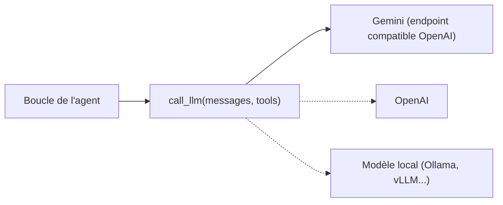

# call_llm et les schémas d'outils

> [!NOTE]
> Dans cette leçon, vous allez écrire les deux briques de base de votre agent, sans aucun framework : une fonction `call_llm` qui cache le fournisseur, et des outils Python décrits en JSON Schema.

## Le principe : un seul point de contact avec le fournisseur

Tout le reste de l'agent ne doit connaître **qu'une** fonction : `call_llm(messages, tools)`. Si demain vous changez de modèle ou de fournisseur, vous ne modifiez qu'elle.



Nous utilisons le format **chat completions** popularisé par OpenAI, parce que beaucoup de fournisseurs l'acceptent : Gemini propose un endpoint compatible, de même que la plupart des serveurs de modèles locaux. On le parle avec la bibliothèque standard (`urllib`), donc **zéro dépendance**.

```python title="agent.py (partie 1)"
import json
import os
import urllib.request

BASE_URL = os.environ.get(
    "LLM_BASE_URL", "https://generativelanguage.googleapis.com/v1beta/openai")
MODEL = os.environ.get("LLM_MODEL", "gemini-2.5-flash")


def call_llm(messages, tools):
    """Envoie la conversation + les outils, renvoie le message de l'assistant."""
    payload = {"model": MODEL, "messages": messages}
    if tools:                       # certains fournisseurs refusent "tools": []
        payload["tools"] = tools
    body = json.dumps(payload)
    req = urllib.request.Request(
        f"{BASE_URL}/chat/completions",
        data=body.encode(),
        headers={"Content-Type": "application/json",
                 "Authorization": f"Bearer {os.environ['LLM_API_KEY']}"},
    )
    with urllib.request.urlopen(req, timeout=60) as resp:
        return json.load(resp)["choices"][0]["message"]
```

Configuration, uniquement par variables d'environnement :

```bash title="terminal"
export LLM_API_KEY="votre-cle"          # jamais dans le code, jamais dans git
# Optionnel, pour changer de fournisseur :
# export LLM_BASE_URL="https://api.openai.com/v1"
# export LLM_MODEL="nom-du-modele"
```

> [!WARNING]
> Une clé d'API écrite en dur dans un fichier finit tôt ou tard dans un dépôt git. Lisez-la avec `os.environ[...]` : si elle manque, le programme s'arrête immédiatement avec un `KeyError` explicite, ce qui est exactement ce qu'on veut.

> [!TIP]
> Les noms de modèles changent souvent. Vérifiez le nom exact dans la documentation de votre fournisseur ; c'est pour cela que `LLM_MODEL` est une variable d'environnement.

## Les outils : du Python ordinaire

Un outil est une fonction normale. Ici, le catalogue et le stock sont de simples dictionnaires pour que tout tienne dans un fichier ; en vrai, ce serait une base de données ou une API.

```python title="agent.py (partie 2)"
CATALOGUE = {"P1": ("Café en grains 1 kg", 18.0), "P2": ("Thé vert 200 g", 9.5)}
STOCK = {"P1": 12, "P2": 0}


def chercher_produit(texte: str) -> list:
    t = texte.lower()
    return [{"ref": r, "nom": n, "prix": p}
            for r, (n, p) in CATALOGUE.items() if t in n.lower()]


def consulter_stock(ref: str) -> dict:
    if ref not in STOCK:
        raise ValueError(f"Référence inconnue : {ref}")
    return {"ref": ref, "quantite": STOCK[ref]}
```

## Les schémas : ce que le modèle voit

Le modèle ne lit pas votre code. Il lit **uniquement** le nom, la description et le schéma des paramètres. Puis on garde une table `nom → fonction` pour exécuter ce qu'il demande.

```python title="agent.py (partie 3)"
TOOLS_PY = {"chercher_produit": chercher_produit,
            "consulter_stock": consulter_stock}

TOOLS = [
    {"type": "function", "function": {
        "name": "chercher_produit",
        "description": "Cherche des produits du catalogue par mot-clé.",
        "parameters": {"type": "object",
                       "properties": {"texte": {"type": "string"}},
                       "required": ["texte"]}}},
    {"type": "function", "function": {
        "name": "consulter_stock",
        "description": "Donne la quantité en stock d'une référence (ex. P1).",
        "parameters": {"type": "object",
                       "properties": {"ref": {"type": "string"}},
                       "required": ["ref"]}}},
]
```

| Élément du schéma | Rôle | Bonne pratique |
| --- | --- | --- |
| `name` | identifiant que le modèle renverra | verbe + objet, en snake_case : `consulter_stock` |
| `description` | **le prompt de l'outil** | dire quand l'utiliser, donner un exemple de valeur |
| `properties` | paramètres et leurs types | types simples (`string`, `integer`, `boolean`), `enum` quand la liste est fermée |
| `required` | paramètres obligatoires | tout ce sans quoi la fonction ne marche pas |

```quiz
question: "Vous renommez le paramètre Python ref en reference dans consulter_stock, sans toucher au schéma. Que se passe-t-il ?"
options:
  - "Rien, le modèle lit le code Python et s'adapte"
  - "Le modèle continue d'envoyer ref, et l'appel consulter_stock(ref=...) lève une TypeError"
  - "Le fournisseur refuse la requête car le schéma est invalide"
answer: 1
explanation: "Le modèle ne voit que le schéma, qui annonce toujours ref. Votre code appelle donc la fonction avec un argument nommé qu'elle n'accepte plus : TypeError. Le schéma reste valide pour le fournisseur. Leçon : schéma et signature doivent évoluer ensemble."
```

```quiz
question: "Quelle description d'outil aidera le plus le modèle à bien l'utiliser ?"
options:
  - "\"stock\""
  - "\"Fonction qui interroge la table stock_v2 en SQL\""
  - "\"Donne la quantité en stock d'une référence produit (ex. P1). Appeler après chercher_produit pour obtenir la référence.\""
answer: 2
explanation: "La troisième dit ce que fait l'outil, le format attendu (exemple P1) et quand l'appeler. La première est trop vague ; la deuxième décrit l'implémentation, qui n'aide en rien le modèle à décider."
```

## Exercice : ajouter un outil `prix_total`

Écrivez la fonction `prix_total(ref: str, quantite: int) -> dict` qui renvoie `{"ref", "quantite", "total"}` à partir du catalogue, puis son schéma, et ajoutez-la à `TOOLS_PY` et `TOOLS`. La quantité doit être un entier strictement positif.

<details>
<summary>Voir la solution</summary>

```python title="agent.py (ajout)"
def prix_total(ref: str, quantite: int) -> dict:
    if ref not in CATALOGUE:
        raise ValueError(f"Référence inconnue : {ref}")
    if quantite < 1:
        raise ValueError("La quantité doit être au moins 1")
    return {"ref": ref, "quantite": quantite,
            "total": round(CATALOGUE[ref][1] * quantite, 2)}


TOOLS_PY["prix_total"] = prix_total
TOOLS.append({"type": "function", "function": {
    "name": "prix_total",
    "description": "Calcule le prix total en euros pour une référence et une quantité. "
                   "Toujours l'utiliser plutôt que de calculer soi-même.",
    "parameters": {"type": "object",
                   "properties": {"ref": {"type": "string"},
                                  "quantite": {"type": "integer", "minimum": 1}},
                   "required": ["ref", "quantite"]}}})
```

Deux points importants :

- la validation (`quantite < 1`) est **dans le code**, même si le schéma dit `minimum: 1` : le schéma guide, le code garantit ;
- la description dit explicitement de ne pas calculer soi-même. Un calcul fait par un LLM peut être faux ; un calcul fait par Python ne l'est pas.

</details>

## Je sais faire

- [ ] Écrire une fonction `call_llm` qui lit sa clé dans une variable d'environnement
- [ ] Changer de fournisseur sans toucher au reste du code
- [ ] Décrire un outil en JSON Schema avec une description utile
- [ ] Valider les arguments dans le code, pas seulement dans le schéma
