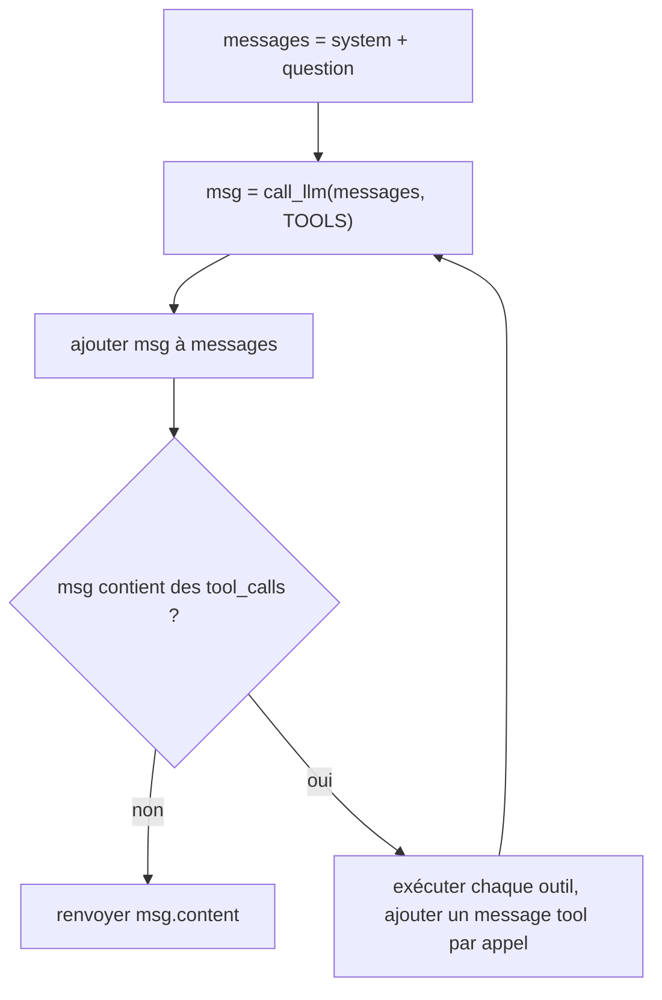

# La boucle agentique en 20 lignes

> [!NOTE]
> Dans cette leçon, vous allez écrire la boucle qui transforme `call_llm` + des outils en agent, puis la tester **sans clé d'API** grâce à un faux LLM.

## L'algorithme



Deux règles du format chat completions à respecter, sinon le fournisseur renvoie une erreur 400 :

1. le message de l'assistant qui contient les `tool_calls` doit être **ajouté tel quel** à l'historique ;
2. chaque appel doit recevoir **exactement un** message `{"role": "tool", "tool_call_id": ..., "content": ...}` avec le même `id`.

## Exécuter un appel d'outil

```python title="agent.py (partie 4, version naïve)"
def run_tool(call):
    name = call["function"]["name"]
    args = json.loads(call["function"]["arguments"] or "{}")
    result = TOOLS_PY[name](**args)
    return {"role": "tool", "tool_call_id": call["id"],
            "content": json.dumps(result, ensure_ascii=False)}
```

Les arguments arrivent sous forme de **chaîne JSON** (`"{\"ref\": \"P1\"}"`), d'où le `json.loads`. Le résultat repart aussi en chaîne : le modèle ne lit que du texte.

## La boucle

```python title="agent.py (partie 5)"
SYSTEM = ("Tu es l'assistant de commandes d'une boutique. Utilise les outils, "
          "n'invente jamais un prix ni un stock.")


def agent(question, max_steps=6, llm=call_llm):
    messages = [{"role": "system", "content": SYSTEM},
                {"role": "user", "content": question}]
    for _ in range(max_steps):
        msg = llm(messages, TOOLS)
        messages.append(msg)
        calls = msg.get("tool_calls") or []
        if not calls:                       # pas d'outil demandé : c'est fini
            return msg.get("content") or ""
        for call in calls:
            messages.append(run_tool(call))
    return "Désolé, je n'ai pas abouti. Je transmets à un conseiller."


if __name__ == "__main__":
    import sys
    print(agent(" ".join(sys.argv[1:]) or "Avez-vous du café en stock ?"))
```

```bash title="terminal"
python agent.py "Il vous reste du thé vert ?"
# Désolé, le thé vert 200 g est actuellement en rupture de stock.
```

Trois détails qui comptent :

| Détail | Pourquoi |
| --- | --- |
| `for _ in range(max_steps)` au lieu de `while True` | une boucle d'agent **doit** avoir une borne (leçon suivante) |
| le message de sortie quand la borne est atteinte | on ne renvoie jamais un silence au client ; on prévoit la sortie vers un humain |
| le paramètre `llm=call_llm` | permet d'injecter un faux LLM dans les tests |

```quiz
question: "Le modèle renvoie deux tool_calls dans le même message. Combien de messages de rôle tool faut-il ajouter avant le prochain call_llm ?"
options:
  - "Un seul, qui regroupe les deux résultats"
  - "Deux, un par tool_call_id"
  - "Aucun, le modèle les exécute lui-même"
answer: 1
explanation: "Chaque tool_call a un id et attend une réponse avec le même tool_call_id. Un message groupé ou absent produit une erreur du fournisseur ou un modèle qui « oublie » un résultat."
```

## Tester sans clé : le faux LLM

Un agent se teste comme n'importe quel code : on remplace la dépendance externe par un double qui rejoue un scénario écrit d'avance.

```python title="test_agent.py"
import json
from agent import agent


def faux_llm(script):
    reponses = iter(script)
    return lambda messages, tools: next(reponses)


def appel(id_, name, **args):
    return {"id": id_, "type": "function",
            "function": {"name": name, "arguments": json.dumps(args)}}


script = [
    {"role": "assistant", "content": None,
     "tool_calls": [appel("c1", "chercher_produit", texte="café")]},
    {"role": "assistant", "content": None,
     "tool_calls": [appel("c2", "consulter_stock", ref="P1")]},
    {"role": "assistant", "content": "Oui, 12 sacs de café en stock."},
]
assert agent("café ?", llm=faux_llm(script)) == "Oui, 12 sacs de café en stock."
print("ok")
```

> [!TIP]
> Ce test vérifie **votre plomberie** (la boucle, l'exécution des outils), pas l'intelligence du modèle. Pour évaluer le modèle, on utilise un jeu de questions réelles et on relit les réponses : c'est le sujet du module 4.

```quiz
question: "Pourquoi la boucle s'arrête-t-elle sur le message « Oui, 12 sacs de café en stock. » ?"
options:
  - "Parce que le texte contient le mot « Oui »"
  - "Parce que ce message n'a pas de tool_calls"
  - "Parce que max_steps vaut 3"
answer: 1
explanation: "La condition d'arrêt normale est l'absence de tool_calls : le modèle signale ainsi qu'il a fini. max_steps vaut 6 par défaut et ne sert que de garde-fou. Le contenu du texte n'est jamais analysé."
```

## Exercice : afficher la trace

Modifiez `agent()` pour qu'avec `verbose=True` il affiche, à chaque tour, le numéro du tour, le nom et les arguments de chaque outil appelé, puis le résultat (tronqué à 80 caractères). C'est votre premier outil d'observabilité.

<details>
<summary>Voir la solution</summary>

```python title="agent.py (boucle avec trace)"
def agent(question, max_steps=6, llm=call_llm, verbose=False):
    messages = [{"role": "system", "content": SYSTEM},
                {"role": "user", "content": question}]
    for step in range(1, max_steps + 1):
        msg = llm(messages, TOOLS)
        messages.append(msg)
        calls = msg.get("tool_calls") or []
        if not calls:
            return msg.get("content") or ""
        for call in calls:
            out = run_tool(call)
            if verbose:
                f = call["function"]
                print(f"[tour {step}] {f['name']}({f['arguments']}) -> {out['content'][:80]}")
            messages.append(out)
    return "Désolé, je n'ai pas abouti. Je transmets à un conseiller."
```

Sortie typique :

```text
[tour 1] chercher_produit({"texte": "thé vert"}) -> [{"ref": "P2", "nom": "Thé vert 200 g", "prix": 9.5}]
[tour 2] consulter_stock({"ref": "P2"}) -> {"ref": "P2", "quantite": 0}
```

</details>

## Je sais faire

- [ ] Écrire la boucle agentique de mémoire, avec une borne `max_steps`
- [ ] Respecter le couple `tool_calls` / messages `tool` avec le bon `tool_call_id`
- [ ] Tester la boucle avec un faux LLM, sans clé ni réseau
- [ ] Afficher une trace lisible des outils appelés
