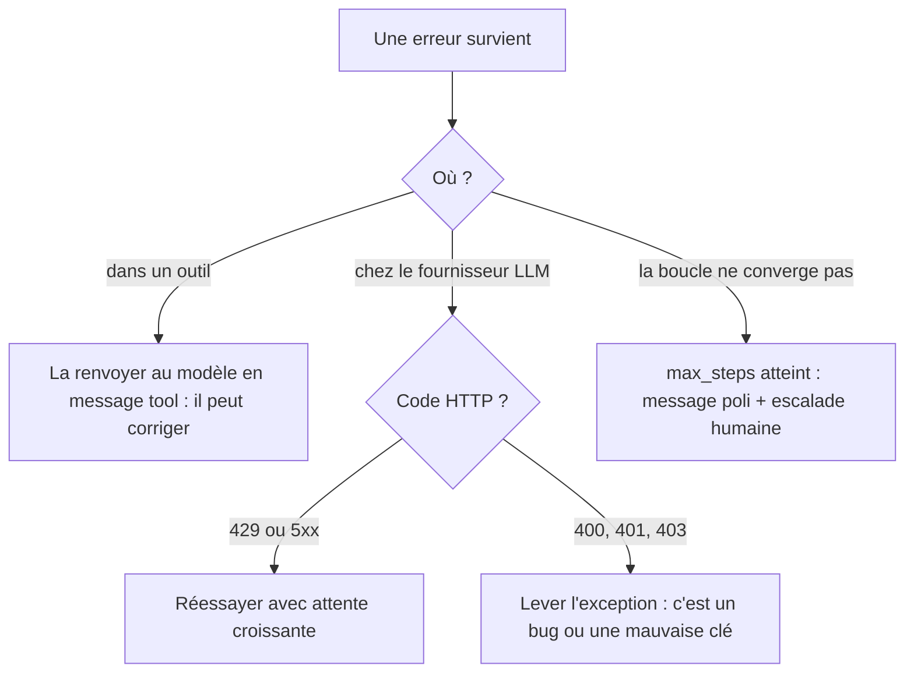

# Erreurs, limites et sortie de secours

> [!NOTE]
> Dans cette leçon, vous allez rendre l'agent robuste : une erreur d'outil ne doit jamais le faire planter, un fournisseur saturé ne doit pas tout casser, et une boucle qui tourne en rond doit s'arrêter proprement.

## Trois familles d'erreurs, trois traitements



| Erreur | Exemple | Bon réflexe | Mauvais réflexe |
| --- | --- | --- | --- |
| Outil inconnu | le modèle invente `annuler_commande` | message tool « Outil inconnu » | `KeyError` qui tue le processus |
| Arguments invalides | `consulter_stock(produit="P1")` | renvoyer le `TypeError` au modèle | planter |
| Erreur métier | référence `P9` inexistante | renvoyer le message d'erreur lisible | renvoyer une liste vide silencieuse |
| Quota fournisseur | HTTP 429 | attendre puis réessayer, nombre d'essais borné | réessayer en boucle sans pause |
| Clé invalide | HTTP 401 | arrêter avec un message clair | réessayer |

## Un outil qui échoue est une information

Le modèle sait très bien se corriger **si on lui dit ce qui ne va pas**. Le `try/except` est donc autour de l'exécution, et l'erreur repart dans la conversation :

```python title="agent.py (partie 4, version robuste)"
def run_tool(call):
    name = call["function"]["name"]
    try:
        args = json.loads(call["function"]["arguments"] or "{}")
        result = TOOLS_PY[name](**args)
    except KeyError:
        result = {"erreur": f"Outil inconnu : {name}"}
    except Exception as e:  # mauvais arguments, erreur métier...
        result = {"erreur": f"{type(e).__name__}: {e}"}
    return {"role": "tool", "tool_call_id": call["id"],
            "content": json.dumps(result, ensure_ascii=False)}
```

> [!WARNING]
> Ce `except KeyError` capture aussi un `KeyError` levé **à l'intérieur** d'un outil, et l'affichera comme « Outil inconnu ». Pour un code de production, testez plutôt `if name not in TOOLS_PY:` avant l'appel. On garde ici la version courte, mais vous la corrigerez dans l'exercice.

```quiz
question: "Le modèle appelle consulter_stock avec ref=\"café\". L'outil lève ValueError(\"Référence inconnue : café\"). Que fait la version robuste ?"
options:
  - "Le programme s'arrête avec une trace d'erreur"
  - "Le message tool contient l'erreur, et le modèle peut appeler chercher_produit pour trouver la vraie référence"
  - "L'appel est relancé automatiquement trois fois"
answer: 1
explanation: "L'erreur métier est renvoyée comme résultat de l'outil. Le modèle comprend qu'il a donné un nom au lieu d'une référence et se corrige souvent au tour suivant. Relancer le même appel à l'identique donnerait la même erreur."
```

## Le fournisseur aussi peut échouer

Les erreurs 429 (trop de requêtes) et 5xx sont temporaires : on réessaie avec une attente qui double. Les autres (400, 401, 403) sont des bugs : on les laisse remonter.

```python title="agent.py (call_llm avec réessais)"
import time
import urllib.error


def call_llm(messages, tools, retries=3):
    payload = {"model": MODEL, "messages": messages}
    if tools:                       # certains fournisseurs refusent "tools": []
        payload["tools"] = tools
    body = json.dumps(payload)
    for attempt in range(retries + 1):
        req = urllib.request.Request(
            f"{BASE_URL}/chat/completions", data=body.encode(),
            headers={"Content-Type": "application/json",
                     "Authorization": f"Bearer {os.environ['LLM_API_KEY']}"})
        try:
            with urllib.request.urlopen(req, timeout=60) as resp:
                return json.load(resp)["choices"][0]["message"]
        except urllib.error.HTTPError as e:
            if e.code not in (429, 500, 502, 503) or attempt == retries:
                raise
            time.sleep(2 ** attempt)  # 1 s, 2 s, 4 s
```

## La limite d'itérations

`max_steps` est le garde-fou le plus important d'un agent. Sans lui, un modèle qui redemande indéfiniment le même outil consomme des tokens jusqu'à ce que quelqu'un s'en aperçoive (souvent sur la facture).

| Valeur de `max_steps` | Effet |
| --- | --- |
| trop basse (1 ou 2) | l'agent abandonne des demandes légitimes qui demandent plusieurs outils |
| raisonnable (par exemple 5 à 10 pour 3 ou 4 outils) | couvre les cas normaux, borne le coût |
| très haute (50+) | ne protège plus vraiment : une boucle infinie coûte 50 appels |

> [!TIP]
> Fixez `max_steps` en regardant vos traces : prenez le nombre de tours des demandes les plus longues **qui réussissent**, et ajoutez une marge. Et quand la borne est atteinte, ne mentez pas au client : dites que vous transmettez à un humain, et **transmettez vraiment** (projet final).

```quiz
question: "Quelles erreurs doivent être réessayées automatiquement par call_llm ? (plusieurs réponses)"
options:
  - "HTTP 429 Too Many Requests"
  - "HTTP 401 Unauthorized"
  - "HTTP 503 Service Unavailable"
  - "HTTP 400 Bad Request à cause d'un tool_call_id manquant"
answer: [0, 2]
explanation: "429 et 503 sont temporaires : attendre puis réessayer a des chances de réussir. Un 401 (mauvaise clé) ou un 400 (requête mal formée) donnera exactement la même erreur à chaque essai : il faut corriger le code ou la configuration."
```

## Exercice : deux améliorations

1. Corrigez `run_tool` pour distinguer « outil inconnu » d'un `KeyError` levé dans l'outil.
2. Dans `agent()`, détectez la répétition : si le modèle demande **exactement le même appel** (même nom, mêmes arguments) qu'au tour précédent, arrêtez la boucle et escaladez.

<details>
<summary>Voir la solution</summary>

```python title="agent.py (améliorations)"
def run_tool(call):
    name = call["function"]["name"]
    if name not in TOOLS_PY:
        result = {"erreur": f"Outil inconnu : {name}"}
    else:
        try:
            args = json.loads(call["function"]["arguments"] or "{}")
            result = TOOLS_PY[name](**args)
        except Exception as e:
            result = {"erreur": f"{type(e).__name__}: {e}"}
    return {"role": "tool", "tool_call_id": call["id"],
            "content": json.dumps(result, ensure_ascii=False)}


ESCALADE = "Désolé, je n'ai pas abouti. Je transmets à un conseiller."


def agent(question, max_steps=6, llm=call_llm):
    messages = [{"role": "system", "content": SYSTEM},
                {"role": "user", "content": question}]
    previous = None
    for _ in range(max_steps):
        msg = llm(messages, TOOLS)
        messages.append(msg)
        calls = msg.get("tool_calls") or []
        if not calls:
            return msg.get("content") or ""
        signature = [(c["function"]["name"], c["function"]["arguments"]) for c in calls]
        if signature == previous:       # même demande deux fois de suite
            return ESCALADE
        previous = signature
        for call in calls:
            messages.append(run_tool(call))
    return ESCALADE
```

Test rapide avec le faux LLM de la leçon précédente : un script qui renvoie dix fois le même `tool_call` doit produire `ESCALADE` dès le deuxième tour.

```python title="test_agent.py (ajout)"
boucle = [{"role": "assistant",
           "tool_calls": [appel("c", "consulter_stock", ref="P1")]}] * 10
assert agent("x", llm=faux_llm(boucle)) == ESCALADE
```

</details>

## Je sais faire

- [ ] Renvoyer une erreur d'outil au modèle au lieu de planter
- [ ] Réessayer uniquement les erreurs temporaires du fournisseur, avec attente croissante
- [ ] Choisir une valeur de `max_steps` à partir de traces réelles
- [ ] Détecter un agent qui répète le même appel et l'arrêter proprement
