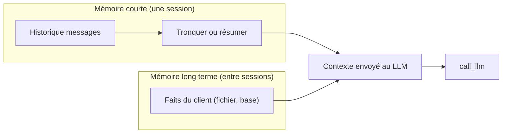

# Mémoire courte, résumé et mémoire long terme

> [!NOTE]
> Dans cette leçon, vous allez donner trois niveaux de mémoire à votre agent : l'historique d'une session, un résumé quand l'historique devient trop long, et des faits durables sur un client d'une session à l'autre.

## Un LLM n'a aucune mémoire

Chaque appel à `call_llm` est indépendant : le modèle ne « se souvient » que de ce que vous lui renvoyez dans `messages`. La mémoire d'un agent est donc **entièrement** de votre ressort.



| Niveau | Contenu | Durée de vie | Stockage typique |
| --- | --- | --- | --- |
| Historique | tous les messages de la session | une conversation | liste en mémoire, cache |
| Résumé | les faits importants des anciens tours | une conversation | un message dans l'historique |
| Long terme | préférences, adresse habituelle, dernière commande | des mois | base de données |
| État | panier en cours, étape du processus | une conversation | dictionnaire structuré, pas du texte |

## Niveau 1 : garder l'historique d'une question à l'autre

Jusqu'ici, `agent()` repartait de zéro à chaque question. On garde les messages dans un objet (`tronquer` est définie juste après) :

```python title="memoire.py"
import json
from pathlib import Path

from agent import SYSTEM, TOOLS, call_llm, run_tool


class Conversation:
    def __init__(self, llm=call_llm):
        self.llm = llm
        self.messages = [{"role": "system", "content": SYSTEM}]

    def demander(self, question, max_steps=6):
        self.messages.append({"role": "user", "content": question})
        self.messages = tronquer(self.messages)
        for _ in range(max_steps):
            msg = self.llm(self.messages, TOOLS)
            self.messages.append(msg)
            calls = msg.get("tool_calls") or []
            if not calls:
                return msg.get("content") or ""
            for call in calls:
                self.messages.append(run_tool(call))
        return "Désolé, je n'ai pas abouti. Je transmets à un conseiller."
```

## Niveau 2 : tronquer, puis résumer

L'historique grossit à chaque tour, et **tout** l'historique est refacturé à chaque appel. Première solution, la plus simple : ne garder que les derniers messages, en commençant toujours par un message `user` (un message `tool` privé de son `tool_calls` provoque une erreur 400 chez la plupart des fournisseurs).

```python title="memoire.py (suite)"
def tronquer(messages, garder=20):
    if len(messages) <= garder + 1:
        return messages
    recent = messages[-garder:]
    while recent and recent[0]["role"] != "user":   # jamais de message tool orphelin
        recent = recent[1:]
    return [messages[0]] + recent
```

Quand l'oubli pose problème (le client a donné sa référence au début), on **résume** les anciens tours avec le LLM lui-même :

```python title="memoire.py (suite)"
def compacter(messages, garder=10, llm=call_llm):
    if len(messages) <= garder + 1:
        return messages
    cut = len(messages) - garder
    while cut < len(messages) and messages[cut]["role"] != "user":
        cut += 1
    ancien = messages[1:cut]
    texte = "\n".join(f"{m['role']}: {m.get('content') or m.get('tool_calls')}"
                      for m in ancien)
    resume = llm([{"role": "user", "content":
                   "Résume en 5 lignes maximum les faits utiles de cet échange "
                   "(produits, références, quantités, décisions) :\n" + texte}], [])
    return [messages[0],
            {"role": "user", "content": "Résumé de la conversation précédente : "
             + (resume.get("content") or "")},
            {"role": "assistant", "content": "Bien noté."}] + messages[cut:]
```

```quiz
question: "Pourquoi ne pas simplement garder tout l'historique, puisque les modèles récents acceptent de très longs contextes ?"
options:
  - "Parce que c'est interdit par les fournisseurs"
  - "Parce que chaque appel refacture tout l'historique, et qu'un contexte très long coûte plus cher, ralentit et peut noyer l'information utile"
  - "Parce que le modèle refuse de répondre au-delà de 20 messages"
answer: 1
explanation: "Ce n'est ni interdit ni limité à 20 messages. Mais le coût d'un tour est proportionnel à la taille du contexte, qui est renvoyé en entier à chaque appel, et la qualité peut baisser quand l'information utile est perdue au milieu d'un long contexte."
```

## Niveau 3 : la mémoire long terme

Certains faits doivent survivre à la session : « livrer le samedi », « allergique aux arachides » (attention, donnée sensible, voir plus bas). On les stocke par client et on les **injecte** dans le prompt système.

```python title="memoire.py (suite)"
MEMOIRE = Path("memoire")


def lire_faits(client_id):
    f = MEMOIRE / f"{client_id}.json"
    return json.loads(f.read_text()) if f.exists() else []


def ajouter_fait(client_id, fait):
    if not client_id.isalnum():          # client_id finit dans un chemin de fichier
        raise ValueError("client_id invalide")
    MEMOIRE.mkdir(exist_ok=True)
    faits = lire_faits(client_id)
    if fait not in faits:
        faits.append(fait)
    (MEMOIRE / f"{client_id}.json").write_text(json.dumps(faits, ensure_ascii=False))
```

Qui alimente cette mémoire ? **Le code** (après chaque commande, on enregistre l'adresse), plus prévisible, ou **le modèle** via un outil `memoriser(fait)`, plus souple.

> [!CAUTION]
> Une mémoire long terme est un **traitement de données personnelles** : finalité claire, durée de conservation, droit d'accès et d'effacement, et pas de données sensibles (santé, opinions…) sans base légale. Prévoyez une fonction `oublier(client_id)` dès le premier jour.

```quiz
question: "Où doit vivre le panier en cours d'un client (références et quantités) ?"
options:
  - "Uniquement dans le texte de la conversation, le modèle s'en souviendra"
  - "Dans un état structuré (dictionnaire, base) manipulé par des outils, et rappelé au modèle si besoin"
  - "Dans la mémoire long terme, avec les préférences"
answer: 1
explanation: "Un panier est un état métier : il doit être exact, et une troncature ou un résumé ne doit pas pouvoir le perdre. On le garde dans une structure de données que les outils lisent et modifient. Ce n'est pas une préférence durable."
```

## Exercice : relier la mémoire long terme à la conversation

Modifiez `Conversation.__init__` pour qu'il prenne un `client_id`, lise ses faits et les ajoute au prompt système sous la forme « Ce que l'on sait du client : … ». Puis écrivez `oublier(client_id)`.

<details>
<summary>Voir la solution</summary>

```python title="memoire.py (solution)"
class Conversation:
    def __init__(self, client_id, llm=call_llm):
        self.llm = llm
        faits = lire_faits(client_id)
        system = SYSTEM
        if faits:
            system += "\nCe que l'on sait du client : " + " ; ".join(faits)
        self.messages = [{"role": "system", "content": system}]

    # demander() est inchangée


def oublier(client_id):
    (MEMOIRE / f"{client_id}.json").unlink(missing_ok=True)
```

Si vous laissez le modèle mémoriser lui-même via un outil `memoriser(fait)`, liez cet outil au `client_id` **dans le code** (par une fonction définie dans `__init__`) : le modèle ne doit jamais pouvoir choisir dans quelle mémoire il écrit. C'est ce que fait `ToolContext` dans ADK (leçon 3) et le projet final.

</details>

## Je sais faire

- [ ] Expliquer pourquoi la mémoire d'un agent est entièrement gérée par le code
- [ ] Tronquer un historique sans laisser de message `tool` orphelin
- [ ] Résumer les anciens tours avec le LLM
- [ ] Stocker et injecter des faits long terme, avec une possibilité d'effacement
