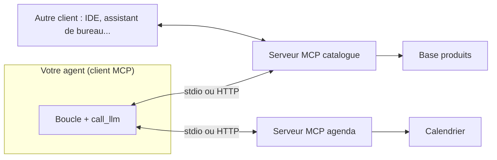

# Brancher des outils avec MCP

> [!NOTE]
> Dans cette leçon, vous allez sortir vos outils de l'agent pour les mettre dans un **serveur MCP**, puis adapter votre boucle pour qu'elle découvre et appelle ces outils via le protocole.

## Le problème que MCP résout

Dans `agent.py`, chaque outil existe deux fois : la fonction Python et son schéma JSON, écrits à la main, dans le même fichier que l'agent. Si une autre équipe veut réutiliser « consulter le stock » dans son propre agent (ou dans Claude Desktop, un IDE, Gemini CLI…), elle doit tout recopier.

Le **Model Context Protocol** (MCP) est un protocole ouvert qui standardise ce branchement : un **serveur** expose des outils, un **client** (votre agent) les découvre et les appelle. Un même serveur sert n'importe quel client compatible.



| Notion MCP | Ce que c'est | Dans notre exemple |
| --- | --- | --- |
| Tool | une fonction appelable, avec un schéma | `consulter_stock` |
| Resource | des données en lecture (fichier, enregistrement) | la fiche d'un produit |
| Prompt | un modèle de prompt proposé par le serveur | « rédiger un récapitulatif de commande » |
| Transport stdio | le serveur est un sous-processus local | développement, outils locaux |
| Transport HTTP (streamable) | le serveur est un service réseau | serveur partagé entre équipes |

## Le serveur : vos outils, sans les schémas

Le SDK Python officiel (`pip install mcp`) fournit `FastMCP`, qui **génère le schéma** à partir des annotations de type et de la docstring :

```python title="serveur_catalogue.py"
from mcp.server.fastmcp import FastMCP

mcp = FastMCP("catalogue")

CATALOGUE = {"P1": ("Café en grains 1 kg", 18.0), "P2": ("Thé vert 200 g", 9.5)}
STOCK = {"P1": 12, "P2": 0}


@mcp.tool()
def chercher_produit(texte: str) -> list[dict]:
    """Cherche des produits du catalogue par mot-clé."""
    t = texte.lower()
    return [{"ref": r, "nom": n, "prix": p}
            for r, (n, p) in CATALOGUE.items() if t in n.lower()]


@mcp.tool()
def consulter_stock(ref: str) -> dict:
    """Donne la quantité en stock d'une référence (ex. P1)."""
    if ref not in STOCK:
        raise ValueError(f"Référence inconnue : {ref}")
    return {"ref": ref, "quantite": STOCK[ref]}


if __name__ == "__main__":
    mcp.run()  # transport stdio par défaut
```

> [!TIP]
> La docstring devient la `description` de l'outil : soignez-la autant que vous soigniez le schéma au module 2. Une exception levée dans l'outil est renvoyée au client comme un résultat d'erreur, exactement le comportement « robuste » codé à la main au module 2.

```quiz
question: "Avec FastMCP, d'où vient le schéma JSON des paramètres de consulter_stock ?"
options:
  - "Il faut l'écrire à la main dans un fichier tools.json"
  - "Il est déduit de la signature Python (ref: str) et la description de la docstring"
  - "Le LLM le devine en lisant le code source du serveur"
answer: 1
explanation: "FastMCP inspecte les annotations de type pour construire le inputSchema et utilise la docstring comme description. Le LLM ne voit jamais le code du serveur, seulement ce que le client lui transmet."
```

## Le client : la même boucle, d'autres outils

Côté agent, on remplace `TOOLS` et `TOOLS_PY` par ce que le serveur annonce : `initialize`, puis `tools/list` (noms, descriptions, schémas), puis un `tools/call` par appel demandé par le LLM. Le SDK client est asynchrone, d'où `async` / `await`.

```python title="agent_mcp.py"
import asyncio
import json
import sys

from mcp import ClientSession, StdioServerParameters
from mcp.client.stdio import stdio_client

from agent import SYSTEM, call_llm


def vers_schema(t):
    """Outil MCP -> format chat completions."""
    return {"type": "function", "function": {
        "name": t.name, "description": t.description or "",
        "parameters": t.inputSchema}}


async def agent_mcp(question, max_steps=6, llm=call_llm):
    params = StdioServerParameters(command=sys.executable,
                                   args=["serveur_catalogue.py"])
    async with stdio_client(params) as (read, write):
        async with ClientSession(read, write) as session:
            await session.initialize()
            tools = [vers_schema(t) for t in (await session.list_tools()).tools]
            messages = [{"role": "system", "content": SYSTEM},
                        {"role": "user", "content": question}]
            for _ in range(max_steps):
                msg = llm(messages, tools)
                messages.append(msg)
                calls = msg.get("tool_calls") or []
                if not calls:
                    return msg.get("content") or ""
                for call in calls:
                    args = json.loads(call["function"]["arguments"] or "{}")
                    res = await session.call_tool(call["function"]["name"], args)
                    texte = "\n".join(c.text for c in res.content if c.type == "text")
                    messages.append({"role": "tool", "tool_call_id": call["id"],
                                     "content": texte})
            return "Désolé, je n'ai pas abouti. Je transmets à un conseiller."


if __name__ == "__main__":
    print(asyncio.run(agent_mcp(" ".join(sys.argv[1:]) or "Du café en stock ?")))
```

La boucle est **identique** à celle du module 2. Seules changent la découverte des outils (`list_tools`) et leur exécution (`call_tool`).

> [!WARNING]
> Un serveur MCP tiers exécute du code et renvoie du texte qui part dans le contexte de votre LLM. N'installez que des serveurs de confiance, épinglez leurs versions, et considérez leurs réponses comme des données non fiables (risque d'injection de prompt indirecte, voir l'OWASP Top 10 LLM).

```quiz
question: "Quels avantages apporte MCP par rapport aux outils codés dans agent.py ? (plusieurs réponses)"
options:
  - "Le même serveur d'outils est réutilisable par plusieurs agents et applications"
  - "Le modèle devient plus intelligent"
  - "Les outils peuvent être maintenus et déployés par une autre équipe, indépendamment de l'agent"
  - "Il n'y a plus besoin de limite d'itérations"
answer: [0, 2]
explanation: "MCP est un protocole de branchement : il découple les outils de l'agent, ce qui permet réutilisation et équipes séparées. Il ne change rien à la qualité du modèle ni aux garde-fous de la boucle, qui restent nécessaires."
```

## Exercice : ajouter un outil au serveur, sans toucher à l'agent

Ajoutez au serveur un outil `prix_total(ref: str, quantite: int)`. Relancez `agent_mcp.py "Combien pour 3 kg de café ?"`. Qu'avez-vous dû modifier dans `agent_mcp.py` ?

<details>
<summary>Voir la solution</summary>

```python title="serveur_catalogue.py (ajout)"
@mcp.tool()
def prix_total(ref: str, quantite: int) -> dict:
    """Calcule le prix total en euros pour une référence et une quantité.
    Toujours l'utiliser plutôt que de calculer soi-même."""
    if ref not in CATALOGUE:
        raise ValueError(f"Référence inconnue : {ref}")
    if quantite < 1:
        raise ValueError("La quantité doit être au moins 1")
    return {"ref": ref, "quantite": quantite,
            "total": round(CATALOGUE[ref][1] * quantite, 2)}
```

Dans `agent_mcp.py` : **rien**. L'agent découvre le nouvel outil au prochain `list_tools()`. C'est tout l'intérêt du protocole : l'ajout d'une capacité ne demande aucun redéploiement de l'agent.

</details>

## Je sais faire

- [ ] Expliquer ce qu'apportent un serveur et un client MCP
- [ ] Écrire un serveur MCP avec `FastMCP` et des docstrings utiles
- [ ] Convertir les outils MCP au format attendu par `call_llm`
- [ ] Citer un risque de sécurité propre aux serveurs MCP tiers
