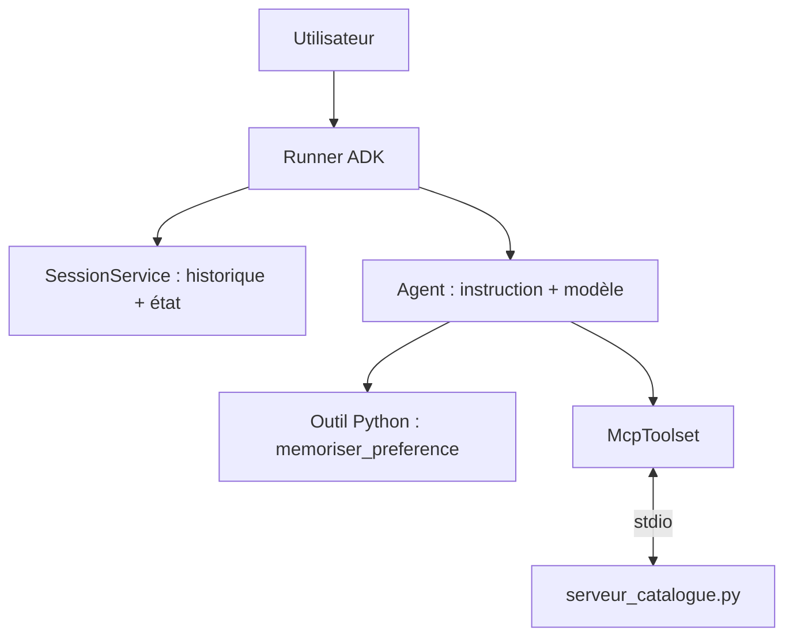

# Le même agent avec Google ADK

> [!NOTE]
> Dans cette leçon, vous allez réécrire l'assistant de commandes avec **Agent Development Kit** (ADK), le framework open source de Google, et retrouver dans ses concepts tout ce que vous avez codé à la main : boucle, outils, MCP, état et mémoire.

## Pourquoi un framework, maintenant ?

Vous savez ce qu'il y a sous le capot. Un framework vous évite de réécrire la plomberie (sessions, streaming, interface de test, traces, déploiement) et vous laisse vous concentrer sur les outils et les instructions.

| Ce que vous avez codé | Équivalent ADK |
| --- | --- |
| `SYSTEM` | `instruction=` de l'agent |
| `TOOLS` + `TOOLS_PY` | `tools=[fonction_python, ...]` : schéma déduit de la signature et de la docstring |
| `agent()` et sa boucle | le `Runner`, fourni |
| `max_steps` | `RunConfig(max_llm_calls=...)` |
| `Conversation.messages` | une **session** gérée par un `SessionService` |
| `lire_faits` / `ajouter_fait` | l'**état** de session (`tool_context.state`) et le `MemoryService` |
| `agent_mcp.py` | `McpToolset` |
| `call_llm` | `model="gemini-2.5-flash"` (ou d'autres modèles via LiteLLM) |



## Installation et structure

```bash title="terminal"
python -m venv .venv && source .venv/bin/activate
pip install google-adk
```

ADK attend un **dossier par agent**, avec un `__init__.py` et un `agent.py` qui définit `root_agent` :

```text
projet/
└── assistant_commandes/
    ├── __init__.py            # contient : from . import agent
    ├── agent.py
    ├── serveur_catalogue.py   # le serveur MCP de la leçon précédente
    └── .env
```

```bash title="assistant_commandes/.env"
# Avec une clé Gemini (Google AI Studio)
GOOGLE_GENAI_USE_VERTEXAI=FALSE
GOOGLE_API_KEY=votre-cle
# Ou avec Vertex AI sur votre projet Google Cloud :
# GOOGLE_GENAI_USE_VERTEXAI=TRUE
# GOOGLE_CLOUD_PROJECT=mon-projet
# GOOGLE_CLOUD_LOCATION=europe-west1
```

> [!WARNING]
> Ajoutez `.env` à votre `.gitignore` avant le premier commit.

## L'agent complet

```python title="assistant_commandes/agent.py"
import sys
from pathlib import Path

from google.adk.agents import Agent
from google.adk.tools import ToolContext
from google.adk.tools.mcp_tool import McpToolset, StdioConnectionParams
from mcp import StdioServerParameters

SERVEUR = str(Path(__file__).with_name("serveur_catalogue.py"))


def memoriser_preference(preference: str, tool_context: ToolContext) -> dict:
    """Retient une préférence durable du client (ex. 'livraison le samedi')."""
    prefs = tool_context.state.get("user:preferences", [])
    tool_context.state["user:preferences"] = prefs + [preference]
    return {"ok": True}


root_agent = Agent(
    name="assistant_commandes",
    model="gemini-2.5-flash",
    description="Aide les clients à trouver un produit et vérifier le stock.",
    instruction=(
        "Tu es l'assistant de commandes d'une boutique. Utilise les outils, "
        "n'invente jamais un prix ni un stock. "
        "Préférences connues du client : {user:preferences?}"
    ),
    tools=[
        McpToolset(connection_params=StdioConnectionParams(
            server_params=StdioServerParameters(
                command=sys.executable, args=[SERVEUR]))),
        memoriser_preference,
    ],
)
```

Lancez l'interface de développement **depuis le dossier parent** :

```bash title="terminal"
cd projet
adk web          # interface web locale : conversation, événements, état, traces
# ou
adk run assistant_commandes   # en ligne de commande
```

> [!TIP]
> Dans `adk web`, l'onglet des événements montre chaque appel d'outil et chaque réponse du modèle : c'est la trace que vous aviez codée à la main avec `verbose=True`.

## État et mémoire dans ADK

- `tool_context.state` est un dictionnaire attaché à la session. Le **préfixe** de la clé fixe sa portée : sans préfixe pour la session, `user:` pour toutes les sessions du même utilisateur, `app:` pour toute l'application, `temp:` pour l'invocation en cours.
- `{user:preferences?}` dans l'instruction est remplacé par la valeur de l'état ; le `?` évite une erreur si la clé n'existe pas encore.
- La persistance dépend du `SessionService` : en mémoire pour le développement, une base de données ou Vertex AI en production. Avec le service en mémoire, tout disparaît au redémarrage.

```quiz
question: "Dans ADK, comment le modèle sait-il que memoriser_preference attend un paramètre preference de type texte ?"
options:
  - "ADK construit la déclaration de l'outil à partir de la signature Python et de la docstring"
  - "Il faut écrire un schéma JSON à la main dans tools="
  - "Le modèle lit le paramètre tool_context et en déduit le reste"
answer: 0
explanation: "Comme FastMCP, ADK inspecte la fonction : preference: str devient un paramètre string obligatoire, la docstring devient la description. Le paramètre tool_context est reconnu par ADK et masqué au modèle."
```

```quiz
question: "Vous stockez le panier en cours sous la clé \"user:panier\". Quel est le problème ?"
options:
  - "Aucun, c'est la bonne portée"
  - "Le panier sera partagé par toutes les sessions de cet utilisateur et survivra à la conversation, alors qu'il concerne une commande en cours"
  - "Les clés avec deux-points sont interdites"
answer: 1
explanation: "Le préfixe user: rend la donnée commune à toutes les sessions de l'utilisateur. Un panier en cours relève de la session (clé sans préfixe). user: convient aux préférences durables."
```

## Exercice : un outil ADK qui écrit dans l'état

Ajoutez à l'agent ADK un outil `ajouter_au_panier(ref: str, quantite: int, tool_context: ToolContext)` qui ajoute une ligne dans `tool_context.state["panier"]` et renvoie le panier complet. Mettez à jour l'instruction pour que le modèle voie le panier.

<details>
<summary>Voir la solution</summary>

```python title="assistant_commandes/agent.py (ajout)"
def ajouter_au_panier(ref: str, quantite: int, tool_context: ToolContext) -> dict:
    """Ajoute une ligne au panier de la conversation en cours."""
    if quantite < 1:
        return {"erreur": "La quantité doit être au moins 1"}
    panier = tool_context.state.get("panier", [])
    panier = panier + [{"ref": ref, "quantite": quantite}]
    tool_context.state["panier"] = panier   # réassigner : ADK enregistre le changement
    return {"panier": panier}
```

Dans l'agent : ajoutez `ajouter_au_panier` à `tools=[...]` et la phrase `"Panier actuel : {panier?}"` à l'instruction.

On **réassigne** une nouvelle liste plutôt que de faire `.append()` sur la liste existante : c'est l'affectation dans `state` qui permet à ADK de détecter et d'enregistrer la modification. Et la clé `panier`, sans préfixe, limite le panier à la session.

</details>

## Je sais faire

- [ ] Faire correspondre chaque morceau de mon agent « fait main » à un concept ADK
- [ ] Créer un agent ADK avec des outils Python et un `McpToolset`
- [ ] Lancer `adk web` et lire les événements d'une conversation
- [ ] Choisir la bonne portée d'état : session, `user:`, `app:`, `temp:`
