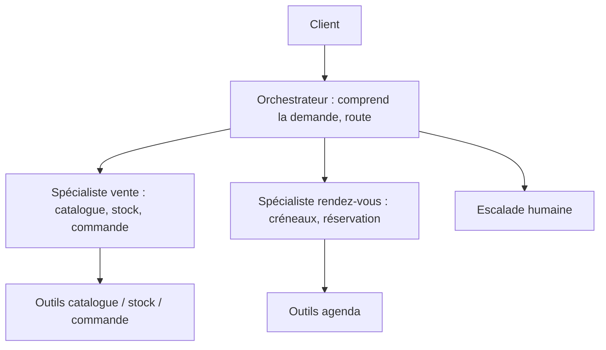
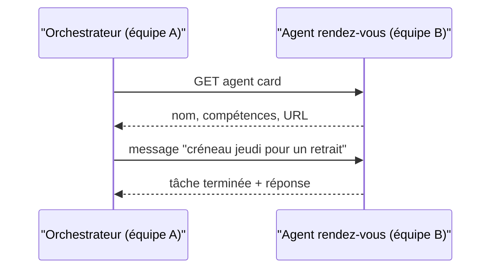

# Orchestrateur, spécialistes et protocole A2A

> [!NOTE]
> Dans cette leçon, vous allez découper un agent devenu trop gros en un **orchestrateur** et des **spécialistes**, choisir entre délégation et appel d'agent comme outil, et comprendre quand faire communiquer des agents distants avec **A2A**.

## Quand un seul agent ne suffit plus

Votre assistant de commandes grossit : catalogue, stock, commandes, puis prise de rendez-vous, suivi de livraison, retours… Avec quinze outils et une instruction de deux pages, le modèle se trompe plus souvent d'outil, et chaque modification risque d'en casser une autre.

Signaux qu'il est temps de découper :

- plus d'une dizaine d'outils, dont certains sans rapport entre eux ;
- des instructions contradictoires selon le sujet (ton commercial pour la vente, ton factuel pour le SAV) ;
- des équipes différentes qui veulent faire évoluer des parties différentes.

> [!WARNING]
> Le multi-agents multiplie les appels LLM, donc la latence et le coût, et rend le débogage plus difficile. Si un seul agent avec de bons outils marche, **restez-y**. On découpe pour un problème mesuré, pas par principe.

## Le motif orchestrateur / spécialistes



Chaque spécialiste a **peu d'outils** et une instruction courte et précise. L'orchestrateur n'a souvent **aucun outil métier** : son seul travail est de router.

Avec ADK, deux façons de relier un orchestrateur à ses spécialistes :

| | `sub_agents=[...]` (délégation) | `AgentTool(agent=...)` (agent comme outil) |
| --- | --- | --- |
| Ce qui se passe | l'orchestrateur **transfère** la conversation ; le spécialiste répond directement | l'orchestrateur **appelle** le spécialiste comme une fonction, récupère sa réponse et continue |
| Qui parle au client ensuite | le spécialiste | l'orchestrateur |
| Bon pour | des domaines séparés (vente / rendez-vous) | combiner plusieurs résultats dans une réponse |

```python title="multi_agents/agent.py"
from google.adk.agents import Agent
from google.adk.tools.agent_tool import AgentTool

vente = Agent(
    name="vente",
    model="gemini-2.5-flash",
    description="Recherche de produits, stock et création de commande.",
    instruction="Tu gères uniquement les commandes. Utilise tes outils.",
    tools=[],  # chercher_produit, consulter_stock, creer_commande...
)

rendez_vous = Agent(
    name="rendez_vous",
    model="gemini-2.5-flash",
    description="Propose des créneaux et réserve des rendez-vous en boutique.",
    instruction="Tu gères uniquement les rendez-vous.",
    tools=[],  # creneaux_libres, reserver...
)

root_agent = Agent(
    name="accueil",
    model="gemini-2.5-flash",
    instruction=("Identifie le besoin du client et transfère au bon spécialiste. "
                 "Si aucun ne convient, propose de parler à un conseiller."),
    sub_agents=[vente, rendez_vous],
)

# Variante « agent comme outil » : l'accueil garde la main.
# root_agent = Agent(..., tools=[AgentTool(agent=vente), AgentTool(agent=rendez_vous)])
```

> [!TIP]
> Pour la délégation, c'est la `description` de chaque spécialiste que l'orchestrateur lit pour choisir. Elle joue le même rôle que la description d'un outil au module 2.

```quiz
question: "L'orchestrateur doit répondre « Votre commande est créée et votre rendez-vous de retrait est confirmé jeudi » en une seule réponse. Quel branchement choisir ?"
options:
  - "sub_agents : la délégation transfère au premier spécialiste qui répond seul"
  - "AgentTool : l'orchestrateur appelle les deux spécialistes, récupère leurs résultats et rédige une réponse combinée"
  - "Aucun, il faut fusionner les deux spécialistes"
answer: 1
explanation: "Avec AgentTool, l'orchestrateur reste maître de la conversation et peut combiner plusieurs résultats. Avec sub_agents, la conversation passe au spécialiste, qui ne connaît que son domaine. Fusionner annulerait le bénéfice du découpage."
```

## A2A : quand les agents ne vivent pas au même endroit

`sub_agents` suppose que tous les agents sont dans le **même programme**. Mais le spécialiste rendez-vous peut appartenir à une autre équipe, être écrit avec un autre framework, tourner sur un autre serveur.

Le protocole **Agent2Agent** (A2A), lancé par Google et désormais projet open source sous gouvernance de la Linux Foundation, standardise ce dialogue :

- chaque agent publie une **agent card** (un JSON à une adresse bien connue de son serveur) qui décrit qui il est, ce qu'il sait faire et comment l'appeler ;
- les agents échangent des **messages** et des **tâches** (avec suivi d'état) sur HTTP.

| | MCP | A2A |
| --- | --- | --- |
| Relie | un agent à des **outils** et des données | un agent à **d'autres agents** |
| L'autre côté est | une fonction : entrée, sortie, pas d'autonomie | un agent : il raisonne, peut poser des questions, prendre du temps |
| Exemple | `consulter_stock(ref)` | « Spécialiste rendez-vous, trouve un créneau à ce client » |



Avec ADK (installer l'extra : `pip install "google-adk[a2a]"`), exposer un agent et en consommer un distant tient en quelques lignes :

```python title="exposer.py (côté équipe B)"
from google.adk.a2a.utils.agent_to_a2a import to_a2a
from rendez_vous.agent import root_agent

app = to_a2a(root_agent, port=8001)   # application ASGI : uvicorn exposer:app --port 8001
```

```python title="orchestrateur.py (côté équipe A)"
from google.adk.agents.remote_a2a_agent import RemoteA2aAgent

rendez_vous = RemoteA2aAgent(
    name="rendez_vous",
    description="Propose des créneaux et réserve des rendez-vous.",
    agent_card="http://localhost:8001/.well-known/agent-card.json",
)
# puis : Agent(..., sub_agents=[vente, rendez_vous])
```

> [!NOTE]
> Le chemin exact de l'agent card a changé entre versions du protocole. Récupérez l'URL que votre serveur affiche ou consultez la documentation A2A de votre version.

```quiz
question: "Quelles situations justifient A2A plutôt que sub_agents ? (plusieurs réponses)"
options:
  - "Le spécialiste est maintenu et déployé par une autre équipe"
  - "Le spécialiste est écrit avec un autre framework que ADK"
  - "Vous voulez simplement ranger votre code en plusieurs fichiers"
  - "Le spécialiste doit pouvoir être réutilisé par plusieurs orchestrateurs, sur le réseau"
answer: [0, 1, 3]
explanation: "A2A sert à faire dialoguer des agents distants, indépendants, éventuellement hétérogènes. Pour ranger du code dans un même programme, des modules Python et sub_agents suffisent : A2A ajouterait un appel réseau inutile."
```

## Exercice : découper l'assistant

Votre agent unique a ces outils : `chercher_produit`, `consulter_stock`, `creer_commande`, `suivre_livraison`, `creneaux_libres`, `reserver_creneau`, `transferer_humain`. Proposez un découpage (orchestrateur + spécialistes), dites quel outil va où, et justifiez le choix `sub_agents` ou `AgentTool`.

<details>
<summary>Voir la solution</summary>

Un découpage raisonnable :

| Agent | Outils | Justification |
| --- | --- | --- |
| `accueil` (orchestrateur) | `transferer_humain` | route, et doit toujours pouvoir escalader |
| `vente` | `chercher_produit`, `consulter_stock`, `creer_commande` | un même parcours de commande |
| `suivi` | `suivre_livraison` | demandes après-vente, ton différent |
| `rendez_vous` | `creneaux_libres`, `reserver_creneau` | domaine séparé, peut-être une autre équipe |

Branchement : `sub_agents`, car les demandes sont en général d'un seul domaine et le spécialiste peut mener la conversation. On garde `transferer_humain` **sur l'orchestrateur** (et idéalement sur chaque spécialiste) : l'escalade ne doit jamais dépendre d'un routage réussi.

Réponse tout aussi valable : ne **pas** découper. Sept outils restent gérables par un seul agent ; on découpe le jour où les traces montrent des erreurs de choix d'outil.

</details>

## Je sais faire

- [ ] Reconnaître les signaux qui justifient (ou non) plusieurs agents
- [ ] Écrire un orchestrateur ADK avec `sub_agents` ou `AgentTool`
- [ ] Expliquer la différence entre MCP et A2A
- [ ] Exposer un agent en A2A et consommer un agent distant
