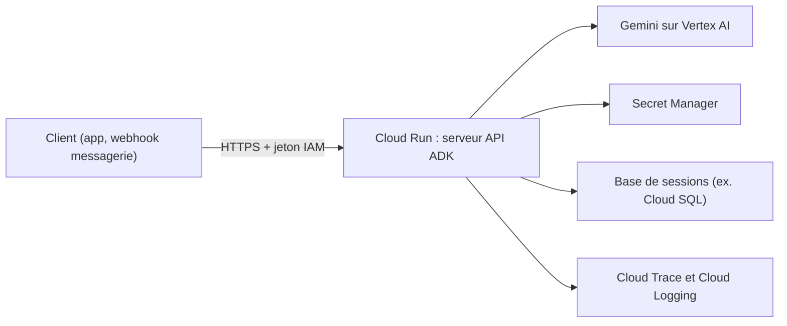

# Déployer l'agent sur Cloud Run

> [!NOTE]
> Dans cette leçon, vous allez mettre votre agent ADK derrière une URL HTTPS privée sur Cloud Run, avec la clé dans Secret Manager, des sessions qui survivent aux redémarrages et des traces. Pour le détail ligne par ligne (Dockerfile, Terraform, IAM), une formation dédiée existe : [un agent ADK sur Cloud Run, déployé avec Terraform](../../../04-agents-google-cloud/01-construire-des-agents/01-adk-cloud-run-terraform/README.md).

## Où faire tourner un agent ?

| Option | Ce que vous gérez | Bon pour |
| --- | --- | --- |
| **Cloud Run** | un conteneur ; Google gère serveurs et mise à l'échelle | API d'agent, webhooks (WhatsApp, chat), contrôle total |
| **Vertex AI Agent Engine** | le code de l'agent ; sessions, mémoire et mise à l'échelle sont gérées | aller vite sur un agent ADK, avec services managés |
| **Gemini Enterprise** | rien côté infra : l'agent est proposé aux employés dans l'interface | assistant interne, après déploiement sur l'une des options ci-dessus |

Nous prenons Cloud Run : c'est le plus transparent, et le même conteneur peut recevoir les webhooks d'une messagerie, à la manière d'un agent de commande sur WhatsApp comme Watpilot.



## Le chemin le plus court : `adk deploy cloud_run`

ADK sait construire le conteneur et le déployer pour vous :

```bash title="terminal"
export PROJECT_ID="mon-projet"
export REGION="europe-west1"

gcloud services enable run.googleapis.com aiplatform.googleapis.com \
  cloudbuild.googleapis.com artifactregistry.googleapis.com --project "$PROJECT_ID"

adk deploy cloud_run \
  --project "$PROJECT_ID" \
  --region "$REGION" \
  --service_name assistant-commandes \
  --trace_to_cloud \
  ./assistant_commandes \
  -- --no-allow-unauthenticated
```

Les options après `--` sont transmises telles quelles à `gcloud run deploy` : ici, on **interdit** les appels anonymes.

> [!WARNING]
> En production, utilisez Gemini via **Vertex AI** (`GOOGLE_GENAI_USE_VERTEXAI=TRUE`) : le service Cloud Run s'authentifie avec son compte de service, et il n'y a **plus de clé** à stocker. Si vous devez garder une clé (autre fournisseur), mettez-la dans Secret Manager et montez-la en variable d'environnement (`--set-secrets`), jamais en clair dans `--set-env-vars` ni dans l'image.

## Appeler l'agent déployé

Le serveur API d'ADK expose notamment `/apps/{app}/users/{user}/sessions/{session}` pour créer une session et `/run` pour envoyer un message :

```bash title="terminal"
URL=$(gcloud run services describe assistant-commandes --region "$REGION" --format 'value(status.url)')
TOKEN=$(gcloud auth print-identity-token)

curl -s -X POST -H "Authorization: Bearer $TOKEN" \
  "$URL/apps/assistant_commandes/users/u1/sessions/s1"

curl -s -X POST -H "Authorization: Bearer $TOKEN" -H "Content-Type: application/json" \
  "$URL/run" -d '{
    "app_name": "assistant_commandes", "user_id": "u1", "session_id": "s1",
    "new_message": {"role": "user", "parts": [{"text": "Il vous reste du café ?"}]}
  }'
```

```quiz
question: "Votre agent est déployé avec le service de sessions en mémoire et Cloud Run démarre une deuxième instance sous la charge. Que constate un client ?"
options:
  - "Rien, Cloud Run partage la mémoire entre instances"
  - "Sa conversation peut « oublier » ce qu'il a dit, si sa requête suivante arrive sur l'autre instance"
  - "Cloud Run refuse de démarrer une deuxième instance"
answer: 1
explanation: "Chaque instance a sa propre mémoire. Une session créée sur l'instance A n'existe pas sur l'instance B. Il faut un service de sessions partagé (base de données ou Vertex AI) dès qu'il peut y avoir plus d'une instance, ou limiter à une instance en phase de test."
```

## Avant d'ouvrir aux clients

| Point | Pourquoi | Comment |
| --- | --- | --- |
| Sessions persistantes | conversations cohérentes entre instances et redémarrages | `--session_service_uri` vers une base ou Vertex AI |
| Accès privé | personne n'appelle votre agent (ni ne consomme votre budget) sans autorisation | `--no-allow-unauthenticated` + IAM, ou une passerelle |
| Compte de service dédié | moindre privilège | un compte avec seulement les rôles nécessaires (ex. utilisateur Vertex AI) |
| Plafonds | éviter l'emballement des coûts | `max_llm_calls`, `--max-instances`, alertes budgétaires |
| Traces | déboguer en production | `--trace_to_cloud`, journaux structurés |
| Jeu de tests | ne pas casser ce qui marchait | `adk eval` ou vos propres cas, à relancer avant chaque déploiement |

```quiz
question: "Quelles mesures réduisent le risque qu'un agent déployé coûte beaucoup plus que prévu ? (plusieurs réponses)"
options:
  - "Une limite du nombre d'appels LLM par requête"
  - "Un nombre maximal d'instances Cloud Run"
  - "Rendre le service public pour simplifier les tests"
  - "Une alerte budgétaire sur le projet"
answer: [0, 1, 3]
explanation: "Limiter les appels par requête, les instances et être alerté sur le budget bornent le coût. Un service public permet à n'importe qui de l'appeler, ce qui augmente le risque au lieu de le réduire."
```

## Exercice : préparer la mise en production

Écrivez la commande `adk deploy cloud_run` complète pour un déploiement de production : service privé, traces, au plus 3 instances, sessions stockées dans une base PostgreSQL dont l'URL est fournie par la variable `SESSION_DB_URL`, et Gemini via Vertex AI. Puis listez les deux vérifications à faire juste après.

<details>
<summary>Voir la solution</summary>

```bash title="terminal"
adk deploy cloud_run \
  --project "$PROJECT_ID" \
  --region "$REGION" \
  --service_name assistant-commandes \
  --trace_to_cloud \
  --session_service_uri "$SESSION_DB_URL" \
  ./assistant_commandes \
  -- --no-allow-unauthenticated --max-instances=3 \
     --service-account="agent-commandes@${PROJECT_ID}.iam.gserviceaccount.com"
```

Avec, dans `assistant_commandes/.env` (ou en variables du service) : `GOOGLE_GENAI_USE_VERTEXAI=TRUE`, `GOOGLE_CLOUD_PROJECT` et `GOOGLE_CLOUD_LOCATION`, sans clé d'API.

Vérifications juste après :

1. **Un appel sans jeton échoue** (`curl "$URL/list-apps"` doit renvoyer 401 ou 403), et le même appel avec jeton réussit.
2. **Une conversation en deux messages** garde le contexte, et sa trace apparaît dans Cloud Trace avec les appels d'outils.

Remarque : l'URL de la base contient un mot de passe. Pour un vrai projet, préférez une connexion sans mot de passe (authentification IAM) ou un secret monté ; la formation Terraform citée en tête de leçon montre comment câbler tout cela proprement.

</details>

## Je sais faire

- [ ] Choisir entre Cloud Run, Agent Engine et Gemini Enterprise pour un cas donné
- [ ] Déployer un agent ADK avec `adk deploy cloud_run` en service privé
- [ ] Appeler l'agent déployé avec un jeton d'identité
- [ ] Vérifier sessions persistantes, plafonds et traces avant l'ouverture aux clients
