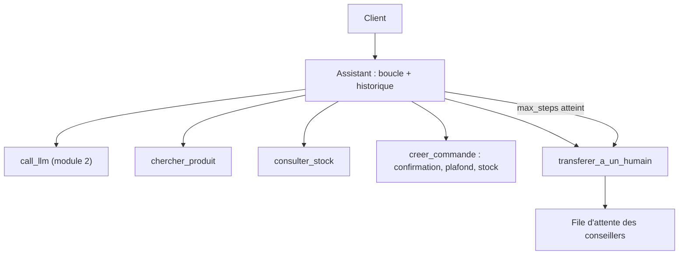

# Projet (1/2) : cahier des charges et outils

> [!NOTE]
> Dans ce projet en deux parties, vous allez livrer un assistant de commandes qui consulte le catalogue, vérifie le stock, crée une commande après confirmation et **passe la main à un humain** quand il le faut. Cette première partie fixe le cahier des charges et vous fait écrire les outils. Comptez une heure pour l'ensemble.

## Le cahier des charges

Une boutique en ligne veut un assistant conversationnel (le même métier qu'un agent de commande sur WhatsApp comme Watpilot). Il doit :

1. **chercher un produit** dans le catalogue par mot-clé (outil 1) ;
2. **consulter le stock** d'une référence (outil 2) ;
3. **créer une commande** (outil 3), uniquement après un récapitulatif et un « oui » explicite du client, avec au plus 50 unités et un stock suffisant ;
4. **transférer à un humain** sur réclamation, demande hors périmètre ou demande explicite, et quand la boucle n'aboutit pas ;
5. ne jamais inventer un prix, une référence ou un stock ;
6. garder le contexte d'un message à l'autre (« oui » doit avoir un sens).



## Les étapes

1. Reprenez `agent.py` du module 2 (`call_llm` et les deux premiers outils), et ajoutez au catalogue `"P3": ("Chocolat noir 100 g", 3.2)` avec un stock de 40.
2. Écrivez `creer_commande` et `transferer_a_un_humain`, puis les 4 schémas et le prompt système (**cette partie**).
3. Assemblez la classe `Assistant`, testez et évaluez (**partie 2**).

> [!TIP]
> Les tests sont fournis : téléchargez [test_assistant.py](./files/test_assistant.py) et lisez-le **avant** de coder, c'est votre spécification. Ils utilisent un faux LLM : à la fin de la partie 2, `python test_assistant.py` doit afficher `ok : 4 scénarios`, sans clé ni réseau.

| Règle métier | Où la mettre | Pourquoi |
| --- | --- | --- |
| Pas de commande sans confirmation | paramètre `confirme` + description de l'outil | oblige le modèle à récapituler d'abord |
| Au plus 50 unités | dans le code de `creer_commande` | un prompt peut être contourné |
| Stock suffisant | dans le code de `creer_commande` | donnée exacte, pas une estimation du modèle |
| Commande au nom du bon client | `client_id` injecté par le code | le modèle ne doit pas pouvoir le choisir |

```quiz
question: "Le modèle doit-il fournir le client_id en argument de creer_commande ?"
options:
  - "Oui, il le connaît grâce à la conversation"
  - "Non : le client_id vient de la session authentifiée et est injecté par le code ; le schéma de l'outil ne le mentionne même pas"
  - "Oui, mais seulement s'il le demande au client"
answer: 1
explanation: "Si le modèle pouvait choisir le client_id, une injection de prompt suffirait à commander au nom d'un autre client. Le code lie l'outil au client de la session ; le modèle ne voit que ref, quantite et confirme."
```

```quiz
question: "Le paramètre confirme=true de creer_commande est rempli par le modèle. Quelles affirmations sont justes ? (plusieurs réponses)"
options:
  - "Il oblige le modèle à passer par un récapitulatif, ce qui réduit les commandes accidentelles"
  - "Il garantit à 100 % que le client a dit oui"
  - "Pour une garantie forte, on ferait valider la commande par le client hors du LLM (bouton, lien de paiement)"
  - "Les plafonds de quantité et le contrôle du stock restent nécessaires, dans le code"
answer: [0, 2, 3]
explanation: "confirme est un garde-fou utile mais déclaratif : le modèle pourrait se tromper. Une vraie garantie passe par une validation hors du LLM. Les contrôles déterministes (plafond, stock) sont toujours faits par le code."
```

## Exercice : les outils, les schémas et le prompt

Dans `assistant_commandes.py` (qui fait `from agent import call_llm`, ainsi que vos `CATALOGUE`, `STOCK`, `chercher_produit` et `consulter_stock`), écrivez :

- `creer_commande(client_id, ref, quantite, confirme)` qui applique les règles du tableau, décrémente le stock, enregistre la commande dans un dictionnaire `COMMANDES` et renvoie `{"numero", "total"}` ;
- `transferer_a_un_humain(client_id, motif)` qui ajoute une entrée à une liste `FILE_HUMAINE` ;
- la liste `TOOLS` des 4 schémas (sans `client_id`) et le prompt `SYSTEM`.

Chaque règle violée doit **lever une exception** au message clair : `run_tool` la renverra au modèle.

<details>
<summary>Voir la solution</summary>

```python title="assistant_commandes.py (partie 1)"
import json
import uuid

COMMANDES = {}           # simplification : une vraie base en production
FILE_HUMAINE = []        # simplification : un outil de ticketing en production
QUANTITE_MAX = 50


def creer_commande(client_id: str, ref: str, quantite: int, confirme: bool) -> dict:
    if not confirme:
        raise ValueError("Récapitule (produit, quantité, total) et demande "
                         "confirmation au client avant de créer la commande.")
    if ref not in CATALOGUE:
        raise ValueError(f"Référence inconnue : {ref}")
    if not 1 <= quantite <= QUANTITE_MAX:
        raise ValueError(f"Quantité hors limites (1 à {QUANTITE_MAX}) : "
                         "propose le transfert à un conseiller.")
    if STOCK[ref] < quantite:
        raise ValueError(f"Stock insuffisant : {STOCK[ref]} disponible(s).")
    STOCK[ref] -= quantite
    numero = "CMD-" + uuid.uuid4().hex[:8].upper()
    total = round(CATALOGUE[ref][1] * quantite, 2)
    COMMANDES[numero] = {"client": client_id, "ref": ref,
                         "quantite": quantite, "total": total}
    return {"numero": numero, "total": total}


def transferer_a_un_humain(client_id: str, motif: str) -> dict:
    FILE_HUMAINE.append({"client": client_id, "motif": motif})
    return {"transfere": True, "message": "Un conseiller reprend la conversation."}


def schema(name, description, **props):
    return {"type": "function", "function": {
        "name": name, "description": description,
        "parameters": {"type": "object", "properties": props,
                       "required": list(props)}}}


TOOLS = [
    schema("chercher_produit", "Cherche des produits du catalogue par mot-clé. "
           "Renvoie référence, nom et prix.", texte={"type": "string"}),
    schema("consulter_stock", "Quantité en stock d'une référence (ex. P1). "
           "Appeler après chercher_produit.", ref={"type": "string"}),
    schema("creer_commande", "Crée la commande. Mettre confirme=true UNIQUEMENT si le "
           "client vient de dire explicitement oui au récapitulatif.",
           ref={"type": "string"}, quantite={"type": "integer", "minimum": 1},
           confirme={"type": "boolean"}),
    schema("transferer_a_un_humain", "Passe la main à un conseiller : réclamation, "
           "demande hors catalogue, client mécontent, ou demande explicite.",
           motif={"type": "string"}),
]

SYSTEM = (
    "Tu es l'assistant de commandes d'une boutique en ligne. Tu aides à trouver un "
    "produit, vérifier le stock et passer commande. Règles : n'invente jamais un prix, "
    "une référence ni un stock, utilise les outils ; avant de créer une commande, "
    "récapitule produit, quantité et total et attends un oui explicite ; hors de ce "
    "périmètre, ou si le client le demande, transfère à un humain. Réponds en "
    "français, en phrases courtes."
)

ESCALADE = "Je vous mets en relation avec un conseiller."


```

Le petit utilitaire `schema()` évite de répéter la structure JSON quatre fois ; tous les paramètres y sont obligatoires, ce qui convient ici.

</details>

## Je sais faire

- [ ] Traduire un cahier des charges en outils, paramètres et règles
- [ ] Décider pour chaque règle si elle va dans le prompt, le schéma ou le code
- [ ] Écrire des outils qui lèvent des erreurs lisibles par le modèle
- [ ] Cacher au modèle les paramètres qu'il ne doit pas contrôler (`client_id`)
