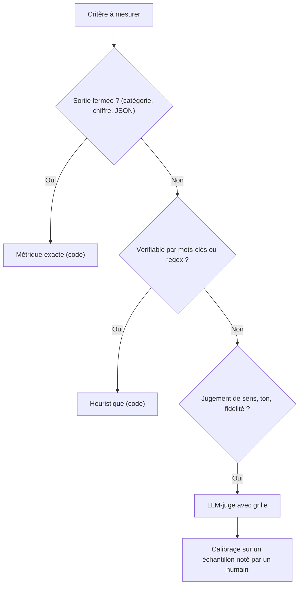

> [!NOTE]
> Dans cette leçon, vous allez choisir la bonne méthode de notation pour chaque critère : **métrique exacte**, **heuristique**, **LLM-juge** avec grille, ou **évaluation humaine**. Vous apprendrez aussi les biais connus des juges LLM et comment les limiter.

## Trois familles de notation

La documentation d'Anthropic distingue la notation **par code**, **par humain** et **par modèle**. Vertex AI fait une distinction proche entre métriques **calculées** (computation-based) et métriques **basées sur un modèle** (model-based). La règle d'or : **utilisez la méthode la moins chère qui mesure correctement le critère**.



| Méthode | Exemples | Coût | Limites |
|---|---|---|---|
| Exacte | Classification d'un ticket, extraction d'une date, JSON conforme au schéma | Quasi nul | Inutilisable sur du texte libre |
| Heuristique | Contient « 25 jours », ne contient pas « 30 jours », cite `[doc:…]`, longueur max | Quasi nul | Reformulations, négations (« pas 25 jours ») |
| Similarité | ROUGE, BLEU, similarité d'embeddings avec la référence | Faible | Mesure la ressemblance, pas la justesse |
| LLM-juge | Fidélité au contexte, complétude, ton, respect de consignes | Un appel LLM par cas et par critère | Biais, variabilité, coût |
| Humain | Validation finale, calibrage du juge, cas ambigus | Élevé | Lent, peu scalable, désaccords entre annotateurs |

> [!TIP]
> Les heuristiques sont sous-estimées. Un `doit_contenir` + `interdit` bien choisis attrapent une grande partie des régressions factuelles, gratuitement et sans variabilité.

## Le LLM-juge : une grille, pas une impression

Demander « cette réponse est-elle bonne ? note de 1 à 10 » produit des notes instables. Un bon juge reçoit **un critère précis, une grille décrite niveau par niveau, et doit justifier avant de noter**. C'est l'approche de G-Eval (Liu et al., 2023) : critères explicites et étapes d'évaluation.

```python title="juge.py"
GRILLE_FIDELITE = """Tu évalues la FIDÉLITÉ d'une réponse à un contexte documentaire.

Contexte :
<contexte>{contexte}</contexte>

Question : {question}
Réponse à évaluer :
<reponse>{reponse}</reponse>

Grille :
5 = toutes les affirmations sont soutenues par le contexte
4 = une précision mineure non soutenue, sans impact sur le sens
3 = une affirmation non soutenue qui pourrait induire en erreur
2 = plusieurs affirmations non soutenues
1 = la réponse contredit le contexte ou invente l'essentiel

Liste d'abord chaque affirmation et indique si elle est soutenue.
Puis termine par une ligne unique : NOTE: <1-5>"""

import re

def noter(appeler_llm, question, reponse, contexte):
    texte = appeler_llm(GRILLE_FIDELITE.format(
        contexte=contexte, question=question, reponse=reponse))
    m = re.search(r"NOTE:\s*([1-5])", texte)
    return int(m.group(1)) if m else None  # None = juge illisible, à compter à part
```

Avec Claude, placez le contexte et la réponse dans des **balises XML** (comme ci-dessus) : la documentation Anthropic recommande cette structuration pour séparer clairement les données des instructions. Sur Vertex AI, le service d'évaluation propose des métriques basées sur un modèle prêtes à l'emploi et des modèles de prompt pour définir les vôtres.

## Les biais connus des juges

L'article « Judging LLM-as-a-Judge » (Zheng et al., 2023, arXiv 2306.05685) a mis en évidence plusieurs biais :

| Biais | Symptôme | Parade |
|---|---|---|
| **Position** | En comparaison A/B, le juge préfère souvent la première (ou la seconde) réponse | Évaluer les deux ordres, ne garder que les verdicts cohérents |
| **Verbosité** | Une réponse longue paraît meilleure | Grille qui pénalise le hors-sujet, critère de concision explicite |
| **Auto-complaisance** | Un modèle favorise les réponses de sa propre famille | Utiliser un juge d'une autre famille que le modèle évalué, ou vérifier sur échantillon humain |
| **Raisonnement limité** | Le juge se trompe sur des calculs ou de la logique | Fournir la réponse de référence au juge |

> [!WARNING]
> Un juge LLM est un **instrument de mesure** : avant de lui faire confiance, mesurez son accord avec un humain sur un échantillon (par exemple 30 à 50 cas). S'il est en désaccord fréquent, corrigez la grille, pas le système évalué.

```quiz
question: "Vous comparez deux prompts en demandant à un juge « quelle réponse est la meilleure, A ou B ? ». Le prompt B gagne 70 % du temps, mais B est toujours présenté en second. Que faire ?"
options:
  - "Conclure que B est meilleur : 70 % est net"
  - "Relancer en inversant l'ordre et ne compter que les verdicts stables dans les deux ordres"
  - "Remplacer le juge par un modèle plus gros sans autre changement"
answer: 1
explanation: "C'est le biais de position décrit par Zheng et al. On neutralise l'ordre en évaluant (A,B) puis (B,A). Un modèle plus gros réduit parfois le biais mais ne le supprime pas."
```

## Mesurer l'accord juge / humain

Le plus simple : le **taux d'accord** sur un verdict binaire (note au moins 4 = acceptable).

```python title="accord.py"
def taux_accord(notes_juge, notes_humain, seuil=4):
    paires = [(j >= seuil, h >= seuil) for j, h in zip(notes_juge, notes_humain) if j is not None]
    return sum(a == b for a, b in paires) / len(paires)

juge   = [5, 4, 2, 5, 3, 4, 1, 5]
humain = [5, 5, 2, 4, 4, 4, 1, 5]
print(taux_accord(juge, humain))  # 0.875 : un seul désaccord (cas 5)
```

> [!TIP]
> Regardez **les désaccords** un par un. Ils révèlent presque toujours un critère ambigu dans la grille (« précision mineure », c'est quoi exactement ?).

## L'évaluation humaine reste indispensable

L'humain ne note pas tout, il intervient à trois endroits :

1. **Écrire et valider** le jeu doré (leçon précédente).
2. **Calibrer** le juge LLM sur un échantillon.
3. **Trancher** les cas où le juge est illisible ou hésitant, et relire un échantillon des échecs à chaque campagne.

Pour limiter la subjectivité : même grille que le juge, deux annotateurs sur une partie des cas, et notation **à l'aveugle** (l'annotateur ne sait pas quelle version a produit la réponse).

```quiz
question: "Quelle méthode convient le mieux pour vérifier qu'un classifieur de tickets renvoie l'une des cinq catégories autorisées ?"
options:
  - "Un LLM-juge avec une grille sur 5 niveaux"
  - "Une métrique exacte : comparaison avec la catégorie attendue"
  - "Une évaluation humaine de chaque ticket"
answer: 1
explanation: "La sortie est fermée : une comparaison exacte est gratuite, déterministe et parfaitement fiable. Un juge ou un humain n'apporteraient que du coût et du bruit."
```

## Exercice : choisir la méthode et écrire une grille

Pour un assistant de support client fictif, associez à chaque critère la méthode la moins chère qui fonctionne, puis rédigez la grille du critère qui nécessite un juge.

1. La réponse est au format JSON `{"reponse": str, "sources": [str]}`.
2. La réponse ne mentionne aucun concurrent (liste de 6 noms connue).
3. Le ton reste courtois même face à un client agressif.
4. La catégorie du ticket (`facturation`, `technique`, `resiliation`) est correcte.

<details>
<summary>Voir la solution</summary>

| # | Méthode | Pourquoi |
|---|---|---|
| 1 | Exacte : validation de schéma (`json.loads` + Pydantic ou `jsonschema`) | Sortie structurée, vérifiable par code |
| 2 | Heuristique : `interdit` avec la liste des 6 noms | Liste fermée, recherche de chaînes suffisante |
| 3 | LLM-juge avec grille | Jugement de ton, non vérifiable par mots-clés |
| 4 | Exacte : comparaison à la catégorie attendue | Sortie fermée |

Grille pour le critère 3 :

```text
Tu évalues la COURTOISIE de la réponse d'un conseiller à un client.
5 = ton calme et respectueux, reconnaît la frustration, propose une action
4 = ton respectueux mais impersonnel
3 = une formulation sèche ou condescendante
2 = plusieurs formulations sèches, ou reproche adressé au client
1 = ton agressif, ironique ou insultant
Cite les formulations qui justifient ta note, puis termine par : NOTE: <1-5>
```

Ensuite : faites noter 30 réponses par un humain avec la même grille et mesurez le taux d'accord avant d'utiliser le juge en CI.

</details>

## Je sais faire

- [ ] Choisir entre métrique exacte, heuristique, LLM-juge et humain pour un critère donné.
- [ ] Écrire une grille de juge avec niveaux décrits et justification avant la note.
- [ ] Citer trois biais des juges LLM et une parade pour chacun.
- [ ] Mesurer le taux d'accord entre un juge et un annotateur humain.
