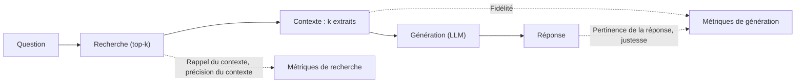
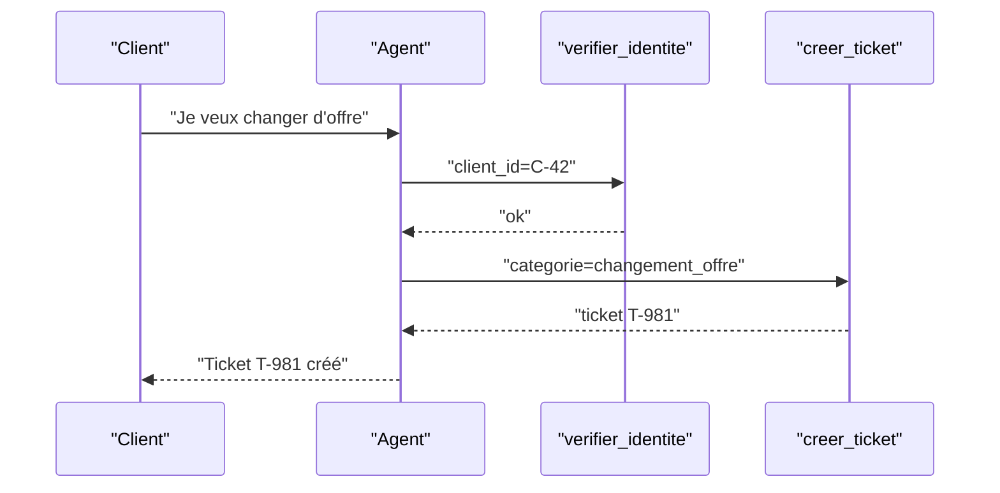

> [!NOTE]
> Dans cette leçon, vous allez décomposer l'évaluation d'un RAG en **recherche** (rappel, pertinence du contexte) et **génération** (fidélité, pertinence de la réponse), puis évaluer un agent sur son **succès de tâche** et sa **trajectoire**.

## Un RAG, deux systèmes à mesurer

Quand un RAG répond mal, la question utile est : **la bonne information était-elle dans le contexte ?** Si non, c'est la recherche. Si oui, c'est la génération. Mesurer une seule note globale empêche de savoir quoi corriger.



## Les métriques de RAGAS

L'article **RAGAS** (Es et al., 2023, arXiv 2309.15217) a popularisé des métriques de RAG évaluées par LLM, dont trois centrales :

| Métrique | Question posée | Comment c'est calculé (principe) |
|---|---|---|
| **Fidélité** (faithfulness) | La réponse est-elle soutenue par le contexte ? | On extrait les affirmations de la réponse, puis on vérifie chacune contre le contexte. Score = affirmations soutenues / total |
| **Pertinence de la réponse** (answer relevance) | La réponse traite-t-elle la question posée ? | On génère des questions à partir de la réponse et on mesure leur similarité avec la question d'origine |
| **Pertinence du contexte** (context relevance) | Le contexte contient-il surtout de l'utile ? | Proportion des phrases du contexte nécessaires pour répondre |

Deux métriques de recherche, plus simples, se calculent **sans LLM** dès que vos cas indiquent les `sources` attendues :

- **Rappel@k** : parmi les documents attendus, combien sont dans le top-k ?
- **Précision@k** : parmi les k documents retrouvés, combien sont attendus ?

```python title="metriques_recherche.py"
def rappel_at_k(retrouves, attendus, k=5):
    if not attendus:
        return None  # cas « sans réponse » : métrique non applicable
    return len(set(retrouves[:k]) & set(attendus)) / len(attendus)

def precision_at_k(retrouves, attendus, k=5):
    top = retrouves[:k]
    return len(set(top) & set(attendus)) / len(top) if top else 0.0

assert rappel_at_k(["conges-2026", "teletravail", "mutuelle"], ["conges-2026"]) == 1.0
assert precision_at_k(["conges-2026", "teletravail"], ["conges-2026"], k=2) == 0.5
```

> [!TIP]
> Commencez par le **rappel@k** : il est gratuit, déterministe, et c'est souvent lui qui explique les mauvaises réponses. Un rappel faible ne se corrige jamais par le prompt.

## Fidélité : une version minimale

```python title="fidelite.py"
import json

PROMPT = """Contexte :
<contexte>{contexte}</contexte>
Réponse :
<reponse>{reponse}</reponse>

1. Découpe la réponse en affirmations factuelles atomiques.
2. Pour chacune, indique si elle est soutenue par le contexte.
Réponds uniquement en JSON : [{{"affirmation": "...", "soutenue": true}}]"""

def fidelite(appeler_llm, reponse, contexte):
    items = json.loads(appeler_llm(PROMPT.format(contexte=contexte, reponse=reponse)))
    if not items:
        return 1.0  # aucune affirmation factuelle (ex. un refus)
    return sum(i["soutenue"] for i in items) / len(items)
```

```quiz
question: "Le rappel@5 vaut 1,0 sur un cas, mais la fidélité vaut 0,4. Où chercher en priorité ?"
options:
  - "Dans la recherche : embeddings, découpage, filtres"
  - "Dans la génération : le prompt, le modèle, ou un contexte trop long qui noie l'information"
  - "Dans le jeu doré : le cas est forcément faux"
answer: 1
explanation: "Le bon document a été retrouvé (rappel parfait), mais la réponse contient des affirmations non soutenues. Le problème est en aval de la recherche. Vérifier le cas reste utile, mais ce n'est pas la piste prioritaire."
```

## Évaluer un agent : résultat et chemin

Un agent enchaîne des appels d'outils. Anthropic, dans « Building effective agents », insiste sur l'importance de tester largement en environnement contrôlé et de garder les agents simples et observables. Deux angles complémentaires :

| Angle | Ce qu'on vérifie | Exemple (agent de support fictif) |
|---|---|---|
| **Succès de tâche** | L'état final est-il correct ? | Le ticket est créé avec la bonne catégorie et le bon client |
| **Trajectoire** | Le chemin est-il acceptable ? | A vérifié l'identité **avant** de modifier l'abonnement, pas d'outil interdit, moins de 8 étapes |
| **Efficacité** | Combien d'étapes, de tokens, de secondes ? | Coût moyen par tâche réussie |



```python title="eval_agent.py"
def evaluer_trajectoire(etapes, cas):
    """etapes : liste de noms d'outils appelés, dans l'ordre."""
    verdicts = {}
    verdicts["outils_interdits"] = not (set(etapes) & set(cas.get("interdits", [])))
    verdicts["budget_etapes"] = len(etapes) <= cas.get("max_etapes", 10)
    # ordre imposé : chaque paire (avant, apres) doit être respectée
    for avant, apres in cas.get("ordre", []):
        ok = avant in etapes and apres in etapes and etapes.index(avant) < etapes.index(apres)
        verdicts[f"{avant}<{apres}"] = ok
    return verdicts

cas = {"interdits": ["supprimer_compte"], "max_etapes": 6,
       "ordre": [("verifier_identite", "modifier_offre")]}
print(evaluer_trajectoire(["verifier_identite", "modifier_offre", "creer_ticket"], cas))
# {'outils_interdits': True, 'budget_etapes': True, 'verifier_identite<modifier_offre': True}
```

> [!WARNING]
> N'imposez pas **la** trajectoire exacte : plusieurs chemins sont souvent valides. Contrôlez les **invariants** (ordre obligatoire, outils interdits, budget) et l'**état final**.

```quiz
question: "Quels contrôles sont des invariants raisonnables pour un agent qui modifie un abonnement ?"
options:
  - "L'identité est vérifiée avant toute modification"
  - "L'agent appelle exactement les outils A, B, C dans cet ordre, sans aucune autre étape"
  - "L'outil supprimer_compte n'est jamais appelé"
  - "Le nombre d'étapes reste sous un budget"
answer: [0, 2, 3]
explanation: "Ordre obligatoire, outil interdit et budget sont des invariants robustes. Imposer une séquence exacte pénalise des chemins alternatifs valides."
```

## Exercice : diagnostiquer trois cas RAG

Pour chaque cas, calculez le rappel@3 et dites où agir.

| Cas | Sources attendues | Top-3 retrouvé | Observation sur la réponse |
|---|---|---|---|
| A | `teletravail-2026` | `teletravail-2024`, `mutuelle`, `conges-2026` | Cite 2 jours de télétravail (règle 2024) |
| B | `conges-2026` | `conges-2026`, `rtt`, `teletravail-2026` | Ajoute « et 5 jours de RTT » absent du contexte |
| C | aucune | `mutuelle`, `rtt`, `conges-2026` | Invente une politique de vélo de fonction |

<details>
<summary>Voir la solution</summary>

- **A** : rappel@3 = 0 (le document 2026 n'est pas retrouvé, la version 2024 l'est). Action : **recherche/index** : retirer ou filtrer les documents périmés (métadonnée de validité), vérifier le découpage du document 2026.
- **B** : rappel@3 = 1,0. La réponse ajoute une affirmation non soutenue : **fidélité** faible. Action : **génération** : consigne « n'affirme rien qui ne figure pas dans le contexte », et cas ajouté au jeu doré avec `interdit: ["RTT"]`.
- **C** : rappel non applicable (aucune source attendue). L'assistant aurait dû répondre qu'il ne sait pas. Action : **génération + garde-fou** : consigne explicite de refus quand le contexte ne contient pas la réponse ; éventuellement seuil de score de similarité sous lequel on répond « je ne trouve pas cette information ».

</details>

## Je sais faire

- [ ] Séparer les métriques de recherche et de génération d'un RAG.
- [ ] Calculer rappel@k et précision@k à partir des sources attendues.
- [ ] Expliquer le principe de la fidélité selon RAGAS et l'implémenter simplement.
- [ ] Évaluer un agent par son état final et par des invariants de trajectoire.
