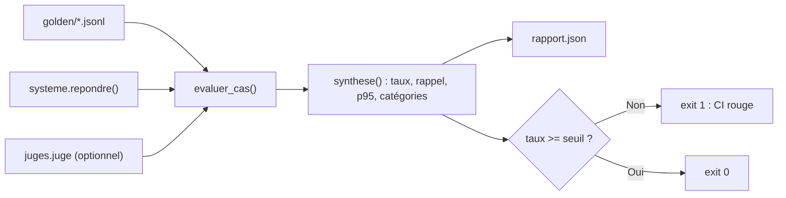

> [!NOTE]
> Dans cette leçon, vous allez assembler un **harnais d'évaluation** en Python (bibliothèque standard uniquement) : jeu doré, contrôles par code, rappel de la recherche, LLM-juge branchable (Claude ou Gemini sur Vertex AI), rapport JSON et **code de sortie** pour la CI. Le kit complet et testé est téléchargeable : [files/evalkit](../files/evalkit/).



Le kit contient `run_eval.py` (ci-dessous), `systeme.py` (votre assistant : `repondre(question) -> {"reponse": str, "sources": [str]}`, un faux système est fourni), `juges.py` (`juge_claude` pour l'API Claude, `juge_gemini` pour Vertex AI), `test_run_eval.py` et `golden/demo.jsonl`.

## Le harnais

```python title="run_eval.py"
"""Mini-harnais d'évaluation RAG (stdlib). Usage : python run_eval.py golden/rh.jsonl --seuil 0.85"""
import argparse, json, re, sys, time
from pathlib import Path

REFUS = ("je ne sais pas", "je ne trouve pas", "je ne peux pas", "hors de mon périmètre")
CHECKS = {  # contrôles par code : gratuits et déterministes
    "contient": lambda s, c: all(m.lower() in s["reponse"].lower() for m in c.get("doit_contenir", [])),
    "interdit": lambda s, c: not any(m.lower() in s["reponse"].lower() for m in c.get("interdit", [])),
    "citation": lambda s, c: set(c.get("sources", [])) <= set(s.get("sources", [])),
    "refus":    lambda s, c: any(m in s["reponse"].lower() for m in REFUS),
}

def rappel(sortie, cas):  # métrique de recherche ; None si aucun document attendu
    attendus = set(cas.get("sources", []))
    return len(attendus & set(sortie.get("sources", []))) / len(attendus) if attendus else None

GRILLE = """Tu es un évaluateur strict.
Question : {question}
Réponse de référence : {attendu}
Critère : {critere}
<reponse>{reponse}</reponse>
5 = critère entièrement respecté ; 3 = partiellement ; 1 = pas du tout ou faux.
Justifie en deux phrases maximum puis termine par : NOTE: <1-5>"""

def juger(juge, cas, sortie):
    texte = juge(GRILLE.format(question=cas["question"], attendu=cas.get("attendu", ""),
                               critere=cas["critere"], reponse=sortie["reponse"]))
    m = re.search(r"NOTE:\s*([1-5])", texte)
    return int(m.group(1)) if m else None  # None = juge illisible -> échec

def evaluer_cas(cas, repondre, juge=None):
    t0, erreur, note = time.perf_counter(), None, None
    try:
        sortie = repondre(cas["question"])
    except Exception as e:  # une exception = un échec noté, pas un crash du harnais
        sortie, erreur = {"reponse": "", "sources": []}, repr(e)
    latence = time.perf_counter() - t0
    verdicts = {n: CHECKS[n](sortie, cas) for n in cas.get("checks", [])}
    if juge and cas.get("critere"):
        try:
            note = juger(juge, cas, sortie)
            verdicts["juge"] = note is not None and note >= 4
        except Exception as e:  # juge indisponible : le cas ne peut pas être certifié
            erreur = erreur or f"juge: {e!r}"
    return {"id": cas["id"], "categorie": cas.get("categorie", "?"),
            "ok": erreur is None and all(verdicts.values()), "verdicts": verdicts,
            "note_juge": note, "rappel": rappel(sortie, cas), "latence_s": round(latence, 3),
            "erreur": erreur, "reponse": sortie["reponse"][:500]}

def charger(chemin):
    return [json.loads(l) for l in Path(chemin).read_text(encoding="utf-8").splitlines() if l.strip()]

def synthese(res):
    n, rap, cats = len(res), [r["rappel"] for r in res if r["rappel"] is not None], {}
    for r in res:
        cats.setdefault(r["categorie"], []).append(r["ok"])
    lat = sorted(r["latence_s"] for r in res)
    return {"n": n, "taux_reussite": round(sum(r["ok"] for r in res) / n, 3),
            "rappel_moyen": round(sum(rap) / len(rap), 3) if rap else None,
            "latence_p95_s": lat[min(n - 1, int(0.95 * n))],
            "par_categorie": {c: round(sum(v) / len(v), 3) for c, v in cats.items()},
            "echecs": [r["id"] for r in res if not r["ok"]]}

def main(argv=None, repondre=None, juge=None):
    p = argparse.ArgumentParser()
    p.add_argument("golden")
    p.add_argument("--seuil", type=float, default=0.85)
    p.add_argument("--sortie", default="rapport.json")
    a = p.parse_args(argv)
    res = [evaluer_cas(c, repondre, juge) for c in charger(a.golden)]
    s = synthese(res)
    Path(a.sortie).write_text(json.dumps({"synthese": s, "details": res}, ensure_ascii=False, indent=2),
                              encoding="utf-8")
    print(json.dumps(s, ensure_ascii=False))
    if s["taux_reussite"] < a.seuil:
        print(f"ÉCHEC : {s['taux_reussite']:.1%} < seuil {a.seuil:.0%}", file=sys.stderr)
        return 1
    return 0

if __name__ == "__main__":
    from systeme import repondre  # votre assistant RAG
    from juges import juge        # None si la variable JUGE n'est pas définie
    sys.exit(main(repondre=repondre, juge=juge))
```

> [!WARNING]
> Une exception de l'assistant **ou du juge** (timeout, quota, clé absente) est **comptée comme un échec** : une panne ne doit jamais rendre la CI verte. Le juge est une simple fonction `prompt -> texte`, désactivée par défaut : `JUGE=claude` ou `JUGE=gemini` l'active, `MODELE_JUGE` fixe une **version précise** (notes comparables d'une campagne à l'autre). Ne faites pas juger un modèle par lui-même (biais d'auto-complaisance) et calibrez le juge sur un échantillon humain.

## Tester le harnais avant le système

Un harnais buggé qui renvoie toujours « OK » est pire que pas de harnais. Le kit contient un faux système dont le cas `rh-003` cite volontairement la règle 2024 :

```bash
python3 test_run_eval.py                      # tests OK
python3 run_eval.py golden/demo.jsonl --seuil 0.6
# {"n": 3, "taux_reussite": 0.667, "rappel_moyen": 0.5, "latence_p95_s": 0.0,
#  "par_categorie": {"frequent": 0.5, "sans-reponse": 1.0}, "echecs": ["rh-003"]}
```

```quiz
question: "Pourquoi le cas rh-002 (catégorie sans-reponse) n'entre-t-il pas dans le rappel moyen ?"
options:
  - "Parce qu'il a réussi"
  - "Parce qu'il n'a aucune source attendue : rappel() renvoie None et le cas est exclu de la moyenne"
  - "Parce que le juge n'est pas branché"
answer: 1
explanation: "Le rappel n'a pas de sens sans document attendu. Compter 0 ou 1 fausserait la moyenne : on renvoie None et on filtre."
```

## Lire le rapport

Lisez dans l'ordre : **`echecs`** (les cas à ouvrir un par un), **`par_categorie`** (90 % au global peut cacher 50 % sur les pièges), **`rappel_moyen`** (s'il baisse, regardez l'index avant le prompt), puis **`latence_p95_s`**.

> [!IMPORTANT]
> Avec 30 cas, un cas vaut environ 3,3 points. Passer de 90 % à 87 %, c'est **un seul cas** : identifiez-le et relancez-le avant de conclure à une régression.

```quiz
question: "Le rapport indique taux_reussite = 0.9 et par_categorie = {frequent: 1.0, piege: 0.5}. Quelle conclusion est la plus juste ?"
options:
  - "Le système est prêt : 90 % dépasse le seuil de 85 %"
  - "Le score global masque une faiblesse sur les pièges : il faut un seuil par catégorie critique"
  - "Le juge LLM est défaillant"
answer: 1
explanation: "Les questions fréquentes tirent la moyenne vers le haut. Pour les catégories critiques (sécurité, refus), un seuil dédié, souvent 100 %, est plus pertinent."
```

## Exercice : un seuil par catégorie

Ajoutez à `main()` une option répétable `--seuil-categorie piege=1.0` : la commande échoue si une catégorie listée passe sous son seuil, même si le taux global est bon.

<details>
<summary>Voir la solution</summary>

```python title="run_eval.py (fin de main)"
    p.add_argument("--seuil-categorie", action="append", default=[])  # avant parse_args
    # ... après le calcul de s :
    code = 0 if s["taux_reussite"] >= a.seuil else 1
    for regle in a.seuil_categorie:
        cat, val = regle.split("=")
        taux = s["par_categorie"].get(cat)
        if taux is None or taux < float(val):
            print(f"ÉCHEC {cat} : {taux} < {val}", file=sys.stderr)
            code = 1
    return code
```

Une catégorie **absente** (`taux is None`) fait aussi échouer : supprimer par erreur les cas pièges ne doit pas rendre la CI verte. Cette version est celle du kit téléchargeable (testée dans `test_run_eval.py`).

</details>

## Je sais faire

- [ ] Brancher n'importe quel assistant via `repondre(question)`.
- [ ] Activer un juge Claude ou Gemini sur Vertex AI sans modifier le harnais.
- [ ] Lire un rapport : échecs, catégories, rappel, latence, taille réelle d'un écart.
- [ ] Faire échouer la commande sous un seuil global ou par catégorie.
