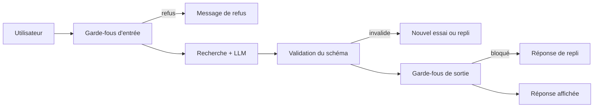

> [!NOTE]
> Dans cette leçon, vous allez entourer l'appel LLM de **garde-fous** (contrôles avant et après le modèle) et imposer une **sortie structurée validée** par un schéma, pour que l'application refuse proprement ce qui est dangereux ou mal formé au lieu de l'afficher.

## Le modèle est un composant non fiable

En production, on traite la sortie d'un LLM comme une **entrée utilisateur** : elle peut être fausse, mal formée ou manipulée. L'OWASP Top 10 pour les applications LLM classe en tête l'**injection de prompt** (LLM01) et liste la **gestion non sûre des sorties** parmi les risques majeurs.



## Garde-fous d'entrée

| Contrôle | But | Mise en œuvre simple |
|---|---|---|
| Longueur maximale | Limiter coût et surface d'attaque | `len(question) <= 2000` |
| Données personnelles | Ne pas envoyer d'IBAN, numéro de sécurité sociale… au modèle | Regex + masquage ; Cloud DLP (Sensitive Data Protection) sur GCP |
| Périmètre | Refuser tôt les demandes hors sujet | Petit classifieur (LLM rapide ou mots-clés) |
| Injection évidente | Repérer « ignore tes instructions » | Heuristiques **en complément**, jamais seules |

```python title="garde_fous.py"
import re

MOTIFS_PII = {
    "iban": re.compile(r"\bFR\d{2}(?:\s?\d{4}){5}\s?\d{3}\b"),
    "email": re.compile(r"\b[\w.+-]+@[\w-]+\.[\w.]+\b"),
}

def masquer_pii(texte):
    for nom, motif in MOTIFS_PII.items():
        texte = motif.sub(f"[{nom.upper()}_MASQUÉ]", texte)
    return texte

def controler_entree(question):
    if len(question) > 2000:
        return None, "Votre question est trop longue (2000 caractères maximum)."
    return masquer_pii(question), None

assert masquer_pii("mon mail : a.b@exemple.fr") == "mon mail : [EMAIL_MASQUÉ]"
```

> [!WARNING]
> Aucun filtre ne bloque toutes les injections de prompt. La vraie protection est **architecturale** : l'assistant n'a accès qu'aux documents que l'utilisateur a le droit de lire, et ses outils ne peuvent pas faire plus que ce que l'utilisateur pourrait faire lui-même.

## Sorties structurées validées

Demander « réponds en JSON » ne suffit pas : il faut **valider** la sortie contre un schéma et traiter l'échec. Les deux plateformes aident :

| Plateforme | Mécanisme |
|---|---|
| Vertex AI (Gemini) | `response_mime_type="application/json"` + `response_schema` dans la configuration de génération |
| Claude | Définir un **outil** avec un `input_schema` JSON et forcer son usage (`tool_choice`), ou utiliser les sorties structurées lorsqu'elles sont disponibles pour votre modèle |

Dans tous les cas, **revalidez côté application** : c'est votre contrat, pas celui du fournisseur.

```python title="schema.py"
from pydantic import BaseModel, Field, ValidationError, field_validator

class Reponse(BaseModel):
    reponse: str = Field(min_length=1, max_length=2000)
    sources: list[str]
    confiance: str  # "haute" | "basse"

    @field_validator("confiance")
    @classmethod
    def valeurs(cls, v):
        if v not in {"haute", "basse"}:
            raise ValueError("confiance doit valoir haute ou basse")
        return v

def parser(texte_llm, sources_autorisees):
    try:
        r = Reponse.model_validate_json(texte_llm)
    except ValidationError as e:
        return None, f"schéma invalide : {e.error_count()} erreur(s)"
    inconnues = set(r.sources) - set(sources_autorisees)
    if inconnues:  # le modèle cite un document qui n'était pas dans le contexte
        return None, f"sources inventées : {sorted(inconnues)}"
    return r, None
```

> [!TIP]
> Vérifier que les `sources` citées font partie des documents **réellement fournis** dans le contexte est un garde-fou gratuit et très efficace contre les citations inventées.

```quiz
question: "Gemini est configuré avec response_schema. Faut-il encore valider la sortie côté application ?"
options:
  - "Non, le fournisseur garantit le schéma"
  - "Oui : on revalide (contrat applicatif, règles métier comme les sources autorisées, changements de modèle ou de configuration)"
  - "Seulement en développement"
answer: 1
explanation: "Le schéma côté fournisseur réduit fortement les erreurs de format, mais ne vérifie pas vos règles métier (sources réellement fournies, valeurs cohérentes). La validation applicative reste la dernière ligne de défense."
```

## Garde-fous de sortie

- **Fidélité minimale** : si la réponse ne cite aucune source alors que la question est factuelle, renvoyer « je ne trouve pas cette information ».
- **Fuite du prompt système** : bloquer une sortie qui contient un extrait reconnaissable du prompt (une phrase témoin).
- **Contenu interdit** : liste de termes (concurrents, insultes) ou classifieur de sécurité.
- **Rendu sûr** : échapper le HTML, ne jamais exécuter du code ou une requête SQL produits par le modèle sans validation.

```quiz
question: "Lesquels sont de bons garde-fous de sortie pour un assistant RAG interne ?"
options:
  - "Rejeter une réponse qui cite une source absente du contexte fourni"
  - "Afficher le HTML généré tel quel pour garder la mise en forme"
  - "Bloquer une sortie contenant une phrase témoin du prompt système"
  - "Remplacer une réponse factuelle sans citation par un message « je ne trouve pas »"
answer: [0, 2, 3]
explanation: "A, C et D sont des contrôles simples et efficaces. Afficher du HTML généré sans l'échapper ouvre la porte à l'injection de script (gestion non sûre des sorties)."
```

## Exercice : écrire le pipeline de réponse protégé

Écrivez `repondre_protege(question, appeler_rag)` qui : contrôle l'entrée, appelle le RAG (qui renvoie `(texte_llm, ids_documents_fournis)`), valide la sortie avec `parser`, et renvoie toujours un dictionnaire `{"reponse", "sources", "statut"}`.

<details>
<summary>Voir la solution</summary>

```python title="pipeline.py"
REPLI = "Je ne trouve pas cette information dans la documentation. Contactez le support interne."

def repondre_protege(question, appeler_rag):
    q, refus = controler_entree(question)
    if refus:
        return {"reponse": refus, "sources": [], "statut": "refus_entree"}
    texte, docs_fournis = appeler_rag(q)
    r, erreur = parser(texte, docs_fournis)
    if erreur:
        # journaliser l'erreur (leçon observabilité), puis repli
        return {"reponse": REPLI, "sources": [], "statut": f"repli:{erreur}"}
    if not r.sources and r.confiance == "basse":
        return {"reponse": REPLI, "sources": [], "statut": "repli:sans_source"}
    return {"reponse": r.reponse, "sources": r.sources, "statut": "ok"}
```

Le champ `statut` est essentiel : il permet de **compter** les replis en production et d'ajouter un cas au jeu doré à chaque nouveau type d'échec.

</details>

## Je sais faire

- [ ] Placer des garde-fous avant et après l'appel au modèle.
- [ ] Masquer des données personnelles avant l'envoi au LLM.
- [ ] Imposer et revalider une sortie structurée (Gemini `response_schema`, outil Claude, Pydantic).
- [ ] Rejeter les citations de documents absents du contexte.
- [ ] Expliquer pourquoi la protection contre l'injection est d'abord architecturale.
