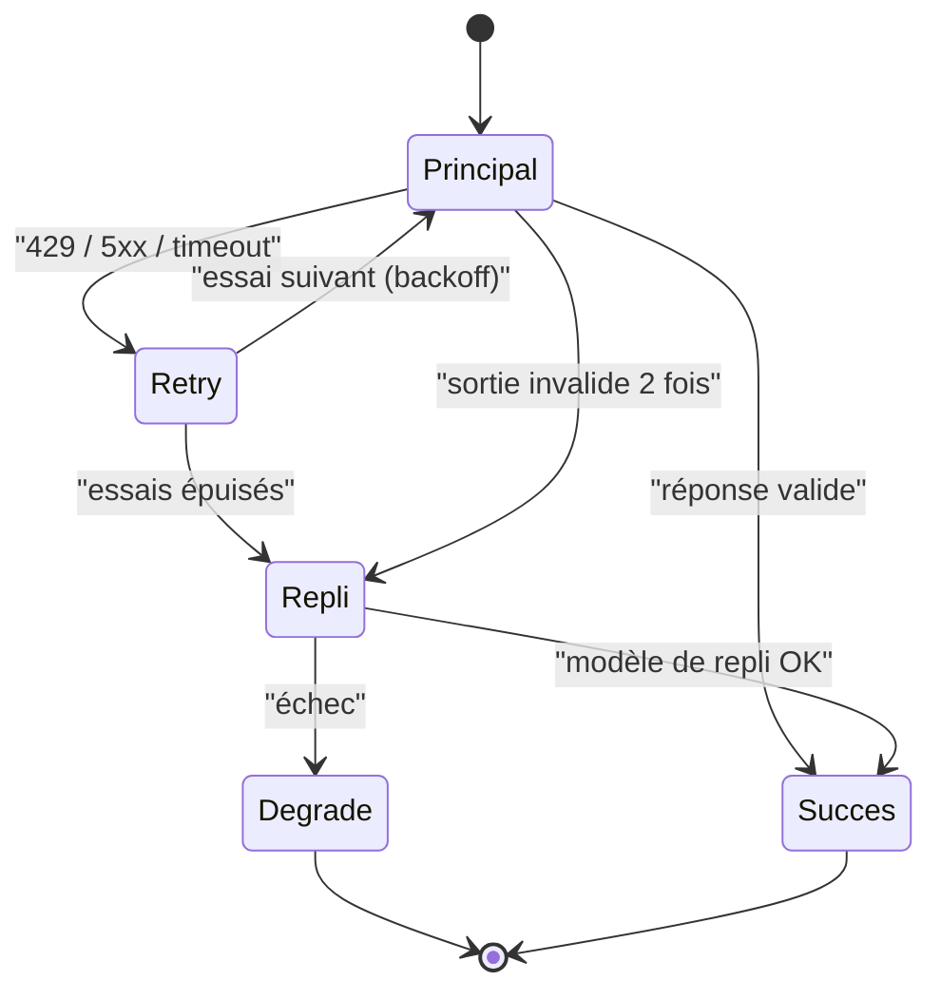

> [!NOTE]
> Dans cette leçon, vous allez rendre l'appel LLM **résilient** (retries avec backoff, délai maximal, modèle de repli), **économe** (cache) et **borné** (plafond de tokens et de dépenses), sans dégrader la qualité mesurée par votre jeu doré.

## Ce qui peut échouer

| Panne | Signal typique | Réponse adaptée |
|---|---|---|
| Surcharge, quota | HTTP 429, 529 (Claude « overloaded »), `RESOURCE_EXHAUSTED` sur Vertex AI | Retry avec backoff exponentiel + aléa |
| Erreur serveur transitoire | HTTP 500, 503 | Retry limité |
| Lenteur | Pas de réponse après N secondes | Délai maximal, puis repli |
| Sortie invalide | Schéma non respecté | Un nouvel essai avec le message d'erreur, puis repli |
| Requête invalide | HTTP 400 | **Pas** de retry : c'est un bug |



## Retry avec backoff exponentiel

Les SDK officiels (Anthropic, Google Gen AI) intègrent déjà des retries configurables : commencez par eux (`max_retries` côté client Anthropic, options HTTP côté Google). Si vous devez l'écrire vous-même :

```python title="resilience.py"
import random, time

class ErreurTransitoire(Exception):
    """429, 5xx, timeout : à relancer."""

def avec_retry(appel, essais=4, base=1.0, plafond=20.0):
    for i in range(essais):
        try:
            return appel()
        except ErreurTransitoire:
            if i == essais - 1:
                raise
            attente = min(plafond, base * 2 ** i) * random.uniform(0.5, 1.0)  # aléa : évite les rafales
            time.sleep(attente)
```

> [!WARNING]
> Ne relancez **jamais** sans limite : un retry infini transforme une panne du fournisseur en facture et en file d'attente bloquée. Fixez aussi un délai total maximal côté utilisateur.

## Modèle de repli

Un repli peut être un **autre modèle** (version plus légère, autre région, autre fournisseur) ou une **réponse dégradée** (« le service est momentanément indisponible, voici les liens vers la documentation »).

```python title="repli.py"
def repondre_resilient(question, principal, secondaire):
    try:
        return avec_retry(lambda: principal(question)), "principal"
    except ErreurTransitoire:
        try:
            return avec_retry(lambda: secondaire(question), essais=2), "secondaire"
        except ErreurTransitoire:
            return {"reponse": "Service momentanément indisponible. Consultez l'intranet RH.",
                    "sources": []}, "degrade"
```

> [!IMPORTANT]
> Le modèle de repli doit **lui aussi passer le jeu doré** avec un seuil acceptable. Un repli jamais évalué est une régression silencieuse qui attend la prochaine panne.

```quiz
question: "Quelle erreur ne doit PAS déclencher de retry automatique ?"
options:
  - "HTTP 429 (trop de requêtes)"
  - "HTTP 503 (service indisponible)"
  - "HTTP 400 (requête mal formée)"
answer: 2
explanation: "Un 400 signale une requête invalide : la renvoyer à l'identique échouera encore. C'est un bug à corriger et à journaliser. 429 et 503 sont transitoires."
```

## Cache : ne pas payer deux fois la même réponse

| Type de cache | Principe | Attention |
|---|---|---|
| Cache exact applicatif | Clé = hash(modèle + prompt + question normalisée) | Invalider quand l'index ou le prompt change (inclure leur version dans la clé) |
| Mise en cache de prompt (Claude) | Le préfixe stable (prompt système, documents) est mis en cache côté API | Structurer le prompt : partie stable en premier |
| Context caching (Vertex AI / Gemini) | Un gros contexte réutilisé est stocké côté Google | Coût de stockage, durée de vie à fixer |
| Cache sémantique | Questions proches → même réponse | Risque de servir une réponse à une question **différente** : à évaluer |

```python title="cache.py"
import hashlib, json
from functools import lru_cache

VERSION = {"prompt": "v7", "index": "2026-10-01", "modele": "gemini-2.5-flash"}

def cle(question):
    q = " ".join(question.lower().split())
    return hashlib.sha256(json.dumps([VERSION, q]).encode()).hexdigest()

# ponytail: cache en mémoire par processus ; Memorystore/Redis si plusieurs instances
@lru_cache(maxsize=5000)
def _repondre_cache(cle_q, question):
    return repondre_protege(question, appeler_rag)  # leçon précédente

def repondre_avec_cache(question):
    return _repondre_cache(cle(question), question)
```

> [!WARNING]
> Ne mettez jamais en cache une réponse **qui dépend de l'utilisateur** (droits d'accès, données personnelles) avec une clé qui n'inclut pas cet utilisateur ou son périmètre de droits.

## Limites de coûts

1. **Par appel** : `max_tokens` (Claude) ou `max_output_tokens` (Gemini), nombre maximal d'extraits dans le contexte.
2. **Par utilisateur** : quota de requêtes par jour.
3. **Global** : alertes de budget Cloud Billing sur GCP, limites de dépenses dans la console Anthropic.
4. **Par campagne d'évaluation** : le juge coûte aussi ; estimez avant de lancer (cas × critères × répétitions).

```quiz
question: "Vous ajoutez un cache exact. Quels éléments doivent faire partie de la clé ?"
options:
  - "La question normalisée"
  - "La version du prompt et de l'index"
  - "L'heure de la requête"
  - "Le périmètre de droits de l'utilisateur si les documents accessibles en dépendent"
answer: [0, 1, 3]
explanation: "Sans version, un changement de prompt ou d'index sert d'anciennes réponses. Sans périmètre de droits, un utilisateur peut recevoir une réponse fondée sur des documents qu'il ne doit pas voir. L'heure rendrait le cache inutile."
```

## Exercice : estimer le budget d'une campagne d'évaluation

Votre jeu doré compte 30 cas. Chaque cas est exécuté 3 fois. Chaque exécution coûte un appel à l'assistant et deux appels au juge (fidélité, complétude). Combien d'appels LLM au total ? Que proposez-vous pour réduire ce coût en CI sans perdre en sécurité ?

<details>
<summary>Voir la solution</summary>

30 cas × 3 répétitions × (1 assistant + 2 juge) = **270 appels**.

Pistes pour la CI :
- Lancer d'abord les **contrôles par code** (gratuits) et n'appeler le juge que si le cas passe ces contrôles (un cas déjà en échec n'a pas besoin d'être jugé).
- Répéter 3 fois seulement les cas **marqués instables**, une fois les autres.
- Utiliser un modèle juge plus léger, **après** avoir vérifié son accord avec l'humain.
- Mettre en cache les réponses de l'assistant pour une même version de prompt/index/modèle : relancer la CI sans changement ne coûte rien.

Le jeu complet avec répétitions peut tourner chaque nuit, la version allégée à chaque pull request.

</details>

## Je sais faire

- [ ] Distinguer erreurs transitoires (retry) et erreurs permanentes (pas de retry).
- [ ] Implémenter un backoff exponentiel avec aléa et un nombre d'essais borné.
- [ ] Mettre en place un modèle de repli lui-même évalué.
- [ ] Construire une clé de cache qui inclut versions et périmètre de droits.
- [ ] Borner les coûts par appel, par utilisateur, globalement et par campagne d'évaluation.
