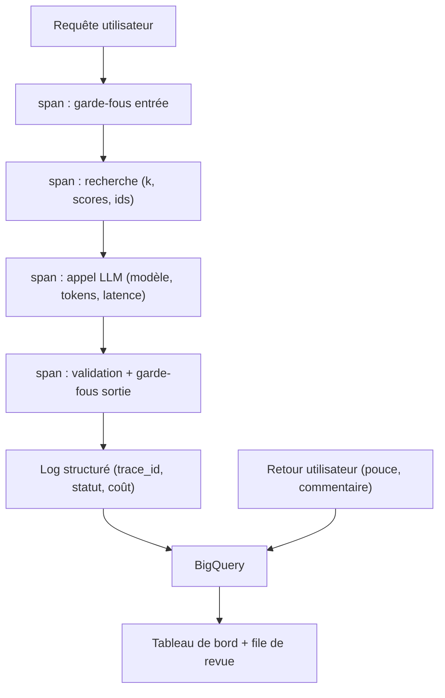

> [!NOTE]
> Dans cette leçon, vous allez instrumenter un assistant RAG pour savoir **ce qui s'est passé** pour chaque question (trace), **comment il se porte** globalement (tableau de bord) et **ce qu'en pensent** les utilisateurs (retours), puis transformer ces signaux en nouveaux cas de test.

## Trois niveaux d'observation

| Niveau | Question | Outil type sur GCP |
|---|---|---|
| **Trace** | Que s'est-il passé pour *cette* requête ? | Cloud Trace (OpenTelemetry) |
| **Log structuré** | Quelles données pour analyser après coup ? | Cloud Logging, export BigQuery |
| **Métrique / tableau de bord** | Comment va le système dans son ensemble ? | Cloud Monitoring, Looker Studio sur BigQuery |



## Que journaliser ?

Un log par requête, **structuré en JSON**, relié à la trace par un identifiant :

```python title="journal.py"
import json, logging, time, uuid

log = logging.getLogger("assistant")

def journaliser(question, resultat, docs, usage, debut, versions):
    log.info(json.dumps({
        "trace_id": str(uuid.uuid4()),
        "versions": versions,                       # prompt, index, modèle
        "question_longueur": len(question),         # pas la question brute si sensible
        "docs_retrouves": [d["id"] for d in docs],
        "scores": [round(d["score"], 3) for d in docs],
        "statut": resultat["statut"],               # ok, repli:..., refus_entree
        "sources_citees": resultat["sources"],
        "tokens_entree": usage["entree"],
        "tokens_sortie": usage["sortie"],
        "latence_ms": int((time.perf_counter() - debut) * 1000),
    }, ensure_ascii=False))
```

> [!WARNING]
> Les questions et réponses peuvent contenir des données personnelles. Définissez **avant** la mise en production : ce qui est journalisé en clair, ce qui est masqué, la durée de conservation et qui y a accès. Le RGPD s'applique aussi aux logs.

> [!TIP]
> Journalisez les **versions** (prompt, index, modèle) dans chaque log. C'est ce qui permet, le jour d'une baisse de satisfaction, de relier le problème à un déploiement précis.

```quiz
question: "Un utilisateur signale une mauvaise réponse hier à 14 h. Quel champ de log permet le plus vite de savoir si la recherche ou la génération est en cause ?"
options:
  - "latence_ms"
  - "docs_retrouves et scores, comparés aux sources attendues"
  - "tokens_sortie"
answer: 1
explanation: "Les documents retrouvés et leurs scores disent si la bonne information était dans le contexte. Si oui, le problème est dans la génération ; sinon, dans la recherche."
```

## Le tableau de bord minimal

| Indicateur | Pourquoi | Alerte suggérée (à adapter) |
|---|---|---|
| Taux de `repli` et de `refus` | Hausse = recherche dégradée ou prompt trop strict | Écart marqué par rapport à la moyenne des 7 derniers jours |
| Score de recherche moyen du top-1 | Baisse = questions hors base ou index cassé | Baisse durable |
| Latence p50 / p95 | Expérience utilisateur | p95 au-dessus de l'objectif fixé avec le métier |
| Tokens et coût par jour | Budget | Seuil de budget Cloud Billing |
| Taux de pouces vers le bas | Qualité perçue | Hausse sur 3 jours consécutifs |
| Erreurs 429 / 5xx du fournisseur | Résilience | Pic |

```sql title="taux_repli_par_version.sql"
-- BigQuery : taux de repli par version de prompt sur 7 jours
SELECT
  JSON_VALUE(payload, '$.versions.prompt') AS version_prompt,
  COUNTIF(STARTS_WITH(JSON_VALUE(payload, '$.statut'), 'repli')) / COUNT(*) AS taux_repli,
  COUNT(*) AS requetes
FROM `mon_projet.logs_assistant.requetes`
WHERE horodatage >= TIMESTAMP_SUB(CURRENT_TIMESTAMP(), INTERVAL 7 DAY)
GROUP BY version_prompt
ORDER BY requetes DESC;
```

## Les retours utilisateurs

Un pouce haut/bas est peu coûteux à ajouter et très utile, à condition de :

1. le **relier à la trace** (`trace_id`) pour retrouver le contexte exact ;
2. proposer un **motif** facultatif en un clic : « faux », « incomplet », « pas de source », « hors sujet » ;
3. ne pas le confondre avec une mesure de justesse : un utilisateur peut aimer une réponse fausse mais confiante.

> [!IMPORTANT]
> Chaque pouce vers le bas confirmé par un expert devient un **candidat au jeu doré**. C'est ainsi que le jeu doré suit l'usage réel au lieu de rester figé sur les idées du lancement.

```quiz
question: "Pourquoi le taux de pouces vers le haut ne suffit-il pas à mesurer la justesse des réponses ?"
options:
  - "Parce que peu d'utilisateurs votent, et qu'une réponse fausse mais assurée peut être bien notée"
  - "Parce que les pouces sont toujours aléatoires"
  - "Parce que les pouces ne peuvent pas être stockés dans BigQuery"
answer: 0
explanation: "Les votes sont rares et biaisés (on vote surtout quand on est mécontent ou ravi), et l'utilisateur ne connaît pas toujours la bonne réponse. Ils signalent des problèmes ; le jeu doré les mesure."
```

## Exercice : diagnostiquer une alerte

Lundi, le taux de repli passe d'environ 4 % à environ 15 %. Les logs montrent : version du prompt inchangée, version de l'index passée de `2026-09-01` à `2026-10-01`, score top-1 moyen en baisse, latence stable. Que s'est-il probablement passé et que faites-vous ?

<details>
<summary>Voir la solution</summary>

Le changement coïncide avec la **nouvelle version de l'index**, et le score de recherche baisse : la cause probable est côté **recherche** (documents mal découpés, documents manquants, changement de modèle d'embedding sans réindexation complète, filtre de métadonnées erroné).

Actions :
1. Relancer le jeu doré contre l'index `2026-10-01` et regarder le **rappel moyen** : s'il chute, c'est confirmé.
2. Si nécessaire, revenir à l'index précédent (d'où l'intérêt de versionner les index).
3. Ajouter au jeu doré quelques questions de production qui ont déclenché un repli, pour qu'une telle régression soit **bloquée en CI** la prochaine fois (module 4).

</details>

## Je sais faire

- [ ] Instrumenter une requête RAG en spans : garde-fous, recherche, LLM, validation.
- [ ] Écrire un log structuré qui inclut versions, documents, statut, tokens et latence.
- [ ] Définir les indicateurs et alertes d'un tableau de bord minimal.
- [ ] Collecter des retours utilisateurs reliés aux traces et les transformer en cas de test.
- [ ] Respecter la confidentialité des données dans les logs.
