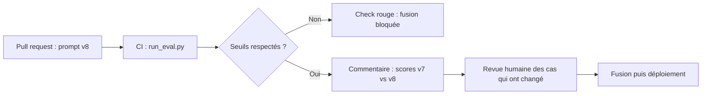

> [!NOTE]
> Dans cette leçon, vous allez traiter prompts, configuration de modèle et jeu doré comme du **code versionné**, et brancher le harnais d'évaluation dans la CI pour qu'un changement qui fait baisser la qualité **ne puisse pas être fusionné**.

## Ce qui doit déclencher l'évaluation

Tout ce qui change le comportement de l'assistant :

| Changement | Exemple | Déclenche l'évaluation ? |
|---|---|---|
| Prompt système | Ajout d'une consigne de ton | Oui |
| Modèle ou version | `gemini-2.5-flash` → version plus récente, ou passage à Claude | Oui |
| Paramètres | `temperature`, `max_tokens`, `top_k` de la recherche | Oui |
| Découpage / embeddings | Taille des extraits, nouveau modèle d'embedding | Oui (avec réindexation de test) |
| Jeu doré | Ajout de cas | Oui (pour voir le nouveau niveau de référence) |
| README, style du front | Faute de frappe | Non |

> [!TIP]
> Sortez les prompts du code applicatif : un fichier `prompts/systeme.md` et un `config/modele.yaml` versionnés. La CI peut alors se déclencher précisément sur ces chemins.

## Le flux



## GitHub Actions : un exemple complet

```yaml title=".github/workflows/eval.yml"
name: eval-llm
on:
  pull_request:
    paths:
      - "prompts/**"
      - "config/modele.yaml"
      - "eval/**"
      - "app/rag/**"
jobs:
  eval:
    runs-on: ubuntu-latest
    permissions:
      contents: read
      id-token: write   # Workload Identity Federation vers GCP (pas de clé JSON)
    steps:
      - uses: actions/checkout@v4
      - uses: actions/setup-python@v5
        with:
          python-version: "3.12"
      - run: pip install -r eval/requirements.txt
      - uses: google-github-actions/auth@v2
        with:
          workload_identity_provider: ${{ secrets.WIF_PROVIDER }}
          service_account: ${{ secrets.EVAL_SA }}
      - name: Évaluation
        env:
          GOOGLE_CLOUD_PROJECT: ${{ vars.GCP_PROJECT }}
          ANTHROPIC_API_KEY: ${{ secrets.ANTHROPIC_API_KEY }}
          JUGE: claude
        run: |
          cd eval
          python run_eval.py golden/assistant.jsonl --seuil 0.85 \
            --seuil-categorie piege=1.0 --sortie rapport.json
      - uses: actions/upload-artifact@v4
        if: always()
        with:
          name: rapport-eval
          path: eval/rapport.json
```

Ensuite, dans les réglages du dépôt, rendez le check `eval-llm` **obligatoire** sur la branche principale (règle de protection de branche) : c'est lui qui rend le seuil réellement **bloquant**.

> [!WARNING]
> Une CI d'évaluation appelle de vrais modèles : elle coûte et dépend de quotas. Utilisez un **projet GCP dédié** à l'évaluation, un compte de service aux droits minimaux, et des secrets jamais imprimés dans les logs.

```quiz
question: "Le workflow s'exécute et échoue, mais la PR peut quand même être fusionnée. Que manque-t-il ?"
options:
  - "Un seuil plus élevé dans run_eval.py"
  - "La règle de protection de branche qui rend le check obligatoire"
  - "Un juge LLM plus strict"
answer: 1
explanation: "Un check rouge n'empêche la fusion que s'il est déclaré obligatoire dans la protection de branche. Le seuil et le juge déterminent le verdict, pas son caractère bloquant."
```

## Choisir le seuil

- Mesurez d'abord la **ligne de base** : le score de la version actuelle, sur plusieurs exécutions.
- Fixez le seuil **un peu sous** cette ligne de base pour absorber la variabilité, puis relevez-le à mesure que le système progresse (effet cliquet).
- Les catégories critiques (sécurité, refus) ont un seuil **dédié**, souvent 100 %.
- Avec un petit jeu doré, un cas d'écart n'est pas significatif : affichez la liste des cas qui **changent de statut** entre la base et la PR, c'est plus parlant qu'un pourcentage.

```python title="diff_rapports.py"
import json, sys

def statuts(chemin):
    return {d["id"]: d["ok"] for d in json.load(open(chemin, encoding="utf-8"))["details"]}

base, pr = statuts(sys.argv[1]), statuts(sys.argv[2])
for cid in sorted(base.keys() & pr.keys()):
    if base[cid] != pr[cid]:
        print(f"{cid}: {'OK' if base[cid] else 'KO'} -> {'OK' if pr[cid] else 'KO'}")
```

```quiz
question: "La version actuelle obtient 0,90, 0,87 et 0,90 sur trois exécutions. Quel seuil bloquant de départ est le plus raisonnable ?"
options:
  - "0,95 pour pousser l'équipe à progresser"
  - "Environ 0,85 : un peu sous la ligne de base, puis relevé progressivement"
  - "0,50 pour éviter les faux échecs"
answer: 1
explanation: "Un seuil au-dessus de la base bloquerait toutes les PR, un seuil trop bas ne bloquerait aucune régression. Juste sous la base absorbe la variabilité tout en détectant une vraie baisse."
```

## Exercice : adapter le workflow à Cloud Build

Votre équipe utilise Cloud Build au lieu de GitHub Actions. Écrivez un `cloudbuild.yaml` qui installe les dépendances, lance l'évaluation avec les mêmes seuils et échoue si le seuil n'est pas atteint. La clé Anthropic est dans Secret Manager sous le nom `anthropic-api-key`.

<details>
<summary>Voir la solution</summary>

```yaml title="cloudbuild.yaml"
steps:
  - name: python:3.12
    entrypoint: bash
    dir: eval
    secretEnv: ["ANTHROPIC_API_KEY"]
    env:
      - "GOOGLE_CLOUD_PROJECT=$PROJECT_ID"
      - "JUGE=claude"
    args:
      - -c
      - |
        pip install -r requirements.txt
        python run_eval.py golden/assistant.jsonl --seuil 0.85 \
          --seuil-categorie piege=1.0 --sortie rapport.json
availableSecrets:
  secretManager:
    - versionName: projects/$PROJECT_ID/secrets/anthropic-api-key/versions/latest
      env: ANTHROPIC_API_KEY
```

Le code de sortie `1` de `run_eval.py` fait échouer l'étape, donc le build. Branchez ensuite un **déclencheur** Cloud Build sur les pull requests avec un filtre de fichiers (`prompts/**`, `config/**`, `eval/**`), et exigez son statut dans la protection de branche du dépôt.

</details>

## Je sais faire

- [ ] Lister les changements qui doivent déclencher une évaluation.
- [ ] Brancher le harnais dans GitHub Actions ou Cloud Build avec un seuil global et par catégorie.
- [ ] Rendre le check réellement bloquant via la protection de branche.
- [ ] Fixer un seuil à partir d'une ligne de base mesurée, puis le relever.
- [ ] Montrer en revue les cas qui changent de statut entre deux versions.
