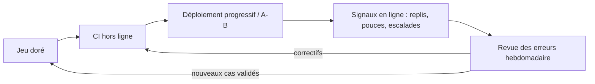

> [!NOTE]
> Dans cette leçon, vous allez compléter l'évaluation hors ligne par des mesures **en production** : comparer deux versions en **A/B**, détecter une **dérive** des questions ou de la qualité, et organiser une **revue des erreurs** régulière qui alimente le jeu doré.

## Hors ligne et en ligne : deux regards complémentaires

| | Évaluation hors ligne (CI) | Évaluation en ligne (production) |
|---|---|---|
| Données | Jeu doré, fixe et validé | Vraies questions, qui évoluent |
| Vérité de référence | Oui (réponse attendue) | Rarement (signaux indirects) |
| Rôle | Bloquer les régressions connues | Découvrir l'inconnu, confirmer un gain |
| Coût d'une erreur | Nul (rien n'est déployé) | Des utilisateurs touchés |



## A/B : comparer deux versions sur du vrai trafic

Une fois la CI passée, la version B est servie à une **fraction** des utilisateurs (par exemple 10 %), la version A au reste. On compare des indicateurs définis **à l'avance** :

- taux de pouces vers le bas, taux de repli, taux d'**escalade** vers un humain (support client) ;
- coût et latence par requête ;
- sur un échantillon de chaque bras : score du LLM-juge (fidélité) **sans** référence.

```python title="affectation.py"
import hashlib

def bras(utilisateur_id, part_b=0.10, experience="prompt-v8"):
    """Affectation stable : un utilisateur reste dans le même bras."""
    h = int(hashlib.sha256(f"{experience}:{utilisateur_id}".encode()).hexdigest(), 16)
    return "B" if (h % 10_000) / 10_000 < part_b else "A"

assert bras("u-1") == bras("u-1")  # stable
```

> [!WARNING]
> Sur un assistant interne à faible trafic, un A/B met longtemps à donner un écart significatif. Fixez la **durée** et la **taille d'échantillon** avant de commencer, et ne vous arrêtez pas au premier jour favorable (on « trouve » toujours un gagnant en regardant trop tôt).

```quiz
question: "Pourquoi affecter les utilisateurs par hash de leur identifiant plutôt qu'au hasard à chaque requête ?"
options:
  - "Pour qu'un même utilisateur voie toujours la même version et que les mesures par utilisateur restent cohérentes"
  - "Parce que le hasard est interdit en production"
  - "Pour réduire la latence"
answer: 0
explanation: "Une affectation stable évite qu'un utilisateur passe d'une version à l'autre au cours d'une conversation, ce qui brouillerait l'expérience et les mesures."
```

## Détecter la dérive

Deux dérives à surveiller :

| Dérive | Exemple | Signal simple |
|---|---|---|
| **Des entrées** | Nouvelle réforme : les salariés posent soudain beaucoup de questions sur un sujet absent de la base | Part des questions avec un score de recherche top-1 bas ; nouveaux thèmes dans les questions |
| **De la qualité** | Le fournisseur met à jour le modèle derrière un alias | Taux de repli, pouces vers le bas, score du juge sur échantillon quotidien |

```python title="derive.py"
from statistics import mean

def alerte_derive(scores_reference, scores_semaine, seuil_bas=0.55, ecart_max=0.10):
    """Compare la part de questions « mal couvertes » (score top-1 < seuil_bas)."""
    part = lambda s: mean(x < seuil_bas for x in s)
    ecart = part(scores_semaine) - part(scores_reference)
    return ecart > ecart_max, round(ecart, 3)

ref = [0.82, 0.77, 0.91, 0.60, 0.85, 0.79, 0.88, 0.73]
semaine = [0.81, 0.42, 0.50, 0.86, 0.47, 0.79, 0.52, 0.90]
print(alerte_derive(ref, semaine))  # (True, 0.5) : 4 questions sur 8 mal couvertes contre 0
```

> [!TIP]
> Épinglez une **version précise** du modèle en production plutôt qu'un alias « latest » quand la plateforme le permet. Les mises à jour deviennent alors des changements volontaires, qui passent par la CI.

## La revue des erreurs

Une séance courte et régulière (par exemple 45 minutes par semaine) avec un développeur et un expert métier :

1. **Échantillonner** : tous les pouces vers le bas, une partie des replis, un échantillon aléatoire de réponses « OK ».
2. **Classer** chaque erreur avec la typologie du module 1 (hallucination, mauvaise recherche, obsolète…).
3. **Compter** par type : on corrige d'abord la catégorie la plus fréquente.
4. **Convertir** chaque erreur confirmée en cas du jeu doré, avec la bonne réponse validée par l'expert.
5. **Décider** du correctif (index, prompt, garde-fou) et le faire passer par la CI.

```quiz
question: "Lors de la revue, 12 erreurs sur 20 sont des « mauvaises recherches ». Quelle action est la plus pertinente en premier ?"
options:
  - "Réécrire le prompt système pour insister sur la précision"
  - "Travailler la recherche (découpage, métadonnées, embeddings) et ajouter ces 12 questions au jeu doré pour suivre le rappel"
  - "Changer de modèle de génération"
answer: 1
explanation: "Si le bon document n'est pas retrouvé, aucun prompt ni modèle de génération ne peut l'inventer correctement. On agit sur la recherche et on mesure le rappel sur ces nouveaux cas."
```

## Exercice : préparer une revue des erreurs

Voici six retours négatifs de la semaine sur l'assistant RH fictif. Classez-les, comptez par type, et proposez les deux premières actions.

1. Réponse sur le télétravail fondée sur la charte 2024.
2. « Je ne trouve pas » pour une question sur la mutuelle, alors que le document existe.
3. Invente un délai de prévenance de 15 jours.
4. Charte télétravail 2024 citée à nouveau, autre formulation.
5. « Je ne trouve pas » sur la prévoyance : document présent mais intitulé « régime de protection sociale ».
6. Réponse juste mais sans citation.

<details>
<summary>Voir la solution</summary>

| Type | Retours | Nombre |
|---|---|---|
| Information obsolète | 1, 4 | 2 |
| Mauvaise recherche (vocabulaire) | 2, 5 | 2 |
| Hallucination | 3 | 1 |
| Format (citation manquante) | 6 | 1 |

Actions prioritaires :
1. **Index** : retirer ou marquer comme périmée la charte télétravail 2024 (filtre de validité), et ajouter 2 cas au jeu doré avec `interdit` sur la règle 2024.
2. **Recherche** : enrichir les documents de synonymes ou de métadonnées (mutuelle, prévoyance, protection sociale), ou passer à une recherche hybride mots-clés + vecteurs ; ajouter les questions 2 et 5 au jeu doré pour suivre le rappel.

L'hallucination (3) et la citation manquante (6) deviennent aussi des cas, traités ensuite par la consigne de fidélité et la validation de sortie.

</details>

## Je sais faire

- [ ] Expliquer la complémentarité entre évaluation hors ligne et en ligne.
- [ ] Mettre en place une affectation A/B stable et définir les indicateurs à l'avance.
- [ ] Détecter une dérive des entrées ou de la qualité avec des signaux simples.
- [ ] Animer une revue des erreurs qui produit des correctifs et de nouveaux cas.
