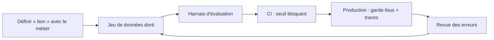

Une démo qui « marche bien » sur cinq questions n'est pas une application fiable. Dès qu'on change un prompt, un modèle ou un découpage de documents, la qualité peut baisser **sans que personne ne s'en aperçoive**. Cette formation vous apprend à transformer l'impression « ça a l'air bien » en **chiffres reproductibles**, puis à protéger l'application en production et à bloquer automatiquement les régressions.

> [!NOTE]
> Fil rouge : **un assistant RAG interne** qui répond aux questions des salariés sur les procédures RH et IT, déployé sur Vertex AI (Gemini) ou sur l'API Claude. Tous les exemples sont fictifs.

## Pour qui ?

- Développeurs et ingénieurs ML qui ont déjà mis un RAG ou un chatbot en ligne et veulent le rendre **mesurable**.
- Tech leads qui doivent décider « peut-on passer au nouveau modèle ? » avec autre chose qu'une intuition.
- Product owners d'assistants de support client ou de recherche documentaire qui veulent un **contrat de qualité** avec l'équipe technique.

## Prérequis

- Python à l'aise (fonctions, JSON, `pytest` ou équivalent).
- Avoir appelé un LLM par API (Gemini sur Vertex AI ou Claude).
- Connaître le principe d'un RAG (découpage, embeddings, recherche, génération).
- Notions de CI (GitHub Actions, GitLab CI ou Cloud Build).

## Objectifs mesurables

À la fin de la formation, vous serez capable de :

1. Rédiger avec le métier une **définition de « bonne réponse »** et un jeu de données doré d'au moins 30 cas.
2. Choisir, pour chaque critère, la méthode adaptée : **métrique exacte, heuristique, LLM-juge ou humain**.
3. Écrire une **grille de LLM-juge** et en mesurer l'accord avec un humain.
4. Mesurer séparément **la recherche** (rappel, pertinence du contexte) et **la génération** (fidélité) d'un RAG.
5. Ajouter à une application des **garde-fous**, une **sortie structurée validée**, des **retries**, un **repli** et un **plafond de coût**.
6. Mettre en place une **CI d'évaluation** qui bloque une fusion si le score passe sous un seuil.

## Programme

| Module | Contenu | Durée indicative |
|---|---|---|
| 1. Pourquoi évaluer | Non-déterminisme, régressions silencieuses, typologie d'erreurs, définir « bon », jeu de données doré | 1h15 |
| 2. Méthodes d'évaluation | Métriques exactes et heuristiques, LLM-juge et ses biais, évaluation humaine, RAG, agents, mini-harnais Python | 2h15 |
| 3. Fiabiliser en production | Garde-fous, sorties structurées, retries, repli, cache, coûts, observabilité, retours utilisateurs | 1h30 |
| 4. Boucle d'amélioration continue | CI d'évaluation, A/B, détection de dérive, revue des erreurs | 1h |
| 5. Projet final | Suite de 30 cas pour un assistant RAG avec seuil bloquant en CI | 1h |

## Ce que vous saurez faire

- Répondre à « le nouveau prompt est-il meilleur ? » avec un tableau de scores, pas une opinion.
- Expliquer à un sponsor pourquoi un taux de réussite de 92 % sur 30 cas a une marge d'incertitude importante.
- Repérer en quelques minutes, dans les traces, **où** un RAG s'est trompé : recherche ou génération.
- Livrer un dépôt où toute modification de prompt déclenche l'évaluation automatiquement.
